<p align="center">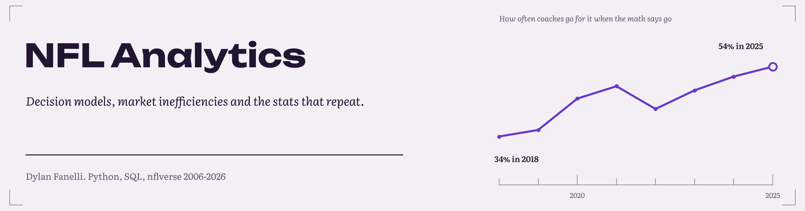</p>

<p align="center"><a href="https://github.com/IForSureI/NFL-Analytics/actions/workflows/tests.yml"></a>     </p>

<p align="center"><b><a href="#the-studies">Studies</a> &nbsp;|&nbsp; <a href="#what-a-club-gets">What a club gets</a> &nbsp;|&nbsp; <a href="#how-i-work">How I work</a> &nbsp;|&nbsp; <a href="#under-the-hood">Under the hood</a> &nbsp;|&nbsp; <a href="docs/glossary.md">Glossary</a> &nbsp;|&nbsp; <a href="#about">About</a></b></p>

I'm Dylan Fanelli, and this is the NFL analytics portfolio I am building toward a job in a club front office. Each study starts from a question a coach, scout or general manager actually argues about, answers it with public data and a model I built, and ends with what a club would do with the answer. I validate every model before I trust it, I say what the data can't show, and every number on these pages is regenerated from code on each weekly refresh.

**Headline work:** a [fourth-down decision bot](reports/02-fourth-down-bot/) on my own win-probability model, which matches nflfastR out of sample (Brier 0.1495 vs 0.1488 on 80,613 plays), and [evidence of a market inefficiency in pass-rusher contracts](reports/07-box-score-tax/): teams pay about \$0.62M a year for sacks that pressures say won't repeat.

<p align="center">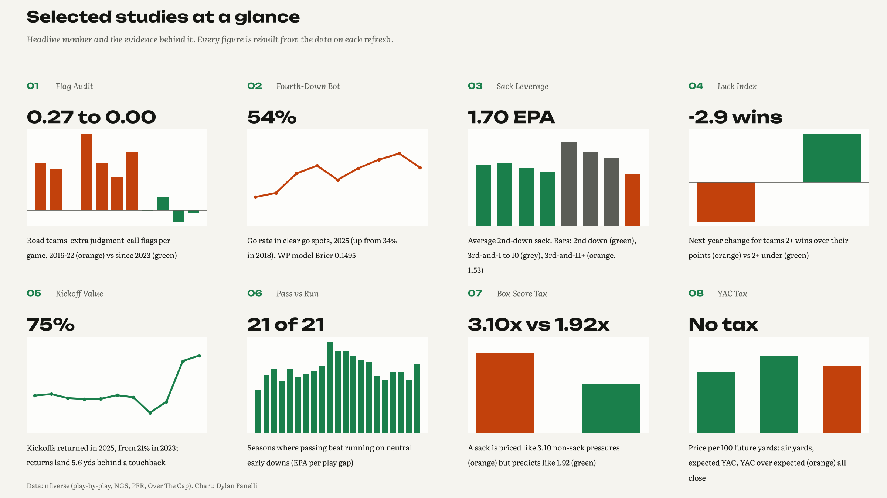</p>

<p>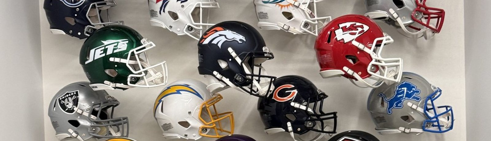</p>

## The studies

| # | Study | The question | Headline | Methods |
|---|---|---|---|---|
| 01 | [**Flag Audit**](reports/01-flag-audit/) | Do NFL flags really even out, or do some teams, quarterbacks and crews get a different game? | Road teams drew 0.27 more judgment-call flags a game than home teams in 2016-22; since 2023 the gap has averaged 0.00. What remains is a small pre-snap gap (neutral zone infractions, delay of game), not judgment calls. | empirical Bayes, Wilson intervals, split-half reliability |
| 02 | [**Fourth-Down Bot**](reports/02-fourth-down-bot/) | When the math says go for it on fourth down, how often do coaches go, and which teams leave the most win probability on the table? | I built a win-probability model that matches nflfastR out of sample (Brier 0.1495 vs 0.1488 on 80,613 plays) and a fourth-down bot on top of it. | gradient boosting, win probability, decision analysis, calibration |
| 03 | [**Sack Leverage**](reports/03-sack-leverage/) | Are all sacks equal, or does the down and distance decide how much a sack is worth? | Down and distance decide a sack's worth: short 3rd-down sacks take the most (3rd-and-1-2: 2.46 expected points), and an average 2nd-down sack (1.70) beats a 3rd-and-11+ sack (1.53). | expected points, replication, player valuation |
| 04 | [**Luck Index**](reports/04-luck-index/) | How many wins does chance hand out, and do the lucky teams fall back the next year? | Fumble, field-goal and close-game luck do not repeat (year-to-year r = 0.04, 0.07, 0.06). | Pythagorean expectation, regression to the mean, year-to-year stability |
| 05 | [**Kickoff Value**](reports/05-kickoff-value/) | What did the new kickoff rule do to field position, and who creates value under it? | The new kickoff brought returns back: 21% of kickoffs returned in 2023, 75% in 2025. | rule-change analysis, special teams, player valuation |
| 06 | [**Pass vs Run**](reports/06-pass-run/) | Passing has been more efficient for years. So why do teams still run, and does passing more make a team better? | Passing beat running on neutral early downs in 21 of 21 seasons. | EPA, pass rate over expected, team-level correlation |
| 07 | [**The Box-Score Tax**](reports/07-box-score-tax/) | Do NFL teams pay pass rushers for sacks that won't repeat, when pressures predict future sacks better? | Teams still pay about \$0.62M a year for each sack beyond what pressures predict (850 contracts, 95% CI \$0.29-0.94M). | clustered OLS, bootstrap, contract valuation, market pricing |
| 08 | [**The YAC Tax**](reports/08-yac-tax/) | Do teams pay receivers for yards after the catch that won't come back? | Contracts price each part of receiving production about the same per future yard (\$4.89M per 100 YAC-over-expected yards vs \$4.44M per 100 air yards): no YAC tax. | Next Gen Stats, clustered OLS, contract valuation, null result |

<table>
<tr><td width="25%" valign="top"><a href="reports/01-flag-audit/">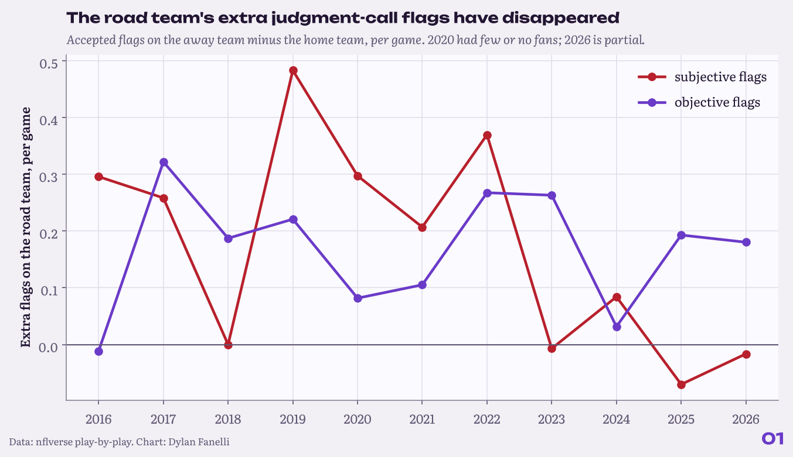</a><br><sub><b>01 Flag Audit</b></sub></td><td width="25%" valign="top"><a href="reports/02-fourth-down-bot/">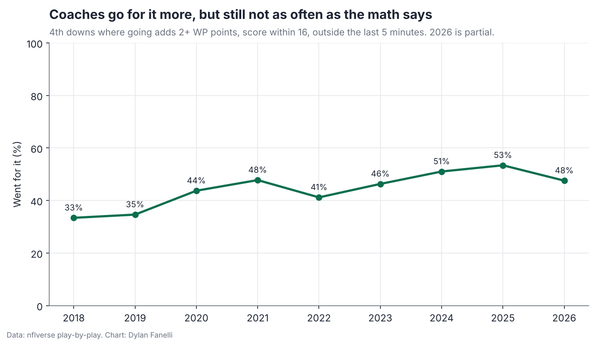</a><br><sub><b>02 Fourth-Down Bot</b></sub></td><td width="25%" valign="top"><a href="reports/03-sack-leverage/">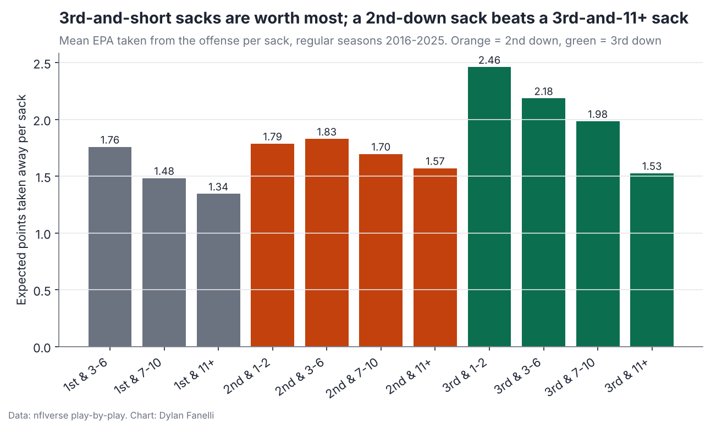</a><br><sub><b>03 Sack Leverage</b></sub></td><td width="25%" valign="top"><a href="reports/04-luck-index/">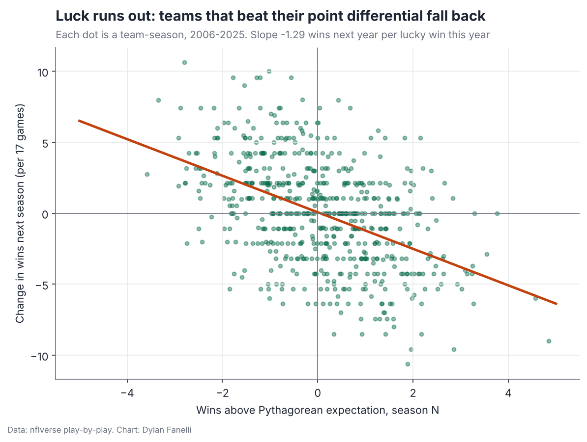</a><br><sub><b>04 Luck Index</b></sub></td></tr>
<tr><td width="25%" valign="top"><a href="reports/05-kickoff-value/">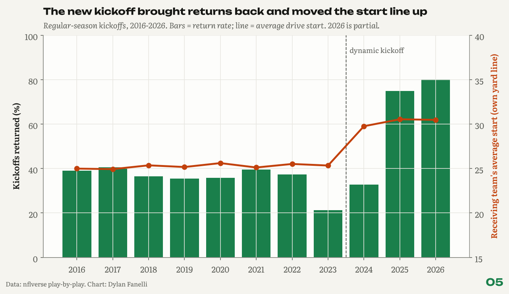</a><br><sub><b>05 Kickoff Value</b></sub></td><td width="25%" valign="top"><a href="reports/06-pass-run/">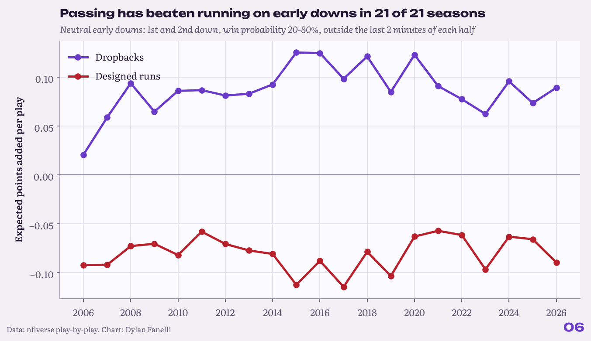</a><br><sub><b>06 Pass vs Run</b></sub></td><td width="25%" valign="top"><a href="reports/07-box-score-tax/">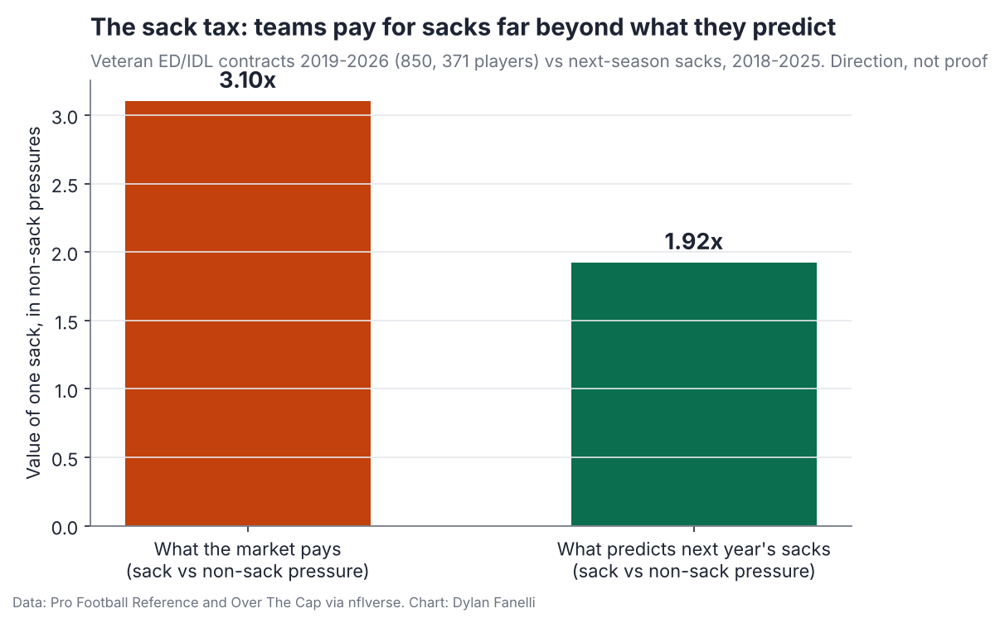</a><br><sub><b>07 The Box-Score Tax</b></sub></td><td width="25%" valign="top"><a href="reports/08-yac-tax/">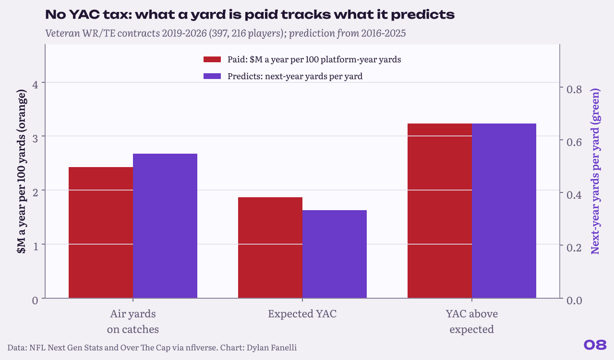</a><br><sub><b>08 The YAC Tax</b></sub></td></tr>
</table>

## 2026 in-season snippets

Twelve quick charts on the season in progress, through Weeks 1-8: QB, running back, receiver, pass rusher, defense, kicker and team views. [See them all](reports/2026-in-season-snippets/). **Hover for the breakdown:** the [interactive version](https://iforsurei.github.io/NFL-Analytics/snippets.html) opens every player's and team's numbers by down, by depth and week by week.

<table><tr><td width="33%"><a href="reports/2026-in-season-snippets/">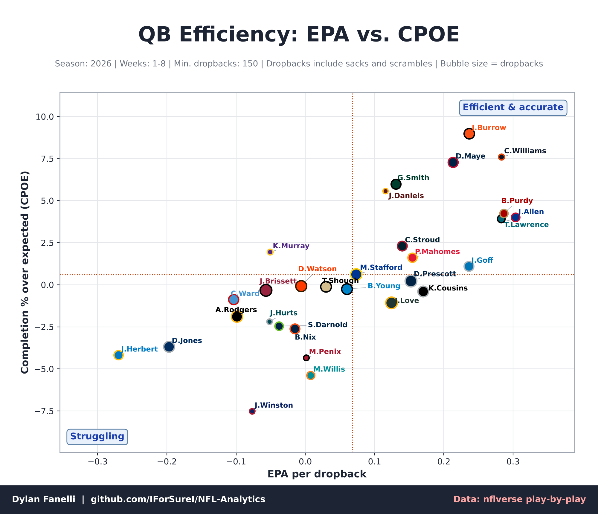</a></td><td width="33%"><a href="reports/2026-in-season-snippets/">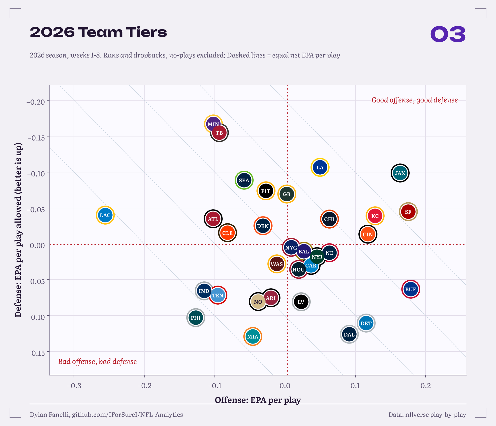</a></td><td width="33%"><a href="reports/2026-in-season-snippets/">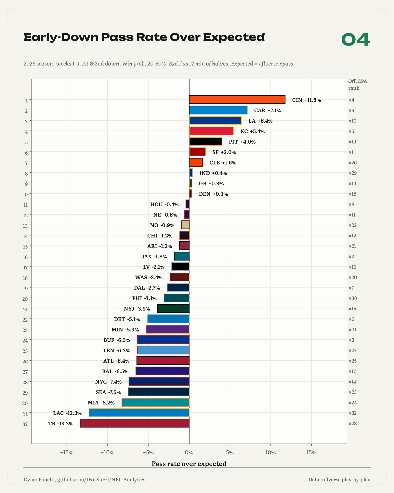</a></td></tr><tr><td width="33%"><a href="reports/2026-in-season-snippets/">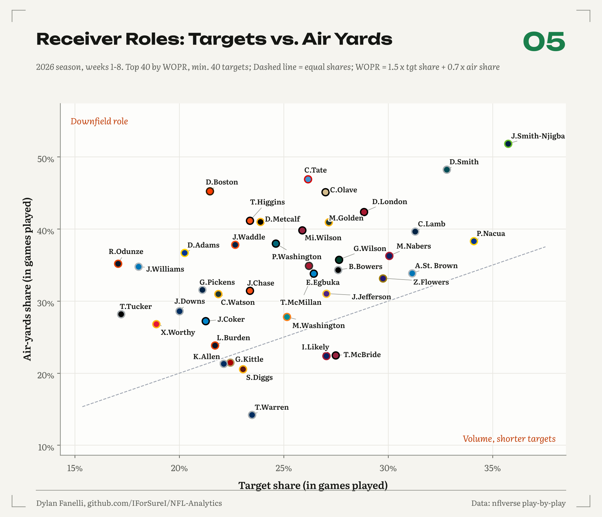</a></td><td width="33%"><a href="reports/2026-in-season-snippets/">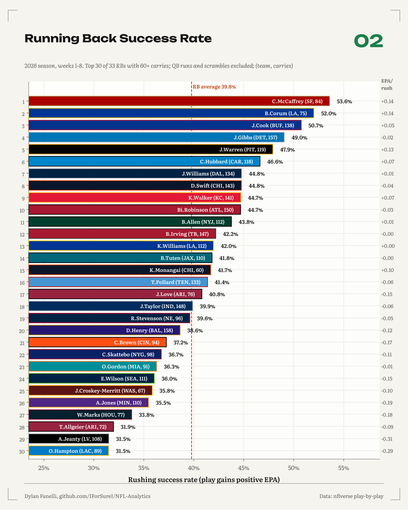</a></td><td width="33%"><a href="reports/2026-in-season-snippets/">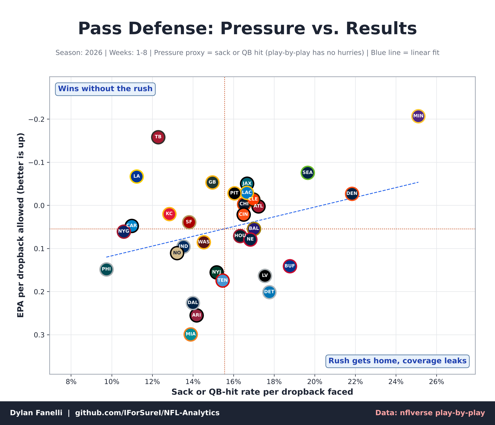</a></td></tr></table>

## Coming next

New studies are on the way; each follows the same [report standard](docs/report-standard.md).

| # | Study | The question |
|---|---|---|
| 09 | Run Game Value | How much of a running back's production is his, and do contracts pay for that part? |
| 10 | Draft Value | In rounds 3-7, which positions return the most value per pick? |
| 11 | Turnovers Forced | Do defenses that force turnovers keep doing it, and does a takeaway-heavy year fool people? |
| 12 | Backup QB Value | What is a good backup quarterback worth, in expected wins and in cap dollars? |

<a id="what-a-club-gets"></a>
## What a club gets

| Department | Question it answers | Study |
|---|---|---|
| Head coach and game management | Go, kick or punt on this fourth down? | [02 Fourth-Down Bot](reports/02-fourth-down-bot/) |
| Pro personnel and free agency | Are pass rushers and receivers priced for what repeats? Who to target in free agency? | [07 Box-Score Tax](reports/07-box-score-tax/), [08 YAC Tax](reports/08-yac-tax/) |
| Defensive staff | When is a sack worth the most, and who produces those? | [03 Sack Leverage](reports/03-sack-leverage/) |
| Offensive staff | Should we pass more on early downs? | [06 Pass vs Run](reports/06-pass-run/) |
| Special teams | Who creates field position under the new kickoff? | [05 Kickoff Value](reports/05-kickoff-value/) |
| Front office and ownership | How much of our record was luck? | [04 Luck Index](reports/04-luck-index/) |
| Game prep | What does this crew call, and what flags are coachable on the road? | [01 Flag Audit](reports/01-flag-audit/) |

<a id="how-i-work"></a>
## How I work

Every study follows the same [report standard](docs/report-standard.md), modeled on how Big Data Bowl entries, Open Source Football articles and the nflverse model write-ups are built:

1. **A question first,** stated before the data, with prior public work credited.
2. **Stability before value.** A stat has to repeat before it can be called a skill or priced.
3. **Validation in the open:** out-of-sample tests, calibration, bootstraps, clustered standard errors and robustness tables.
4. **Results under headings that state the finding,** each with its figure.
5. **What a club does with it,** limitations and next steps on every page.
6. **Reproducible:** one command rebuilds every number, chart and page; `pytest` (run by GitHub Actions on every change, Python 3.10 and 3.12) checks that published numbers stay football-sane and every page meets the standard.

**Techniques used here:** gradient-boosted win probability with monotone constraints; decision analysis; expected points (EPA); empirical-Bayes shrinkage and Wilson intervals; split-half and year-to-year reliability; OLS with player-clustered standard errors; bootstrap resampling; Pythagorean expectation; contract valuation in cap-share terms; DuckDB SQL.

<a id="under-the-hood"></a>
## Under the hood

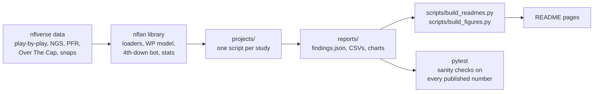

```
nflan/          tested library: data loading, win-probability model, 4th-down bot, penalty and stats helpers
projects/       one script per study (python -m projects.<name>)
reports/        each study's write-up, figures, CSV outputs and findings.json
sql/            DuckDB queries answering the same questions straight from the parquet files
scripts/        update.py (weekly refresh), build_readmes.py, build_figures.py, report_meta.py
tests/          unit tests and sanity checks on published numbers
docs/           report standard, glossary, data dictionary, inspiration notes
assets/         banner and at-a-glance figure
```

### Reproduce

```bash
pip install -r requirements.txt
python scripts/update.py          # downloads nflverse data (about 400 MB), runs every study, figures, tests and READMEs
pytest -q
```

Each study also runs alone, for example `python -m projects.fourth_down_bot`.

## Data, glossary and credit

- Data: [nflverse](https://github.com/nflverse/nflverse-data) (CC-BY 4.0): play-by-play with nflfastR's EPA and win-probability models, officials, NFL Next Gen Stats, Pro Football Reference advanced stats, snap counts and Over The Cap contracts. See the [data dictionary](docs/data-dictionary.md).
- Terms used on these pages (EPA, WP, Brier score, PROE, clustered standard errors and more): [glossary](docs/glossary.md).
- Fourth-down method: the public idea behind [nfl4th](https://github.com/nflverse/nfl4th) by Ben Baldwin, rebuilt from scratch in Python.
- Inspiration: **Michael MacKelvie** (data storytelling) and **Brett Kollmann** (film plus numbers); each report links the video that started it. Notes in [`docs/inspiration.md`](docs/inspiration.md).
- All analysis, and any mistakes, are mine.

## Changelog

- 2026-11-08: Snippets page redesigned as an index of plates (Unbounded and Literata, violet and red on carbon-copy paper, crop marks): charts redraw at the screen's width so phone text stays readable, a dark mode with its own colors, names in ink with team colors on the marks, a table under every chart, and the provenance line at the top.
- 2026-11-08: Snippet charts restyled to match the page: Unbounded and Literata (in assets/fonts, OFL), numbered plates with crop marks, the title set left, a plain footer in place of the dark band, names in ink with team colours on the marks, no bar-end badges or shadows. Same data and numbers; findings.json unchanged.
- 2026-11-08: Every study figure, the banner and the at-a-glance panel restyled to the snippets design through nflan/plot.py (Unbounded and Literata, carbon-copy paper, violet and red series checked for colour-blind separation, study number on each plate); the yard-line banner and Inter are gone. Rebuilt with a refresh: nflverse revised past seasons, so a few numbers moved slightly (2025 go rate in clear spots 53% to 54%; flags 35,094 to 35,104).

Full history: [LOG.md](LOG.md). Data refreshes weekly in season (last: November 08, 2026, through the latest completed week of 2026).

## License and citation

© 2026 Dylan Fanelli. All rights reserved. The code, reports and figures may be viewed here; they may not be copied, modified or used without written permission. See [LICENSE](LICENSE). To cite this work, use the **Cite this repository** button (from [CITATION.cff](CITATION.cff)).

<a id="about"></a>
## About

<table>
<tr>
<td width="32%" valign="top">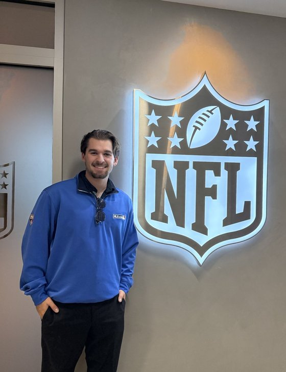<br><sub>At the NFL offices in New York City</sub></td>
<td valign="top">

Dylan Fanelli, M.S. Sport Management candidate at UMass Amherst (Mark H. McCormack Department). I am building this portfolio to show proficiency in NFL statistics and sabermetrics-style analysis.

I also keep a [baseball analytics portfolio](https://github.com/IForSureI/Dylan-Fanelli-Baseball-Analytics-Portfolio). [LinkedIn](https://www.linkedin.com/in/dylanfanelli/)

<sub>Photos are my own.</sub>

</td>
</tr>
</table>
