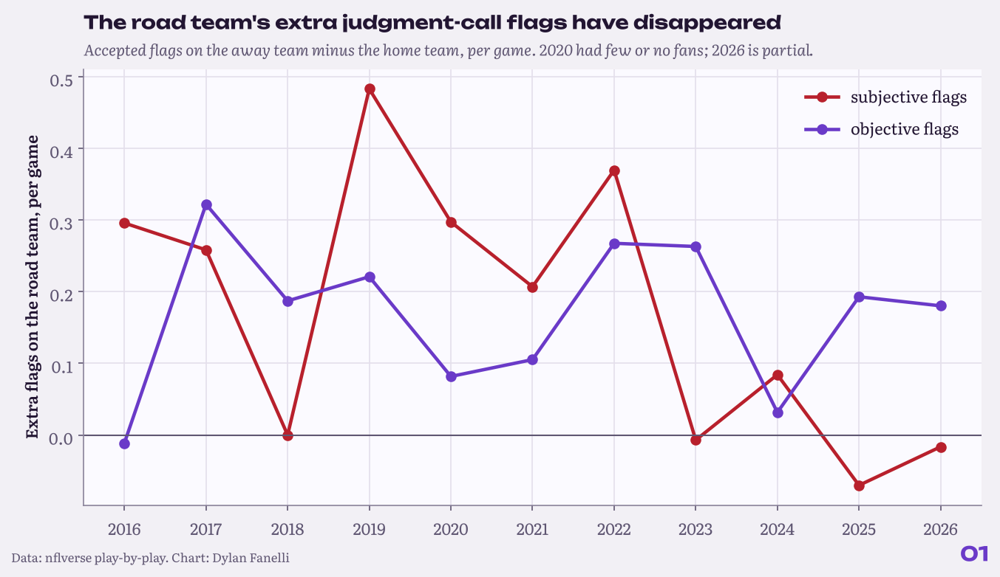
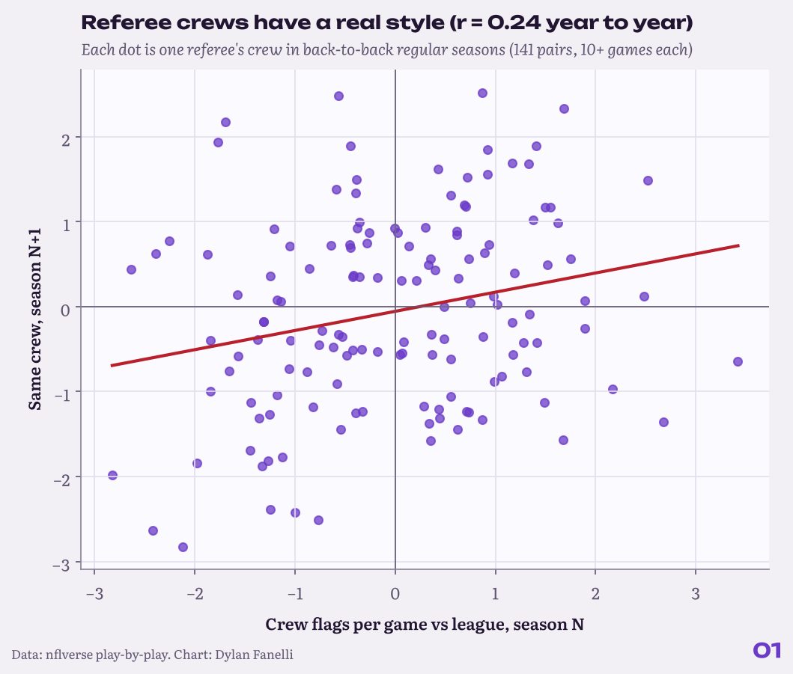
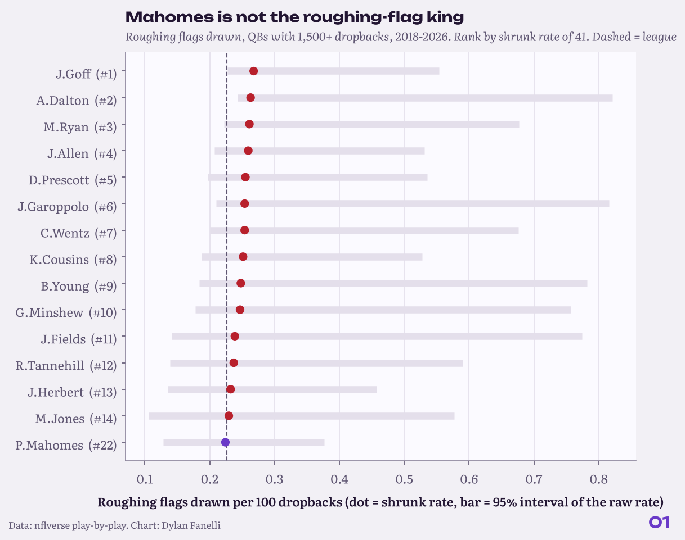

<sub>[← Portfolio](../../README.md) &nbsp;|&nbsp; [02 Fourth-Down Bot →](../02-fourth-down-bot/)</sub>

# 01 Flag Audit
### Do NFL flags really even out?

    

> **TL;DR**
> - Road teams drew 0.27 more judgment-call flags a game than home teams in 2016-22; since 2023 the gap has averaged 0.00. What remains is a small pre-snap gap (neutral zone infractions, delay of game), not judgment calls.
> - Referee crews have a modest, real style (year-to-year r = 0.24); a team's flag luck does not carry over (r = 0.08).
> - Mahomes ranks #22 of 41 QBs in roughing flags drawn, right at the league rate.

<p align="center"></p>
<p align="center"><sub>Road team's extra flags per game, by flag type and season.</sub></p>

## Key numbers

| Measure | Value |
|---|---|
| Road team's extra judgment-call flags per game, 2016-22 | **0.27** |
| Same, 2023-26 | **0.00** |
| Crew flags per game, year-to-year r | **0.24** |
| Team net flags, odd vs even weeks r | **0.08** |
| Mahomes' rank in roughing flags drawn | **#22 of 41** |
| Flags that swung win probability 10+ points, per season | **84** |

## Why it matters for a club

- **Coaching and game prep:** the road penalty gap that is left is pre-snap communication (neutral zone infractions, delay of game), which is coachable with silent-count and cadence work in road weeks.
- **Weekly opponent and crew prep:** crews have a modest, repeatable style (see key numbers), worth one line in the game-plan packet, not a strategy.
- **Expectations:** a team's flag luck does not carry over, so a bad flag differential is not a reason to change personnel by itself.

## The question

**Do NFL flags really even out, or do some teams, quarterbacks and crews get a different game?**

**Inspired by:** Michael MacKelvie, [We looked at 92,255 flags - NFL refs are biased](https://www.youtube.com/watch?v=LH3Ck59I8V0).  

## Data

nflverse play-by-play and officials, 2016-2026 (2,883 games, 35,104 accepted flags). Declined and offsetting flags removed.

## Results

### 1. The road team's extra judgment-call flags are gone.

In 2016-22, road teams drew 0.27 more subjective flags per game than home teams (holding, pass interference, roughing). Since 2023 the gap is 0.00.

### 2. The road gap that remains is noise and communication, not referees' judgment.

Road teams still take about 0.17 extra rule-book flags a game. Neutral zone infractions go against the road defense 60% of the time, and delay of game against the road offense 56%. False starts, the flag fans blame on crowd noise, split almost evenly (49.6% on the road team).

### 3. Referee crews have a real, modest style.

A crew's flags per game this season predicts next season at r = 0.24 (141 back-to-back crew seasons). In 2025, Alex Moore's crew averaged 16.0 flags a game and Brad Allen's averaged 9.9.

<p align="center"></p>
<p align="center"><sub>A crew's flags per game in one season vs the next.</sub></p>

### 4. A team's flag luck does not carry over.

Within a season, a team's net subjective flags (drawn minus committed) in odd weeks predicts even weeks at only r = 0.08. Committing flags is a bit more stable (r = 0.28) than drawing them (r = 0.17): discipline is partly real, getting calls is mostly not.

### 5. Mahomes is not the roughing-flag king.

Among 41 QBs with 1,500+ dropbacks since 2018, he ranks #22 (by shrunk rate) at 0.22 roughing flags per 100 dropbacks, about the league rate of 0.23. The top of the list is J.Goff (0.35 raw), A.Dalton (0.45) and M.Ryan (0.39). Only J.Goff and A.Dalton sit clearly above the league rate (95% interval); everyone else overlaps it.

<p align="center"></p>
<p align="center"><sub>Roughing-the-passer flags drawn per 100 dropbacks, shrunk toward the league rate, with 95% intervals.</sub></p>

### 6. Big calls are real but random.

921 accepted flags (886 in the regular season) moved win probability by 10+ points, about 84 per full regular season. Pass interference leads. A team's net big calls this year predicts next year at r = 0.04: no team is owed them.

## Method

- **Objective vs subjective:** objective flags are facts at the snap (alignment, motion, clock); subjective flags need a judgment about contact or intent. The lists are in [`nflan/penalties.py`](../../nflan/penalties.py).
- **Crews:** the referee's name stands for the crew (officials table, position = Referee). Regular-season crews with 10+ games.
- **Split-half reliability:** for each team-season, the odd-week mean vs the even-week mean.
- **Roughing:** flags drawn per dropback, with Wilson 95% intervals and empirical-Bayes shrinkage so small samples are not ranked on noise.

**In equations**

- Shrunk roughing rate for quarterback $`i`$ (beta-binomial empirical Bayes): $`\hat p_i = \dfrac{x_i + \alpha}{n_i + \alpha + \beta}`$, with $`\alpha, \beta`$ fit to all quarterbacks.
- Split-half reliability: $`r\big(\bar y_{\text{odd weeks}},\ \bar y_{\text{even weeks}}\big)`$ across team-seasons.

## Validation

- Stability is tested before anything is called a skill: crews 0.24, team flags committed 0.28, drawn 0.17, net 0.08.
- Quarterback rates are shrunk and shown with Wilson 95% intervals, so small samples are not ranked on noise.
- Unit tests check the flag categories and that the published stability numbers stay in sane ranges (`tests/`).

## Limitations

- Play-by-play has no tracking data, so this cannot judge whether a single flag was correct.
- "Big call" uses nflfastR's WPA, which measures the flag plus the play it wiped out.

## Next steps

- Penalty-type profiles per crew (who calls holding vs pass interference).
- Add tracking-era context once public player tracking covers full seasons.

## Reproduce

```bash
pip install -r requirements.txt
python -m projects.flag_audit
```
Code: [`projects/flag_audit.py`](../../projects/flag_audit.py)

## Files in this folder

| File | What it holds |
|---|---|
| [`home_edge_by_season.csv`](home_edge_by_season.csv) | Road minus home flags per game by season and flag type |
| [`home_edge_by_era.csv`](home_edge_by_era.csv) | The same by era (2016-22 vs 2023 on) |
| [`objective_road_skew_by_type.csv`](objective_road_skew_by_type.csv) | Share of each rule-book flag that goes against the road team |
| [`crew_flags_per_game.csv`](crew_flags_per_game.csv) | Flags per game by referee crew and season |
| [`qb_roughing_drawn.csv`](qb_roughing_drawn.csv) | Roughing flags drawn per QB with shrunk rates and intervals |
| [`big_calls_team_season.csv`](big_calls_team_season.csv) | Flags that moved win probability 10+ points, by team-season |
| [`findings.json`](findings.json) | Every number quoted on this page, machine-readable |

---
<sub>[← Portfolio](../../README.md) &nbsp;|&nbsp; [02 Fourth-Down Bot →](../02-fourth-down-bot/)</sub>

<sub>© 2026 Dylan Fanelli. All rights reserved. To cite: Fanelli, D. (2026). *Flag Audit*. NFL Analytics. https://github.com/IForSureI/NFL-Analytics/tree/main/reports/01-flag-audit</sub>
