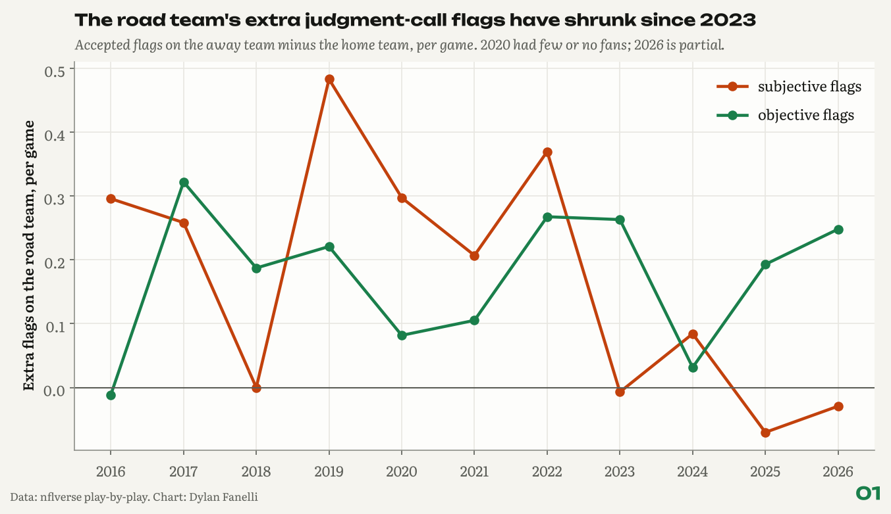
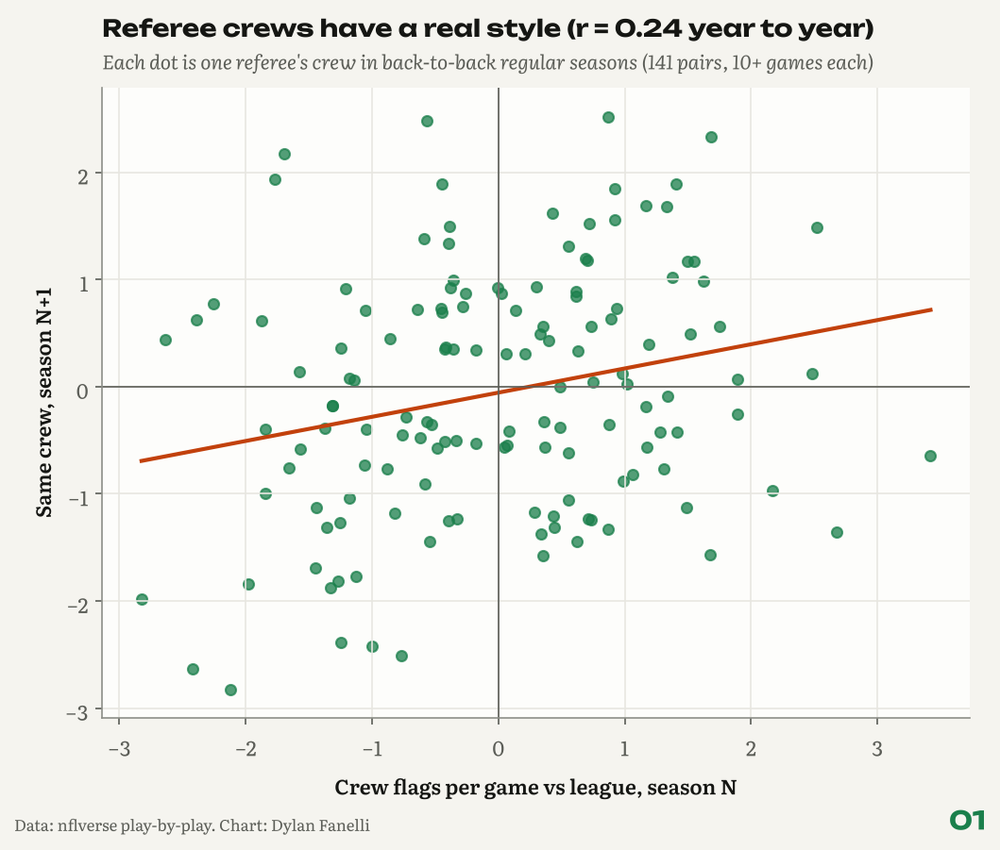
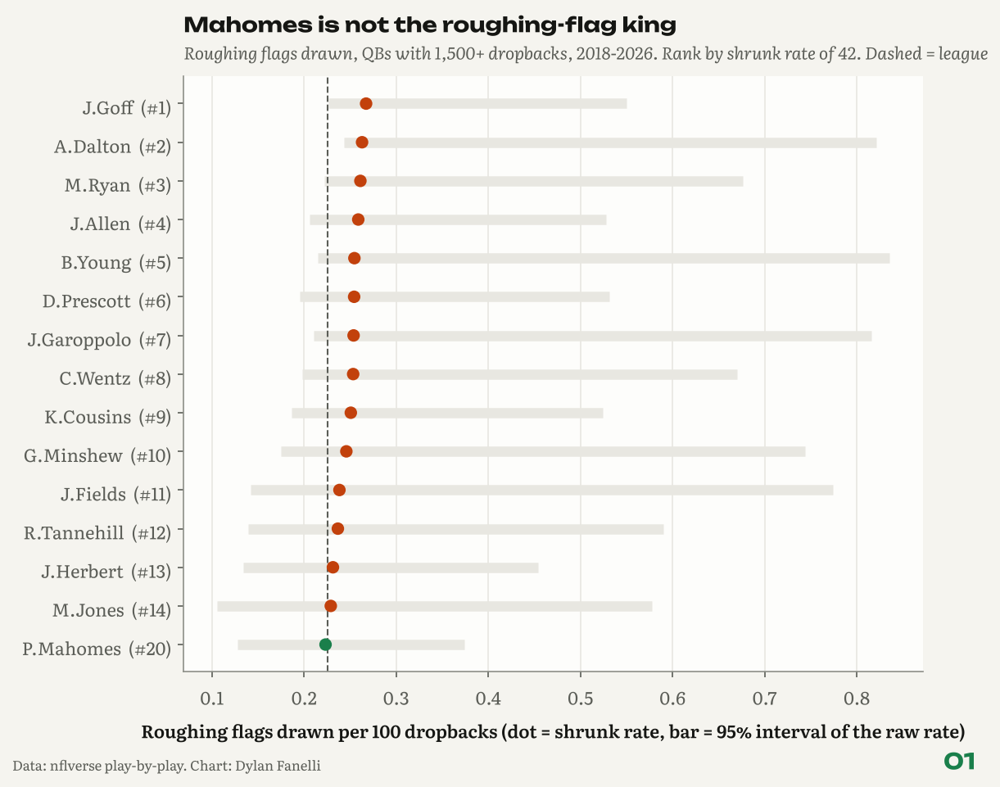

<sub>[← Portfolio](../../README.md) &nbsp;|&nbsp; [02 Fourth-Down Bot →](../02-fourth-down-bot/)</sub>

# 01 Flag Audit
### Do NFL flags really even out?

    

**TL;DR**

- Road teams drew 0.27 more judgment-call flags a game than home teams in 2016-22; since 2023 the gap has averaged 0.00. The drop is real per snap (95% interval 0.02 to 0.29 per 100 snaps) but not yet in close games only, and I picked 2023 from the chart.
- Referee crews have a modest style (year-to-year r = 0.24, 95% interval 0.03 to 0.41); a team's flag luck does not carry over (r = 0.08).
- Mahomes ranks #20 of 42 QBs in roughing flags drawn, right at the league rate.

<p align="center"></p>
<p align="center"><sub>Road team's extra flags per game, by flag type and season.</sub></p>

## Key numbers

| Measure | Value |
|---|---|
| Road team's extra judgment-call flags per game, 2016-22 | **0.27** |
| Same, 2023-26 | **0.00** |
| Drop in the road gap per 100 snaps, all snaps (95% interval) | **0.16 (0.02 to 0.29)** |
| Same, close game states only | **0.12 (-0.06 to 0.29)** |
| Crew flags per game, year-to-year r | **0.24 (0.03 to 0.41)** |
| Team net flags, odd vs even weeks r | **0.08** |
| Mahomes' rank in roughing flags drawn | **#20 of 42** |
| Flags that swung win probability 10+ points, per season | **84** |

## Why it matters for a club

- **Coaching and game prep:** the road gap that is clearly left is in neutral zone infractions and delay of game. False starts split evenly, so this data does not show that a silent count is the fix. It shows where to look on road film.
- **Weekly opponent and crew prep:** crews have a modest style with a wide interval (see key numbers), worth one line in the game-plan packet, not a strategy.
- **Expectations:** a team's flag luck does not carry over, so a bad flag differential is not a reason to change personnel by itself.

## The question

**Do NFL flags really even out, or do some teams, quarterbacks and crews get a different game?**

**Inspired by:** Michael MacKelvie, [We looked at 92,255 flags - NFL refs are biased](https://www.youtube.com/watch?v=LH3Ck59I8V0).  

## Data

nflverse play-by-play and officials, 2016-2026 (2,898 games, 35,327 accepted flags). Declined and offsetting flags removed.

## Results

### 1. The road team's extra judgment-call flags have shrunk since 2023, and the data cannot yet say they are gone.

In 2016-22, road teams drew 0.27 more subjective flags per game than home teams (holding, pass interference, roughing). Since 2023 the gap is 0.00. Per 100 snaps that is 0.18 (95% interval 0.09 to 0.26) before and 0.02 (95% interval -0.09 to 0.13) since. The drop is 0.16 (95% interval 0.02 to 0.29). Two cautions. I picked 2023 after looking at the chart, and it gives the biggest drop of the 8 break years I could have picked. And in close game states only (score within 8), the drop is 0.12 (95% interval -0.06 to 0.29), which includes zero.

### 2. The road gap that is clearly still there is in rule-book flags.

Road teams still take about 0.17 extra rule-book flags a game. Neutral zone infractions go against the road defense 60% of the time, and delay of game against the road offense 56%. False starts, the flag fans blame on crowd noise, split almost evenly (49.6% on the road team). Crowd noise is one reading of the first two. This data cannot test it.

### 3. Referee crews have a real, modest style.

A crew's flags per game this season predicts next season at r = 0.24 (95% interval 0.03 to 0.41, 141 back-to-back crew seasons, crews resampled). In 2025, Alex Moore's crew averaged 16.0 flags a game and Brad Allen's averaged 9.9.

<p align="center"></p>
<p align="center"><sub>A crew's flags per game in one season vs the next.</sub></p>

### 4. A team's flag luck does not carry over.

Within a season, a team's net subjective flags (drawn minus committed) in odd weeks predicts even weeks at only r = 0.08. Committing flags is a bit more stable (r = 0.29) than drawing them (r = 0.18): discipline is partly real, getting calls is mostly not.

### 5. Mahomes is not the roughing-flag king.

Among 42 QBs with 1,500+ dropbacks since 2018, he ranks #20 (by shrunk rate) at 0.22 roughing flags per 100 dropbacks, about the league rate of 0.23. The top of the list is J.Goff (0.35 raw), A.Dalton (0.45) and M.Ryan (0.39). J.Goff and A.Dalton have a 95% interval above the league rate. With 42 quarterbacks, about 1.1 would by chance alone. None of them stays above it once the test is corrected for checking 42 quarterbacks at once.

<p align="center"></p>
<p align="center"><sub>Roughing-the-passer flags drawn per 100 dropbacks, shrunk toward the league rate, with 95% intervals.</sub></p>

### 6. Big calls are real but random.

928 accepted flags (893 in the regular season) moved win probability by 10+ points, about 84 per full regular season. Pass interference leads. A team's net big calls this year predicts next year at r = 0.04: no team is owed them.

## Method

- **Objective vs subjective:** objective flags are facts at the snap (alignment, motion, clock); subjective flags need a judgment about contact or intent. The lists are in [`nflan/penalties.py`](../../nflan/penalties.py).
- **Crews:** the referee's name stands for the crew (officials table, position = Referee). Regular-season crews with 10+ games.
- **Per play and close games:** road minus home subjective flags per 100 scrimmage snaps, for all snaps and for snaps with the score within 8. 95% intervals resample games 2,000 times.
- **Split-half reliability:** for each team-season, the odd-week mean vs the even-week mean.
- **Roughing:** flags drawn per dropback, with Wilson 95% intervals and empirical-Bayes shrinkage so small samples are not ranked on noise.

**In equations**

- Shrunk roughing rate for quarterback $`i`$ (beta-binomial empirical Bayes): $`\hat p_i = \dfrac{x_i + \alpha}{n_i + \alpha + \beta}`$, with $`\alpha, \beta`$ fit to all quarterbacks.
- Split-half reliability: $`r\big(\bar y_{\text{odd weeks}},\ \bar y_{\text{even weeks}}\big)`$ across team-seasons.

## Validation

- Stability is tested before anything is called a skill: crews 0.24, team flags committed 0.29, drawn 0.18, net 0.08.
- Quarterback rates are shrunk and shown with Wilson 95% intervals. 42 quarterbacks are tested at once, so about 1.1 would clear the league rate by chance; 0 clear it after a Bonferroni correction.
- The home-edge drop is reported per snap, in close game states, without 2020, and for every break year, with game-bootstrap intervals.
- Unit tests check the flag categories on a small made-up play-by-play table (`tests/`).

## Limitations

- Play-by-play has no tracking data, so this cannot judge whether a single flag was correct.
- The 2023 break was chosen from the chart, not set in advance. Four seasons after it, one of them partial, is a short record.
- 42 quarterbacks are tested against the league roughing rate at once, so about 1.1 would sit above it by chance alone.
- "Big call" uses nflfastR's WPA, which measures the flag plus the play it wiped out.

## Next steps

- Penalty-type profiles per crew (who calls holding vs pass interference).
- Add tracking-era context once public player tracking covers full seasons.

## Reproduce

```bash
pip install -r requirements.txt
python -m projects.flag_audit
```
Code: [`projects/flag_audit.py`](../../projects/flag_audit.py)

## Files in this folder

| File | What it holds |
|---|---|
| [`home_edge_by_season.csv`](home_edge_by_season.csv) | Road minus home flags per game by season and flag type |
| [`home_edge_by_era.csv`](home_edge_by_era.csv) | The same by era (2016-22 vs 2023 on; the break year was chosen from the chart) |
| [`objective_road_skew_by_type.csv`](objective_road_skew_by_type.csv) | Share of each rule-book flag that goes against the road team |
| [`crew_flags_per_game.csv`](crew_flags_per_game.csv) | Flags per game by referee crew and season |
| [`qb_roughing_drawn.csv`](qb_roughing_drawn.csv) | Roughing flags drawn per QB with shrunk rates and intervals |
| [`big_calls_team_season.csv`](big_calls_team_season.csv) | Flags that moved win probability 10+ points, by team-season |
| [`findings.json`](findings.json) | Every number quoted on this page, machine-readable |

---
<sub>[← Portfolio](../../README.md) &nbsp;|&nbsp; [02 Fourth-Down Bot →](../02-fourth-down-bot/)</sub>

<sub>© 2026 Dylan Fanelli. All rights reserved. To cite: Fanelli, D. (2026). *Flag Audit*. NFL Analytics. https://github.com/IForSureI/NFL-Analytics/tree/main/reports/01-flag-audit</sub>
