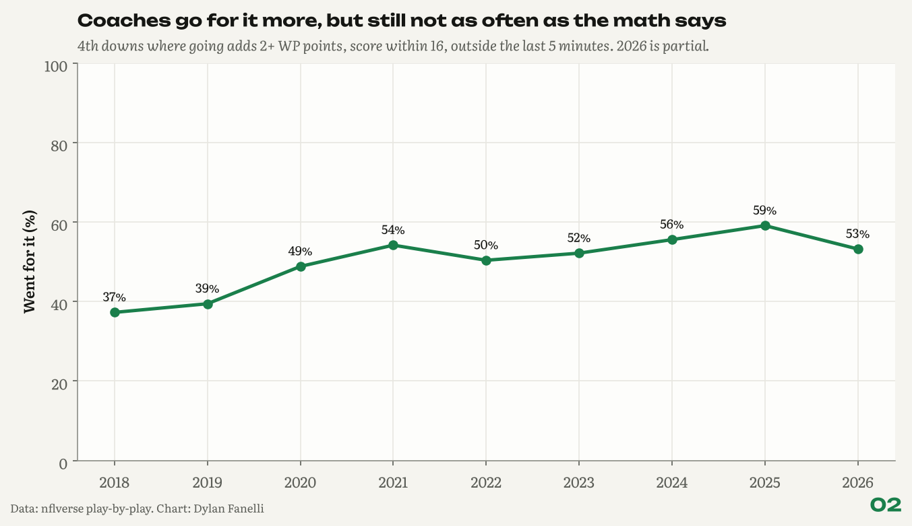
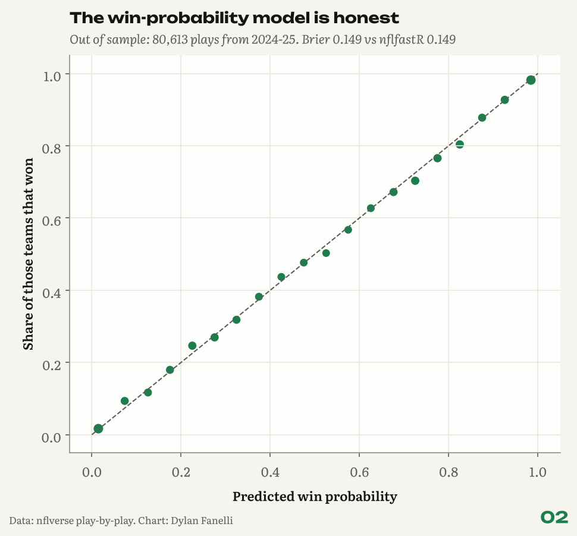

<sub>[← Portfolio](../../README.md) &nbsp;|&nbsp; [← 01 Flag Audit](../01-flag-audit/) &nbsp;|&nbsp; [03 Sack Leverage →](../03-sack-leverage/)</sub>

# 02 Fourth-Down Bot
### How often do coaches go when the math says go?

     

**TL;DR**

- I built a win-probability model that comes close to nflfastR out of sample (Brier 0.1495 vs 0.1488 on 80,613 plays) and a fourth-down bot on top of it.
- Coaches now go for it in 59% of clear go spots, up from 37% in 2018. Only spots that stay go spots when the models are refit are counted.
- The team card is a description, not a ranking: a team's lost win probability in odd weeks predicts its even weeks at r = 0.17, and 7 of 32 teams clear the league median this season.

<p align="center"></p>
<p align="center"><sub>Go rate when going adds 2+ win-probability points.</sub></p>

## Key numbers

| Measure | Value |
|---|---|
| Brier score, my WP model (out of sample) | **0.1495** |
| Brier score, nflfastR (same plays) | **0.1488** |
| Agreement with nflfastR (r) | **0.993** |
| Test plays | **80,613** |
| Go rate in clear go spots, 2018 | **37%** |
| Go rate in clear go spots, 2025 | **59%** |
| Median standard error of the go-vs-kick margin (WP points) | **1.34** |
| Team card, odd vs even weeks r | **0.17** |
| Team card, year-to-year r | **0.28** |
| Longest field goal the bot offers | **56 yards** |

## Why it matters for a club

- **Game day:** the same engine could produce a pregame go/kick chart by field position and distance for the head coach's call sheet.
- **Post-game review:** every fourth down graded against the best option, so the staff argues about inputs (our kicker, our short-yardage offense) rather than outcomes.
- **Front office:** the league-wide go rate is the solid number here. The team card is too noisy to judge a coach on one season.

## The question

**When the math says go for it on fourth down, how often do coaches go, and can the cost be pinned on a team?**

**Inspired by:** Brett Kollmann, [Are analytics ruining football?](https://www.youtube.com/watch?v=FOnQFk5qy-4) (judge the decision apart from the play), and Michael MacKelvie, [Passing is better...so, why run?](https://www.youtube.com/watch?v=pPXZlK9puqw) (coaches lag the math). Method follows the public idea of Ben Baldwin's [nfl4th](https://github.com/nflverse/nfl4th), rebuilt from scratch in Python.  

## Data

nflverse play-by-play 2006-2026.

## Results

### 1. The win-probability model comes close to nflfastR out of sample.

Trained on 2006-2023 and tested on 80,613 plays from 2024-25: Brier score 0.1495, against 0.1488 for nflfastR's spread-adjusted model on the same plays (lower is better). Mine is 0.0007 behind theirs. The two agree at r = 0.993. Calibration sits close to the 45-degree line.

<p align="center"></p>
<p align="center"><sub>Out-of-sample calibration of my win-probability model, 2024-25.</sub></p>

### 2. Coaches go for it far more than they used to.

In clear go spots (going adds 2+ win-probability points and still adds some when the models are refit, score within 16, outside the last 5 minutes), teams went 37% of the time in 2018 (95% interval 32% to 42%, 357 spots) and 59% in 2025 (55% to 64%, 457 spots). 2026 so far: 53% on 235 spots (47% to 60%), which overlaps the 2025 interval. The rise does not depend on the 2-point line: at a 1-point line the rate went from 25% to 42%, at 5 points from 50% to 76%.

### 3. How sure is the bot?

I refit the conversion, field-goal and punt models on 30 resamples of games. The typical fourth down's go-versus-kick margin moves by 1.34 win-probability points (median standard error). 53% of calls that miss the best option by 1+ point still miss it in 95% of refits, and 70% of 2+ point go spots stay go spots. Only those are charged or counted.

### 4. 2026 team card (regular season): a description, not a ranking.

Most win probability lost per game on charged calls: BAL (3.7, 90% interval 1.7 to 6.0), NYG (3.7, 90% interval 1.7 to 6.0), DEN (3.5, 90% interval 1.5 to 5.7). Least: LV (0.1, 90% interval 0.0 to 0.4), MIA (0.2, 90% interval 0.0 to 0.6), CLE (0.5, 90% interval 0.0 to 1.0). Does it repeat? Odd weeks against even weeks of the same season, r = 0.17 (256 team-seasons, 2018-2025); one season to the next, r = 0.28. That is mostly noise, so the card describes what happened and does not rank coaches. This season 7 of 32 teams have an interval that clears the league median.

<p align="center"></p>
<p align="center"><sub>Win-probability points lost per game on charged fourth-down calls, this season, with 90% intervals.</sub></p>

### 5. Sanity checks.

4th-and-1 at midfield, tied, early, even teams: going adds 3.0 WP points. 4th-and-10 at your own 20: going costs 11.5.

## How the bot works

- **Win probability:** gradient-boosted trees on score, clock, field position, down and distance, timeouts, the second-half kickoff and the point spread. Like nflfastR, the spread fades as the game goes on and a lead counts more late. Monotone constraints keep it football-logical (more points ahead never lowers WP).
- **Go:** P(convert) from every 3rd and 4th down since 2016, by distance, field position and the offense's pregame spread (a better offense converts more), x WP after a first down (median extra yards by distance), plus (1 - P) x WP with the opponent taking over at the spot.
- **Field goal:** make probability by distance, dome and season, then WP after +3 and a kickoff (season-average drive start) or after a miss (opponent at the spot of the kick or the 20). No kick longer than 56 yards is offered. That is the longest distance at which coaches still kick on at least a quarter of fourth downs; 357 of 11,308 attempts since 2016 were longer, and their make rate reflects strong legs and good conditions, not an average kicker.
- **Punt:** opponent's expected next start from the punt spot, then WP.
- **Grading:** a call is charged only when it misses the best option by 1+ WP point and the miss survives the refits (finding 3).

**In equations**

- $`\text{WP}_{\text{go}} = P(\text{convert})\cdot \text{WP}(\text{first down}) + \big(1 - P(\text{convert})\big)\cdot \text{WP}(\text{opponent ball at the spot})`$
- $`\text{WP}_{\text{FG}} = P(\text{make})\cdot \text{WP}(+3,\ \text{kickoff}) + \big(1 - P(\text{make})\big)\cdot \text{WP}(\text{opponent ball after a miss})`$
- A call is charged $`\max_k \text{WP}_k - \text{WP}_{\text{call}}`$ only when that gap is at least 1 point and its 5th percentile across game-bootstrap refits is above zero. Brier score $`= \frac{1}{N}\sum_i (p_i - y_i)^2`$.

## Validation

- Trained on 2006-2023, tested on 80,613 plays from 2024-25: Brier 0.1495 vs nflfastR 0.1488 on the same rows; r = 0.993.
- Calibration plot under result 1: predicted vs actual win rate by bin, close to the 45-degree line.
- The conversion, field-goal and punt models are refit on 30 resamples of games, so every recommendation carries a standard error. They are not tested out of sample.
- The team card is tested for repeatability before it is read: split-half r = 0.17, year-to-year r = 0.28.
- Football sanity checks: 4th-and-1 at midfield favors going (+3.0 WP), 4th-and-10 at your own 20 favors kicking (-11.5). The bot's arithmetic is unit-tested on a made-up model (`tests/test_logic.py`).
- Monotone constraints keep the model football-logical (a bigger lead never lowers WP).

## Limitations

- One average team: it knows the pregame spread, not a team's QB, kicker or short-yardage offense.
- Only the win-probability model is tested out of sample. The conversion, field-goal and punt models are fit and applied on the same 2016-2026 plays; in that sample the conversion model predicts 41.4% and 41.3% converted.
- The refits vary the conversion, kick and punt models. The win-probability model is held fixed, so the true uncertainty is larger than finding 3 shows.
- Third downs feed the conversion model. Defenses play fourth down differently, which a 4th-down flag only partly covers.
- Seasons through 2023 are scored with a win-probability model trained on them (in sample); 2024 on is out of sample.
- No clock management beyond fixed play lengths, and fake punts count as "go".

## Next steps

- Team-specific inputs: the offense's short-yardage success and the kicker's range.
- Two-point decisions and end-of-half clock management.
- A one-page in-game chart per opponent.

## Reproduce

```bash
pip install -r requirements.txt
python -m projects.fourth_down_bot
```
Code: [`nflan/wp.py`](../../nflan/wp.py), [`nflan/fourth.py`](../../nflan/fourth.py), [`projects/fourth_down_bot.py`](../../projects/fourth_down_bot.py)

## Files in this folder

| File | What it holds |
|---|---|
| [`fourth_downs_scored.parquet`](fourth_downs_scored.parquet) | Every fourth down with WP for go, field goal and punt, and the refit standard errors |
| [`team_scorecard.csv`](team_scorecard.csv) | WP points lost per game by team and season, with 90% intervals |
| [`go_rate_when_math_says_go.csv`](go_rate_when_math_says_go.csv) | Go rate in clear go spots by season, with spots and Wilson intervals |
| [`costliest_calls_current_season.csv`](costliest_calls_current_season.csv) | The current season's most expensive calls |
| [`wp_calibration_2024_2025.csv`](wp_calibration_2024_2025.csv) | Calibration bins for the out-of-sample test |
| [`kickoff_start_by_season.csv`](kickoff_start_by_season.csv) | Average drive start after a kickoff, used by the bot |
| [`model_summary.txt`](model_summary.txt) | Out-of-sample Brier scores, test plays and the field-goal range |
| [`findings.json`](findings.json) | Every number quoted on this page, machine-readable |

---
<sub>[← Portfolio](../../README.md) &nbsp;|&nbsp; [← 01 Flag Audit](../01-flag-audit/) &nbsp;|&nbsp; [03 Sack Leverage →](../03-sack-leverage/)</sub>

<sub>© 2026 Dylan Fanelli. All rights reserved. To cite: Fanelli, D. (2026). *Fourth-Down Bot*. NFL Analytics. https://github.com/IForSureI/NFL-Analytics/tree/main/reports/02-fourth-down-bot</sub>
