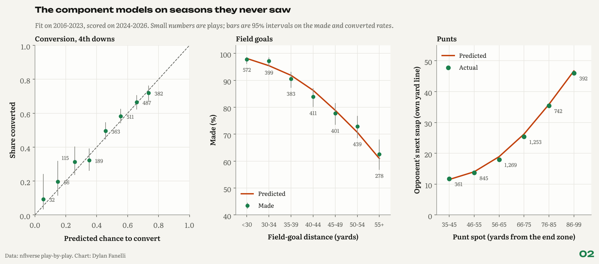
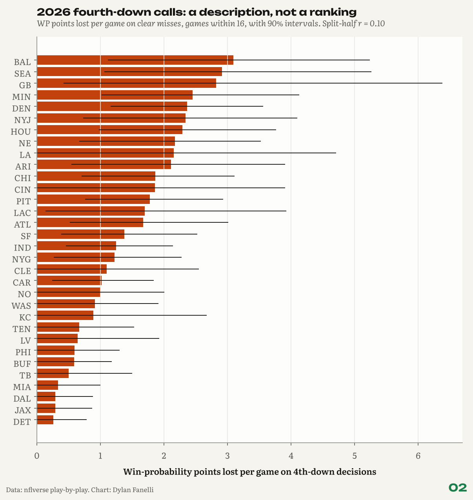

<sub>[← Portfolio](../../README.md) &nbsp;|&nbsp; [← 01 Flag Audit](../01-flag-audit/) &nbsp;|&nbsp; [03 Sack Leverage →](../03-sack-leverage/)</sub>

# 02 Fourth-Down Bot
### How often do coaches go when the math says go?

     

**TL;DR**

- I built a win-probability model that comes close to nflfastR out of sample (Brier 0.1495 vs 0.1488 on 80,613 plays) and a fourth-down bot on top of it. Its conversion, field-goal and punt models, fit on 2016-2023, all beat the league average on 2024-2026, and a bot fit on those seasons alone changes 3.5% of the recommendations and leaves the go rate and every team on the card inside their intervals.
- Coaches now go for it in 63% of clear go spots, up from 43% in 2018. Only spots that stay go spots when the models are refit are counted. The held-out test caught an error in the punt model; before the fix these read 59% and 37%.
- The team card is a description, not a ranking: a team's lost win probability in odd weeks predicts its even weeks at r = 0.10, and 6 of 32 teams clear the league median this season.

<p align="center"></p>
<p align="center"><sub>Go rate when going adds 2+ win-probability points.</sub></p>

## Key numbers

| Measure | Value |
|---|---|
| Brier score, my WP model (out of sample) | **0.1495** |
| Brier score, nflfastR (same plays) | **0.1488** |
| Agreement with nflfastR (r) | **0.993** |
| Test plays | **80,613** |
| Go rate in clear go spots, 2018 | **43%** |
| Go rate in clear go spots, 2025 | **63%** |
| Median standard error of the go-vs-kick margin (WP points) | **1.37** |
| 4th-down conversion Brier, held out 2024-2026 (league average) | **0.2238 (0.2479)** |
| Field-goal Brier, held out (league average) | **0.1147 (0.1288)** |
| Punt start RMSE in yards, held out (league average) | **10.1 (14.3)** |
| Recommendations that change with components fit on 2016-2023 only | **3.5% (3.1% to 3.9%)** |
| Team card, odd vs even weeks r | **0.10** |
| Team card, year-to-year r | **0.14** |
| Longest field goal the bot offers | **56 yards** |

## Why it matters for a club

- **Game day:** the same engine could produce a pregame go/kick chart by field position and distance for the head coach's call sheet.
- **Post-game review:** every fourth down graded against the best option, so the staff argues about inputs (our kicker, our short-yardage offense) rather than outcomes.
- **Front office:** the league-wide go rate is the solid number here. The team card is too noisy to judge a coach on one season.

## The question

**When the math says go for it on fourth down, how often do coaches go, and can the cost be pinned on a team?**

**Inspired by:** Brett Kollmann, [Are analytics ruining football?](https://www.youtube.com/watch?v=FOnQFk5qy-4) (judge the decision apart from the play), and Michael MacKelvie, [Passing is better...so, why run?](https://www.youtube.com/watch?v=pPXZlK9puqw) (coaches lag the math). Method follows the public idea of Ben Baldwin's [nfl4th](https://github.com/nflverse/nfl4th), rebuilt from scratch in Python.  

## Data

nflverse play-by-play 2006-2026.

## Results

### 1. The win-probability model comes close to nflfastR out of sample.

Trained on 2006-2023 and tested on 80,613 plays from 2024-25: Brier score 0.1495, against 0.1488 for nflfastR's spread-adjusted model on the same plays (lower is better). Mine is 0.0007 behind theirs. The two agree at r = 0.993. Calibration sits close to the 45-degree line.

<p align="center"></p>
<p align="center"><sub>Out-of-sample calibration of my win-probability model, 2024-25.</sub></p>

### 2. Coaches go for it far more than they used to.

In clear go spots (going adds 2+ win-probability points and still adds some when the models are refit, score within 16, outside the last 5 minutes), teams went 43% of the time in 2018 (95% interval 37% to 49%, 258 spots) and 63% in 2025 (57% to 68%, 342 spots). 2026 so far: 56% on 178 spots (48% to 63%), which overlaps the 2025 interval. The rise does not depend on the 2-point line: at a 1-point line the rate went from 26% to 44%, at 5 points from 48% to 72%.

### 3. How sure is the bot?

I refit the win-probability, conversion, field-goal and punt models on 30 resamples of games. The typical fourth down's go-versus-kick margin moves by 1.37 win-probability points (median standard error). 43% of calls that miss the best option by 1+ point still miss it in 95% of refits, and 61% of 2+ point go spots stay go spots. Only those are charged or counted.

### 4. All three component models beat the league average on seasons they never saw; 2 of 3 also beat a simple table (the fourth-down conversion model only ties it).

I fit the conversion, field-goal and punt models on 2016-2023 and scored them on 2024-2026 (2026 through Week 10), seasons the fit never saw. Intervals are 95%, from resampling whole games, and the model and its baselines are scored on the same resampled games. On 2,135 fourth-down tries the conversion model predicted 54.2% and 55.6% converted; its Brier score is 0.2238 (0.2176 to 0.2302), against 0.2479 for the league-average rate and 0.2249 for a distance-only table. On 2,883 field goals it predicted 84.8% made and 84.8% were; Brier 0.1147 (0.1075 to 0.1225), against 0.1288 and 0.1165. On 4,863 punts the opponent's start is off by 10.1 (9.6 to 10.5) yards (RMSE), against 14.3 for one league-average start and 11.0 for the average net punt from the spot; the model's average miss is -0.6 yards (-0.9 to -0.3). Inside the 55-yard range the bot offers, the field-goal model only ties the distance table. The table has every difference with its interval, and `holdout_calibration.csv` has predicted against actual by bin with counts.

**Held-out scores, fit on 2016-2023 and scored on 2024-2026.** Lower is better. The simple table is the training-season rate by distance (conversion and field goals) or the training-season average net punt from the spot. A difference whose interval stays below zero is a win for the model.

| Component (test plays) | Score | Model | League average | Simple table | Model minus league average | Model minus table |
|---|---|---|---|---|---|---|
| Conversion, 4th downs (2,135) | Brier | 0.2238 | 0.2479 | 0.2249 | -0.0240 (-0.0301 to -0.0179) | -0.0011 (-0.0035 to +0.0011) |
| Conversion, 4th downs (2,135) | Log loss | 0.6387 | 0.6889 | 0.6410 | -0.0502 (-0.0635 to -0.0360) | -0.0023 (-0.0078 to +0.0029) |
| Conversion, 3rd and 4th downs (19,951) | Brier | 0.2121 | 0.2432 | 0.2136 | -0.0311 (-0.0331 to -0.0291) | -0.0015 (-0.0021 to -0.0009) |
| Conversion, 3rd and 4th downs (19,951) | Log loss | 0.6102 | 0.6795 | 0.6144 | -0.0693 (-0.0738 to -0.0646) | -0.0042 (-0.0056 to -0.0027) |
| Field goal, all attempts (2,883) | Brier | 0.1147 | 0.1288 | 0.1165 | -0.0142 (-0.0179 to -0.0106) | -0.0019 (-0.0032 to -0.0006) |
| Field goal, all attempts (2,883) | Log loss | 0.3687 | 0.4260 | 0.3733 | -0.0573 (-0.0694 to -0.0455) | -0.0046 (-0.0081 to -0.0010) |
| Field goal, 55 yards and in (2,654) | Brier | 0.1051 | 0.1154 | 0.1057 | -0.0103 (-0.0132 to -0.0075) | -0.0006 (-0.0017 to +0.0004) |
| Field goal, 55 yards and in (2,654) | Log loss | 0.3450 | 0.3924 | 0.3471 | -0.0475 (-0.0583 to -0.0367) | -0.0022 (-0.0056 to +0.0011) |
| Punt, opponent's start (4,863) | RMSE, yards | 10.06 | 14.31 | 11.03 | -4.25 (-4.55 to -3.96) | -0.97 (-1.09 to -0.85) |

<p align="center"></p>
<p align="center"><sub>The conversion, field-goal and punt models on seasons they were not fit on: predicted against actual, with the number of plays in each bin.</sub></p>

### 5. Fit on the training seasons only, the bot changes 3.5% of its recommendations, and the headline numbers hold, though the top of the team card reorders.

I rebuilt the bot with the three component models and the field-goal range fit on 2016-2023 only, and rescored all 9,898 fourth downs of 2024-2026 (707 games). The recommendation changed on 349 of them, 3.5% (95% interval 3.1% to 3.9%); 322 are go against kick and 27 are field goal against punt. They are the close calls: the median go-versus-kick margin on a flipped call is 0.17 win-probability points, against 1.51 for all fourth downs, and 24 of the 4,102 calls with a margin of 2+ points flipped. Of the 1,238 calls the headline numbers are built from (clear go spots and charged misses), 1 flipped. Go rate in clear go spots, 2024: 62% with the production bot, 61% held out; 2025: 63% with the production bot, 62% held out; 2026: 56% with the production bot, 56% held out. Win probability lost per team-game on charged calls, production and held out, 2025: 1.39 and 1.37; 2026: 1.47 and 1.50. The 2026 team card correlates r = 0.917 between the two versions; the average team moves 0.25 points per game and the largest move is NYJ (2.34 to 1.50); the three teams that lose the most change from BAL, SEA, GB to BAL, DEN, HOU. By the rule I set before running it (a go rate outside its 95% interval, a team outside its 90% interval, or the two team cards correlating below 0.90), the headline numbers do not move. With the win-probability model also held to 2006-2023, 12.5% of recommendations change (11.8% to 13.2%). So the recommendations depend more on which seasons train the win-probability model than on which seasons train the three components. I have not rebuilt the go rate or the team card with every model held out.

### 6. The held-out test caught a punt model that was one number; fixing it moved the published numbers.

Until Nov. 15, 2026 a sign error in a monotone constraint made the punt model return the same opponent start, its own 24-yard line, from every punt spot. That is the league-average row in the table above: 14.3 yards of error against 10.1 for the corrected model. The correction changed the recommendation on 7.1% of the 33,184 fourth downs since 2018 (808 from punt to go, 1,483 from go to punt, 74 other). Graded the old way, with one league-average start for every punt, the go rate in clear go spots was 37% in 2018 and 59% in 2025 (366 and 464 spots); corrected it is 43% and 63%. The team card's odd-against-even r went from 0.16 to 0.10 and its year-to-year r from 0.29 to 0.14; the three most costly 2026 teams were BAL, NYG, DEN and are now BAL, SEA, GB. The go rate still rises and the team card is still mostly noise; the levels are what changed. Every other number on this page is from the corrected model.

### 7. 2026 team card (regular season): a description, not a ranking.

Most win probability lost per game on charged calls: BAL (3.1, 90% interval 1.1 to 5.2), SEA (2.9, 90% interval 1.1 to 5.3), GB (2.8, 90% interval 0.4 to 6.4). Least: DET (0.3, 90% interval 0.0 to 0.8), JAX (0.3, 90% interval 0.0 to 0.9), DAL (0.3, 90% interval 0.0 to 0.9). Does it repeat? Odd weeks against even weeks of the same season, r = 0.10 (256 team-seasons, 2018-2025); one season to the next, r = 0.14. That is mostly noise, so the card describes what happened and does not rank coaches. This season 6 of 32 teams have an interval that clears the league median.

<p align="center"></p>
<p align="center"><sub>Win-probability points lost per game on charged fourth-down calls, this season, with 90% intervals.</sub></p>

### 8. Sanity checks.

4th-and-1 at midfield, tied, early, even teams: going adds 1.0 WP points. 4th-and-10 at your own 20: going costs 8.7.

## How the bot works

- **Win probability:** gradient-boosted trees on score, clock, field position, down and distance, timeouts, the second-half kickoff and the point spread. Like nflfastR, the spread fades as the game goes on and a lead counts more late. Monotone constraints keep it football-logical (more points ahead never lowers WP).
- **Go:** P(convert) from every 3rd and 4th down since 2016, by distance, field position and the offense's pregame spread (a better offense converts more), x WP after a first down (median extra yards by distance), plus (1 - P) x WP with the opponent taking over at the spot.
- **Field goal:** make probability by distance, dome and season, then WP after +3 and a kickoff (season-average drive start) or after a miss (opponent at the spot of the kick or the 20). No kick longer than 56 yards is offered. That is the longest distance at which coaches still kick on at least a quarter of fourth downs; 357 of 11,308 attempts since 2016 were longer, and their make rate reflects strong legs and good conditions, not an average kicker.
- **Punt:** opponent's expected next start from the punt spot (never deeper for a punt from farther back), then WP.
- **Held-out test:** each component is fit on 2016-2023 and scored on 2024-2026. Conversion and field goals are scored by Brier score and log loss against the training seasons' league-average rate and a distance-only table of training rates; punts by root mean squared error against the training average start and the training average net punt (41.2 yards, touchback at the 20). The held-out bot uses those fits, the field-goal range from the training seasons (55 yards) and the same win-probability model, and is graded by the same refit rule.
- **Grading:** a call is charged only when it misses the best option by 1+ WP point and the miss survives the refits (finding 3).

**In equations**

- $`\text{WP}_{\text{go}} = P(\text{convert})\cdot \text{WP}(\text{first down}) + \big(1 - P(\text{convert})\big)\cdot \text{WP}(\text{opponent ball at the spot})`$
- $`\text{WP}_{\text{FG}} = P(\text{make})\cdot \text{WP}(+3,\ \text{kickoff}) + \big(1 - P(\text{make})\big)\cdot \text{WP}(\text{opponent ball after a miss})`$
- A call is charged $`\max_k \text{WP}_k - \text{WP}_{\text{call}}`$ only when that gap is at least 1 point and its 5th percentile across game-bootstrap refits is above zero. Brier score $`= \frac{1}{N}\sum_i (p_i - y_i)^2`$.

## Validation

- Trained on 2006-2023, tested on 80,613 plays from 2024-25: Brier 0.1495 vs nflfastR 0.1488 on the same rows; r = 0.993.
- Calibration plot under result 1: predicted vs actual win rate by bin, close to the 45-degree line.
- The conversion, field-goal and punt models are fit on 2016-2023 and scored on 2024-2026 (result 4): Brier score and log loss against the league-average rate and a distance-only table for the two probability models, RMSE against two baselines for punts, each with a 95% interval from resampling games. Calibration by bin with counts is in `holdout_calibration.csv` and the figure under result 4.
- A second bot built only from the 2016-2023 fits rescored every 2024-2026 fourth down (result 5): 3.5% of recommendations change, and the rule for whether the headline numbers move was written before the run.
- The win-probability, conversion, field-goal and punt models are refit on 30 resamples of games, so every recommendation carries a standard error.
- The team card is tested for repeatability before it is read: split-half r = 0.10, year-to-year r = 0.14.
- Football sanity checks: 4th-and-1 at midfield favors going (+1.0 WP), 4th-and-10 at your own 20 favors kicking (-8.7). The bot's arithmetic is unit-tested on a made-up model (`tests/test_logic.py`).
- Monotone constraints keep the model football-logical (a bigger lead never lowers WP).

## Limitations

- One average team: it knows the pregame spread, not a team's QB, kicker or short-yardage offense.
- The bot that grades 2018-2026 uses conversion, field-goal and punt models fit on all of 2016-2026, so it has seen the plays it grades. Findings 4 and 5 test the same models on seasons they had not seen; the published numbers still come from the all-seasons fit.
- The held-out test has three seasons, one of them partial (1,943 fourth downs in 2026). Fourth-down tries and field-goal attempts are the ones coaches chose, so the test covers the spots coaches try from, not every spot the bot scores.
- In the held-out bot the drive start after a kickoff is still each test season's own average, and the win-probability model is the production one (trained through 2025); the last line of finding 5 holds the win-probability model out too.
- The before-the-fix numbers in finding 6 are a regrade in the same run, with one league-average start for every punt in the bot and in each refit. They are not read from the earlier page.
- The extra yards gained on a conversion are a training-season median by distance, and the test seasons differ a little (2 yards to go: 4 in training, 3 in the test seasons; 3-4 yards to go: 5 in training, 4 in the test seasons).
- The refits vary the win-probability, conversion, field-goal and punt models. The field-goal range and the kickoff start are held fixed, so the true uncertainty is larger than finding 3 shows.
- Third downs feed the conversion model. Defenses play fourth down differently, which a 4th-down flag only partly covers.
- The production win-probability model is trained through 2025, so seasons through 2025 are scored in sample and only 2026 is out of sample. The 2024-25 test in finding 1 uses a separate model trained through 2023.
- No clock management beyond fixed play lengths, and fake punts count as "go".

## Next steps

- Team-specific inputs: the offense's short-yardage success and the kicker's range.
- Two-point decisions and end-of-half clock management.
- A one-page in-game chart per opponent.

## Reproduce

```bash
pip install -r requirements.txt
python -m projects.fourth_down_bot
```
Code: [`nflan/wp.py`](../../nflan/wp.py), [`nflan/fourth.py`](../../nflan/fourth.py), [`projects/fourth_down_bot.py`](../../projects/fourth_down_bot.py)

## Files in this folder

| File | What it holds |
|---|---|
| [`fourth_downs_scored.parquet`](fourth_downs_scored.parquet) | Every fourth down with WP for go, field goal and punt, and the refit standard errors |
| [`holdout_scores.csv`](holdout_scores.csv) | Held-out scores for the conversion, field-goal and punt models and their baselines, with 95% game-bootstrap intervals |
| [`holdout_calibration.csv`](holdout_calibration.csv) | Held-out calibration: predicted against actual by bin, with counts |
| [`holdout_fourth_downs.parquet`](holdout_fourth_downs.parquet) | Every test-season fourth down with the production and the training-seasons-only recommendation |
| [`holdout_team_card.csv`](holdout_team_card.csv) | The team card under both versions of the bot |
| [`team_scorecard.csv`](team_scorecard.csv) | WP points lost per game by team and season, with 90% intervals |
| [`go_rate_when_math_says_go.csv`](go_rate_when_math_says_go.csv) | Go rate in clear go spots by season, with spots and Wilson intervals |
| [`costliest_calls_current_season.csv`](costliest_calls_current_season.csv) | The current season's most expensive calls |
| [`wp_calibration_2024_2025.csv`](wp_calibration_2024_2025.csv) | Calibration bins for the out-of-sample test |
| [`kickoff_start_by_season.csv`](kickoff_start_by_season.csv) | Average drive start after a kickoff, used by the bot |
| [`model_summary.txt`](model_summary.txt) | Out-of-sample Brier scores, test plays and the field-goal range |
| [`findings.json`](findings.json) | Every number quoted on this page, machine-readable |

---
<sub>[← Portfolio](../../README.md) &nbsp;|&nbsp; [← 01 Flag Audit](../01-flag-audit/) &nbsp;|&nbsp; [03 Sack Leverage →](../03-sack-leverage/)</sub>

<sub>© 2026 Dylan Fanelli. All rights reserved. To cite: Fanelli, D. (2026). *Fourth-Down Bot*. NFL Analytics. https://github.com/IForSureI/NFL-Analytics/tree/main/reports/02-fourth-down-bot</sub>
