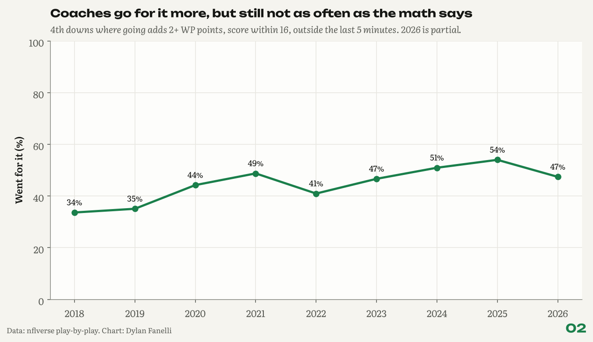
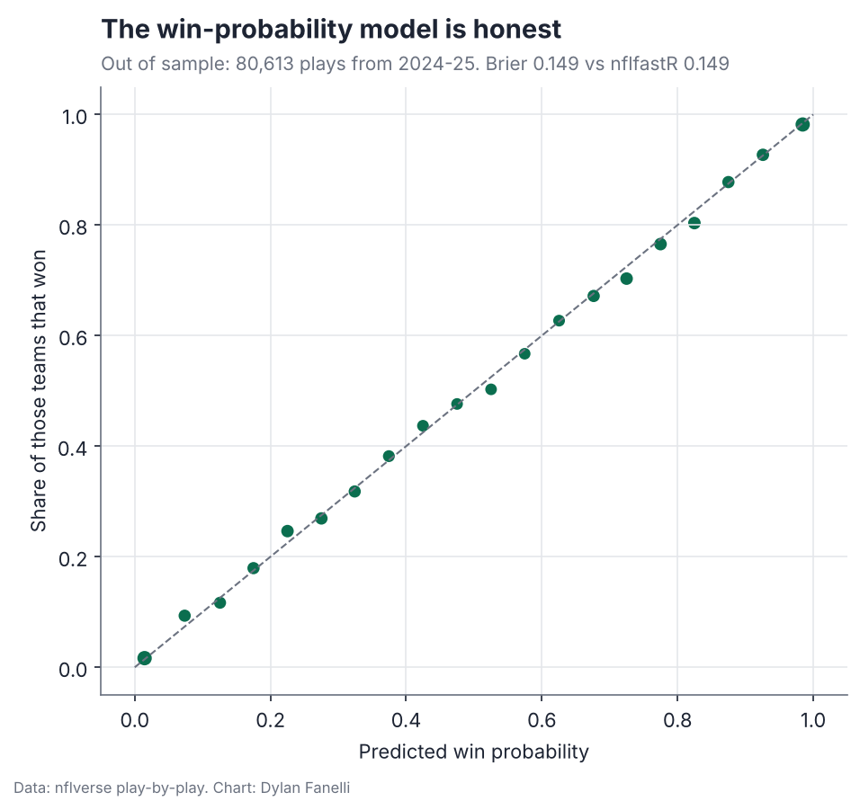
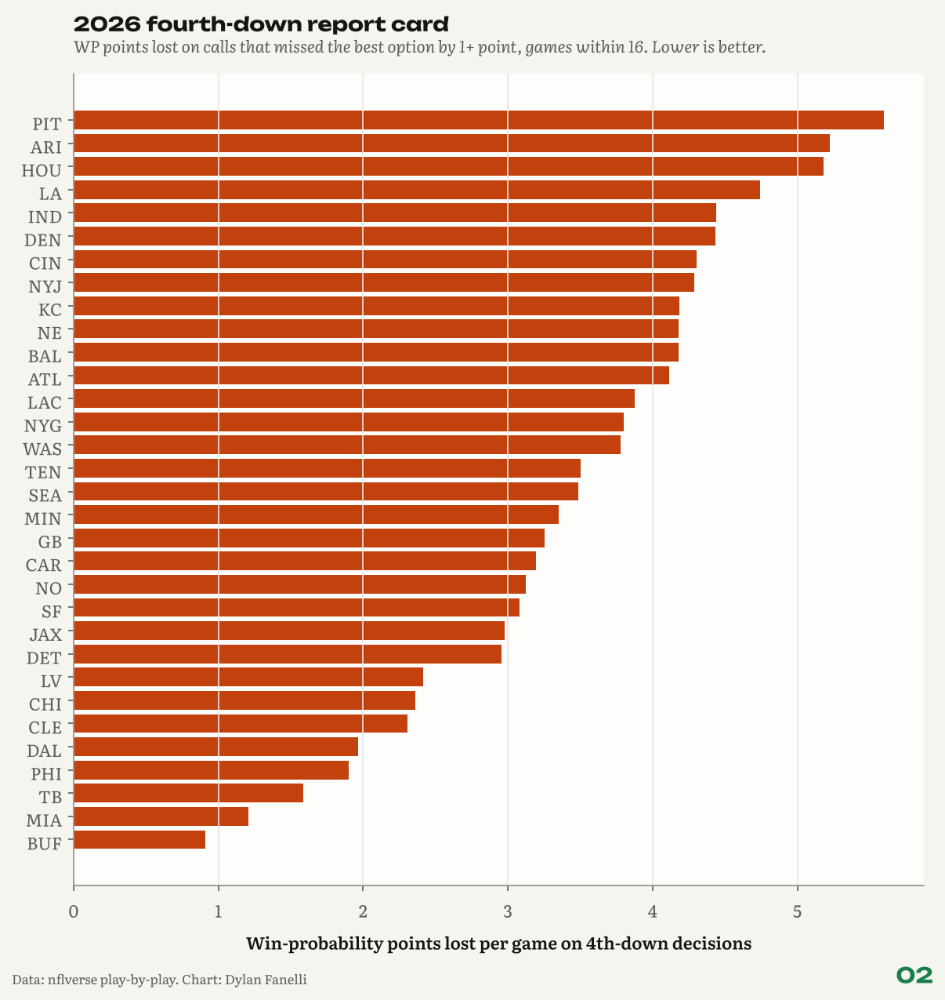

<sub>[← Portfolio](../../README.md) &nbsp;|&nbsp; [← 01 Flag Audit](../01-flag-audit/) &nbsp;|&nbsp; [03 Sack Leverage →](../03-sack-leverage/)</sub>

# 02 Fourth-Down Bot
### Who leaves wins on the table?

     

**TL;DR**

- I built a win-probability model that matches nflfastR out of sample (Brier 0.1495 vs 0.1488 on 80,613 plays) and a fourth-down bot on top of it.
- Coaches now go for it in 54% of clear go spots, up from 34% in 2018; there is still win probability left on the table.
- 2026 report card: PIT has lost the most per game on clear calls, BUF the least.

<p align="center"></p>
<p align="center"><sub>Go rate when going adds 2+ win-probability points.</sub></p>

## Key numbers

| Measure | Value |
|---|---|
| Brier score, my WP model (out of sample) | **0.1495** |
| Brier score, nflfastR (same plays) | **0.1488** |
| Agreement with nflfastR (r) | **0.993** |
| Test plays | **80,613** |
| Go rate in clear go spots, 2018 | **34%** |
| Go rate in clear go spots, 2025 | **54%** |

## Why it matters for a club

- **Game day:** the same engine could produce a pregame go/kick chart by field position and distance for the head coach's call sheet.
- **Post-game review:** every fourth down graded against the best option, so the staff argues about inputs (our kicker, our short-yardage offense) rather than outcomes.
- **Front office:** a running count of win probability lost to conservative calls, in wins, is a number ownership understands.

## The question

**When the math says go for it on fourth down, how often do coaches go, and which teams leave the most win probability on the table?**

**Inspired by:** Brett Kollmann, [Are analytics ruining football?](https://www.youtube.com/watch?v=FOnQFk5qy-4) (judge the decision apart from the play), and Michael MacKelvie, [Passing is better...so, why run?](https://www.youtube.com/watch?v=pPXZlK9puqw) (coaches lag the math). Method follows the public idea of Ben Baldwin's [nfl4th](https://github.com/nflverse/nfl4th), rebuilt from scratch in Python.  

## Data

nflverse play-by-play 2006-2026.

## Results

### 1. The win-probability model holds up out of sample.

Trained on 2006-2023 and tested on 80,613 plays from 2024-25: Brier score 0.1495, against 0.1488 for nflfastR's spread-adjusted model on the same plays (lower is better). The two agree at r = 0.993. Calibration sits close to the 45-degree line (most bins within 2 points).

<p align="center"></p>
<p align="center"><sub>Out-of-sample calibration of my win-probability model, 2024-25.</sub></p>

### 2. Coaches go for it far more than they used to, and still not enough.

In clear "go" spots (going adds 2+ win-probability points, score within 16, outside the last 5 minutes), teams went 34% of the time in 2018 and 54% in 2025. 2026 so far: 47%.

### 3. 2026 report card (regular season).

Most win probability lost per game on clear 4th-down calls: PIT (5.6 points), ARI (5.2), HOU (5.2). Least: BUF (0.9), MIA (1.2), TB (1.6). Totals add up small misses, so read them as a ranking, not an exact count of lost wins.

<p align="center"></p>
<p align="center"><sub>Win-probability points lost per game on clear fourth-down calls, this season.</sub></p>

### 4. Sanity checks pass.

4th-and-1 at midfield, tied, early, even teams: going adds 2.8 WP points. 4th-and-10 at your own 20: going costs 11.9.

## How the bot works

- **Win probability:** gradient-boosted trees on score, clock, field position, down and distance, timeouts, the second-half kickoff and the point spread. Like nflfastR, the spread fades as the game goes on and a lead counts more late. Monotone constraints keep it football-logical (more points ahead never lowers WP).
- **Go:** P(convert) from every 3rd and 4th down since 2016 x WP after a first down (median extra yards by distance), plus (1 - P) x WP with the opponent taking over at the spot.
- **Field goal:** make probability by distance, dome and season, then WP after +3 and a kickoff (season-average drive start) or after a miss (opponent at the spot of the kick or the 20).
- **Punt:** opponent's expected next start from the punt spot, then WP.
- **Grading:** only calls that miss the best option by 1+ WP point are charged, because smaller gaps sit inside the model's error.

**In equations**

- $`\text{WP}_{\text{go}} = P(\text{convert})\cdot \text{WP}(\text{first down}) + \big(1 - P(\text{convert})\big)\cdot \text{WP}(\text{opponent ball at the spot})`$
- $`\text{WP}_{\text{FG}} = P(\text{make})\cdot \text{WP}(+3,\ \text{kickoff}) + \big(1 - P(\text{make})\big)\cdot \text{WP}(\text{opponent ball after a miss})`$
- A call is charged $`\max_k \text{WP}_k - \text{WP}_{\text{call}}`$ only when that gap is at least 1 point. Brier score $`= \frac{1}{N}\sum_i (p_i - y_i)^2`$.

## Validation

- Trained on 2006-2023, tested on 80,613 plays from 2024-25: Brier 0.1495 vs nflfastR 0.1488 on the same rows; r = 0.993.
- Calibration plot under result 1: predicted vs actual win rate by bin, close to the 45-degree line.
- Football sanity checks run as unit tests: 4th-and-1 at midfield favors going (+2.8 WP), 4th-and-10 at your own 20 favors kicking (-11.9).
- Monotone constraints keep the model football-logical (a bigger lead never lowers WP).

## Limitations

- One average team: it does not know a team's QB, kicker, or short-yardage offense.
- Seasons through 2025 are scored with a model trained on them (in sample); 2026 is out of sample.
- Per-game totals add up many small misses graded by an average-team model, so they run higher than published fourth-down estimates; read the report card as a ranking.
- No clock management beyond fixed play lengths, and fake punts count as "go".

## Next steps

- Team-specific inputs: the offense's short-yardage success and the kicker's range.
- Two-point decisions and end-of-half clock management.
- A one-page in-game chart per opponent.

## Reproduce

```bash
pip install -r requirements.txt
python -m projects.fourth_down_bot
```
Code: [`nflan/wp.py`](../../nflan/wp.py), [`nflan/fourth.py`](../../nflan/fourth.py), [`projects/fourth_down_bot.py`](../../projects/fourth_down_bot.py)

## Files in this folder

| File | What it holds |
|---|---|
| [`fourth_downs_scored.parquet`](fourth_downs_scored.parquet) | Every fourth down with WP for go, field goal and punt |
| [`team_scorecard.csv`](team_scorecard.csv) | WP points lost per game by team, current season |
| [`go_rate_when_math_says_go.csv`](go_rate_when_math_says_go.csv) | Go rate in clear go spots by season |
| [`costliest_calls_current_season.csv`](costliest_calls_current_season.csv) | The current season's most expensive calls |
| [`wp_calibration_2024_2025.csv`](wp_calibration_2024_2025.csv) | Calibration bins for the out-of-sample test |
| [`kickoff_start_by_season.csv`](kickoff_start_by_season.csv) | Average drive start after a kickoff, used by the bot |
| [`model_summary.txt`](model_summary.txt) | Model settings and test scores |
| [`findings.json`](findings.json) | Every number quoted on this page, machine-readable |

---
<sub>[← Portfolio](../../README.md) &nbsp;|&nbsp; [← 01 Flag Audit](../01-flag-audit/) &nbsp;|&nbsp; [03 Sack Leverage →](../03-sack-leverage/)</sub>

<sub>© 2026 Dylan Fanelli. All rights reserved. To cite: Fanelli, D. (2026). *Fourth-Down Bot*. NFL Analytics. https://github.com/IForSureI/NFL-Analytics/tree/main/reports/02-fourth-down-bot</sub>
