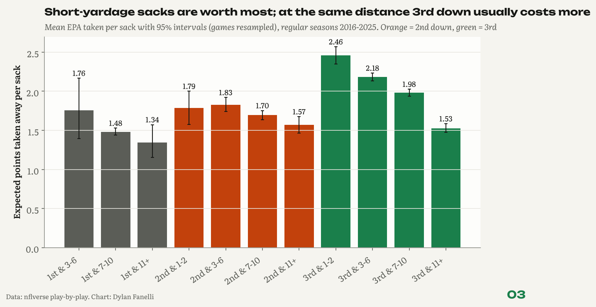
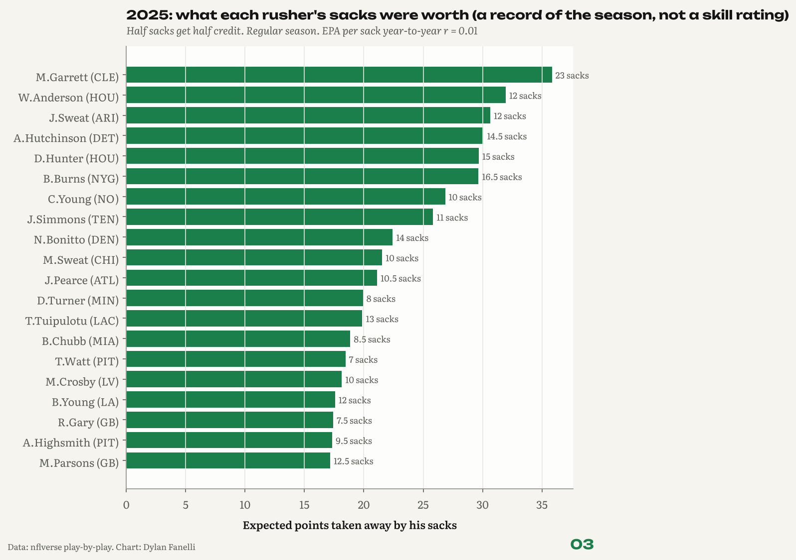

<sub>[← Portfolio](../../README.md) &nbsp;|&nbsp; [← 02 Fourth-Down Bot](../02-fourth-down-bot/) &nbsp;|&nbsp; [04 Luck Index →](../04-luck-index/)</sub>

# 03 Sack Leverage
### Not all sacks are created equal

     

**TL;DR**

- Distance decides a sack's worth: 3rd-and-1-2 takes 2.46 expected points, 3rd-and-11+ only 1.53. At the same distance a third-down sack costs more than a second-down sack except at 11+ yards (-0.04, interval -0.15 to +0.07).
- 82% of 2nd-down sacks leave 3rd-and-11 or longer, and the series survives only 21% of the time.
- EPA per sack does not repeat for a rusher (year-to-year r = 0.01, 95% interval -0.09 to 0.11), so the player board is a record of the season, not a skill rating.

<p align="center"></p>
<p align="center"><sub>Expected points taken away per sack, by down and distance, with 95% intervals.</sub></p>

## Key numbers

| Measure | Value |
|---|---|
| Average 3rd-down sack / 2nd-down sack, EPA taken | **1.99 / 1.70** |
| 3rd minus 2nd down at 7-10 yards | **+0.29 (+0.21 to +0.36)** |
| 3rd minus 2nd down at 11+ yards | **-0.04 (-0.15 to +0.07)** |
| 2nd-down sacks that leave 3rd-and-11+ | **82%** |
| Series still converted after a 2nd-down sack | **21%** |
| EPA per sack, year-to-year r (rushers) | **0.01 (-0.09 to 0.11)** |
| 3rd-and-1-2 conversion rate (2022-2025) | **63.9%** |

## Why it matters for a club

- **Defensive game planning:** a second-down sack ends most series because it leaves third-and-long. That is the value of the sack, not of calling pressure; whether a pressure call pays depends on what it gives up when it does not get home.
- **Pass-rush evaluation:** when a rusher's sacks came is not a skill that repeats, so judge him on pressures and sack counts (study 07), not on the leverage of last year's sacks.
- **Reviewing a season:** the board shows which sacks swung the most expected points, which is useful for telling the story of a season.

## The question

**Are all sacks equal, or does the down and distance decide how much a sack is worth?**

**Inspired by:** Brett Kollmann, [Not all sacks are created equal.](https://www.youtube.com/watch?v=o6q1dd0mI8Q). He used PFF data; this rebuilds his table with public play-by-play, tests his second-down point at matched distances, and checks whether a rusher's value per sack repeats.  

## Data

nflverse play-by-play, regular seasons 2016 to now.

## Results

### 1. His 3rd-down table roughly replicates.

3rd-down conversion (first down or touchdown), 2022-2025: 1-2 yards 63.9%, 3-6 45.9%, 7-10 32.1%, 11+ 15.9% (Kollmann, from PFF: 62.8, 46.8, 34.4, 16.3). The closest bucket is within a point; 7-10 yards is about two points lower here.

### 2. Distance decides a sack's worth, and at the same distance third down usually costs more.

Expected points taken per sack (12,558 sacks): 3rd-and-1-2 2.46, 3rd-and-3-6 2.18, 3rd-and-7-10 1.98, 3rd-and-11+ 1.53; 2nd-and-1-2 1.79, 2nd-and-3-6 1.83, 2nd-and-7-10 1.7, 2nd-and-11+ 1.57. Third down minus second down at the same distance: +0.67 at 1-2 yards (95% interval +0.43 to +0.93), +0.36 at 3-6 (+0.25 to +0.46), +0.29 at 7-10 (+0.21 to +0.36), -0.04 at 11+ (-0.15 to +0.07). The average third-down sack takes 1.99 points and the average second-down sack 1.70. The one place a second-down sack matches a third-down sack is third-and-long, where the offense was unlikely to convert anyway.

### 3. Why a 2nd-down sack still hurts: it usually ends the series.

82% of 2nd-down sacks leave 3rd-and-11 or longer. The offense extends the series 21% of the time after a 2nd-down sack, vs 46% after other 2nd-down dropbacks that also failed to convert.

### 4. EPA per sack is not a repeatable trait of the rusher.

For rushers with 5+ sacks in back-to-back seasons (387 pairs), EPA per sack repeats at r = 0.01 (95% interval -0.09 to 0.11); odd weeks against even weeks inside a season, r = 0.12. Sack counts repeat at r = 0.33 for the same players. So the board below records what happened in 2025; it does not rate a rusher's skill at picking his spots, and it should not move a contract number.

### 5. 2025 sacks by value (descriptive).

Top five by expected points taken: M.Garrett (23 sacks, 35.8 EPA), W.Anderson (12 sacks, 31.9 EPA), J.Sweat (12 sacks, 30.7 EPA), A.Hutchinson (14.5 sacks, 30.1 EPA), D.Hunter (15 sacks, 29.7 EPA). Largest gaps between sack rank and value rank: T.Watt (#35 in sacks, #15 in value), D.Turner (#25 in sacks, #12 in value), A.Van Ginkel (#35 in sacks, #23 in value).

<p align="center"></p>
<p align="center"><sub>Expected points taken by each rusher's sacks, last full season.</sub></p>

## Method

- Sacks are dropbacks with `sack == 1`; value is the negative of nflfastR EPA on the play.
- Half sacks get half credit. Boards: 6+ sacks for a full season, 3+ for the season in progress.
- Intervals on the down-and-distance table resample games 1,000 times. Stability intervals resample rushers 2,000 times.
- Series success is nflfastR's `series_success` (the series earned a first down or scored a touchdown; field goals count as failures).

**In equations**

- Value of a sack $`= -\text{EPA}_{\text{play}}`$ (nflfastR expected points), credited half and half on shared sacks.

## Validation

- Checked against Brett Kollmann's third-down conversion table (PFF data): 63.9/45.9/32.1/15.9% here vs his 62.8/46.8/34.4/16.3.
- Stability before value: EPA per sack year to year r = 0.01 (387 pairs), odd vs even weeks r = 0.12 (381 rusher-seasons).
- Down-and-distance intervals resample games, so sacks in the same game are not treated as independent.

## Limitations

- Sacks only. Pressures and hurries need charting (`was_pressure` exists from 2023 in nflverse participation data); that is the next version.
- EPA blames or credits the whole defense, not just the rusher who finished the play.
- No garbage-time filter: sacks in decided games count the same as sacks in close ones.

## Next steps

- Credit pressures, not only sacks, from nflverse participation data (2023 on).
- Split credit between the rusher who finished and the one who forced it.

## Reproduce

```bash
pip install -r requirements.txt
python -m projects.sack_leverage
```
Code: [`projects/sack_leverage.py`](../../projects/sack_leverage.py)

## Files in this folder

| File | What it holds |
|---|---|
| [`third_down_by_distance.csv`](third_down_by_distance.csv) | Third-down conversion and sack rate by distance |
| [`epa_lost_per_sack.csv`](epa_lost_per_sack.csv) | EPA taken per sack by down and distance, with 95% intervals |
| `pass_rusher_board_<season>.csv` | EPA taken by each rusher's sacks, last full season (descriptive) |
| [`pass_rusher_board_2025.csv`](pass_rusher_board_2025.csv) | EPA taken by each rusher's sacks, last full season (descriptive) |
| [`pass_rusher_board_2026.csv`](pass_rusher_board_2026.csv) | The same for the season in progress |
| [`findings.json`](findings.json) | Every number quoted on this page, machine-readable |

---
<sub>[← Portfolio](../../README.md) &nbsp;|&nbsp; [← 02 Fourth-Down Bot](../02-fourth-down-bot/) &nbsp;|&nbsp; [04 Luck Index →](../04-luck-index/)</sub>

<sub>© 2026 Dylan Fanelli. All rights reserved. To cite: Fanelli, D. (2026). *Sack Leverage*. NFL Analytics. https://github.com/IForSureI/NFL-Analytics/tree/main/reports/03-sack-leverage</sub>
