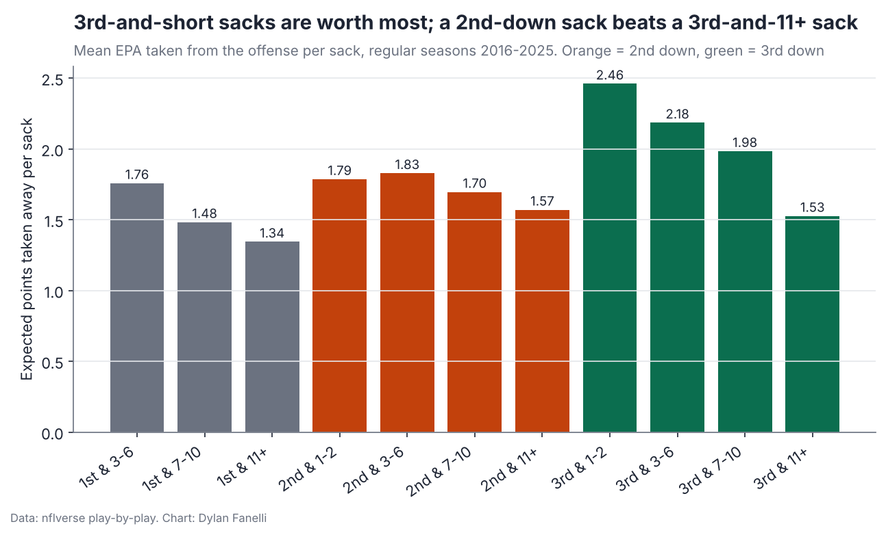
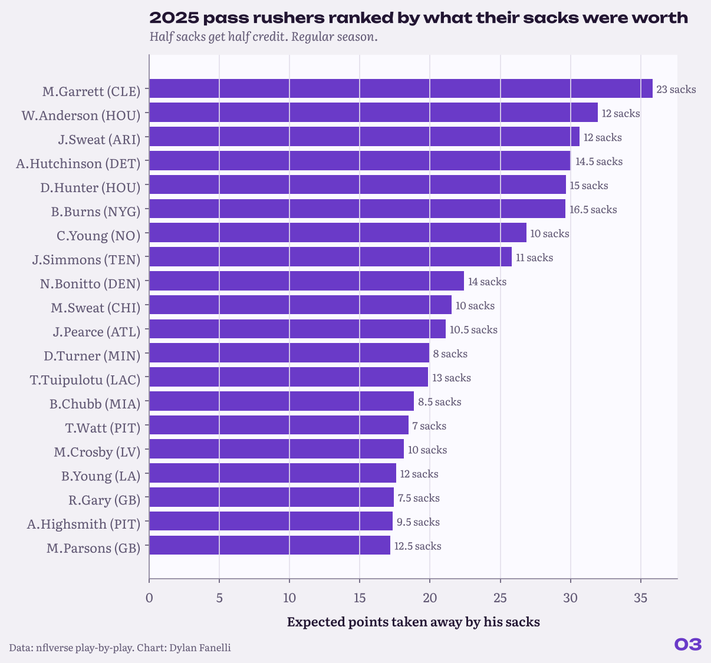

<sub>[← Portfolio](../../README.md) &nbsp;|&nbsp; [← 02 Fourth-Down Bot](../02-fourth-down-bot/) &nbsp;|&nbsp; [04 Luck Index →](../04-luck-index/)</sub>

# 03 Sack Leverage
### Not all sacks are created equal

    

> **TL;DR**
> - Down and distance decide a sack's worth: short 3rd-down sacks take the most (3rd-and-1-2: 2.46 expected points), and an average 2nd-down sack (1.70) beats a 3rd-and-11+ sack (1.53).
> - 82% of 2nd-down sacks leave 3rd-and-11 or longer, and the series survives only 21% of the time.
> - Brett Kollmann's third-down table replicates with public data (3rd-and-1-2 conversion 63.9% vs his 62.8%), and ranking rushers by value instead of sack count reorders the list.

<p align="center"></p>
<p align="center"><sub>Expected points taken away per sack, by down and distance.</sub></p>

## Key numbers

| Measure | Value |
|---|---|
| Average 2nd-down sack, EPA taken | **1.70** |
| 3rd-and-11+ sack, EPA taken | **1.53** |
| 2nd-down sacks that leave 3rd-and-11+ | **82%** |
| Series still converted after a 2nd-down sack | **21%** |
| 3rd-and-1-2 conversion rate (2022-2025) | **63.9%** |

## Why it matters for a club

- **Pass-rush evaluation:** rank rushers by the expected points their sacks took, not the count; it reorders the list.
- **Defensive game planning:** a second-down sack ends more drives than a long third-down sack. That is the value of the sack, not of calling pressure; whether a pressure call pays depends on what it gives up when it does not get home.
- **Free agency:** a sack total built on long third downs is worth less than it looks.

## The question

**Are all sacks equal, or does the down and distance decide how much a sack is worth?**

**Inspired by:** Brett Kollmann, [Not all sacks are created equal.](https://www.youtube.com/watch?v=o6q1dd0mI8Q). He used PFF data; this rebuilds his argument with public play-by-play and turns it into a player board.  

## Data

nflverse play-by-play, regular seasons 2016 to now.

## Results

### 1. His 3rd-down table replicates.

3rd-down conversion, 2022-2025: 1-2 yards 63.9%, 3-6 45.9%, 7-10 32.1%, 11+ 15.9% (Kollmann: 62.8, 46.8, 34.4, 16.3).

### 2. Which sacks are worth most.

Expected points taken per sack: 3rd-and-1-2 2.46, 3rd-and-3-6 2.18, 2nd-and-3-6 1.83, 2nd-and-7-10 1.7, 3rd-and-11+ only 1.53. Every 2nd-down bucket (1.57-1.83) is worth more than a 3rd-and-11+ sack.

### 3. Why: a 2nd-down sack kills the series.

82% of 2nd-down sacks leave 3rd-and-11 or longer. The offense extends the series 21% of the time after a 2nd-down sack, vs 46% after other 2nd-down dropbacks that also failed to convert.

### 4. 2025 pass rushers by value, not count.

Top five by expected points taken: M.Garrett (23 sacks, 35.8 EPA), W.Anderson (12 sacks, 31.9 EPA), J.Sweat (12 sacks, 30.7 EPA), A.Hutchinson (14.5 sacks, 30.1 EPA), D.Hunter (15 sacks, 29.7 EPA). Biggest risers vs the sack list: T.Watt (#35 in sacks, #15 in value), D.Turner (#25 in sacks, #12 in value), A.Van Ginkel (#35 in sacks, #23 in value).

<p align="center"></p>
<p align="center"><sub>Pass rushers ranked by expected points taken, not sack count.</sub></p>

## Method

- Sacks are dropbacks with `sack == 1`; value is the negative of nflfastR EPA on the play.
- Half sacks get half credit. Boards: 6+ sacks for a full season, 3+ for the season in progress.
- Series success is nflfastR's `series_success` (the series earned a first down or scored a touchdown; field goals count as failures).

**In equations**

- Value of a sack $`= -\text{EPA}_{\text{play}}`$ (nflfastR expected points), credited half and half on shared sacks.

## Validation

- Replicates Brett Kollmann's third-down conversion table from PFF data with public play-by-play: 63.9/45.9/32.1/15.9% vs his 62.8/46.8/34.4/16.3.
- A unit test checks that conversion falls as distance grows.

## Limitations

- Sacks only. Pressures and hurries need charting (`was_pressure` exists from 2023 in nflverse participation data); that is the next version.
- EPA blames or credits the whole defense, not just the rusher who finished the play.

## Next steps

- Credit pressures, not only sacks, from nflverse participation data (2023 on).
- Split credit between the rusher who finished and the one who forced it.

## Reproduce

```bash
pip install -r requirements.txt
python -m projects.sack_leverage
```
Code: [`projects/sack_leverage.py`](../../projects/sack_leverage.py)

## Files in this folder

| File | What it holds |
|---|---|
| [`third_down_by_distance.csv`](third_down_by_distance.csv) | Third-down conversion and sack rate by distance |
| [`epa_lost_per_sack.csv`](epa_lost_per_sack.csv) | EPA taken per sack by down and distance |
| `pass_rusher_board_<season>.csv` | Rushers ranked by EPA taken, last full season |
| [`pass_rusher_board_2025.csv`](pass_rusher_board_2025.csv) | Rushers ranked by EPA taken, last full season |
| [`pass_rusher_board_2026.csv`](pass_rusher_board_2026.csv) | The same for the season in progress |
| [`findings.json`](findings.json) | Every number quoted on this page, machine-readable |

---
<sub>[← Portfolio](../../README.md) &nbsp;|&nbsp; [← 02 Fourth-Down Bot](../02-fourth-down-bot/) &nbsp;|&nbsp; [04 Luck Index →](../04-luck-index/)</sub>

<sub>© 2026 Dylan Fanelli. All rights reserved. To cite: Fanelli, D. (2026). *Sack Leverage*. NFL Analytics. https://github.com/IForSureI/NFL-Analytics/tree/main/reports/03-sack-leverage</sub>
