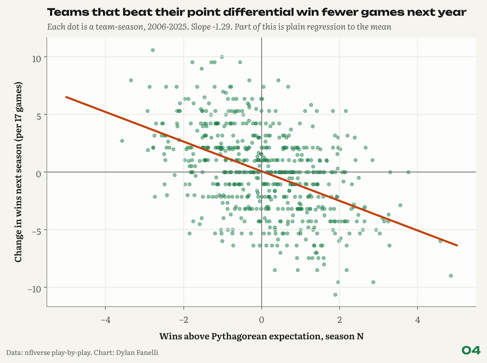
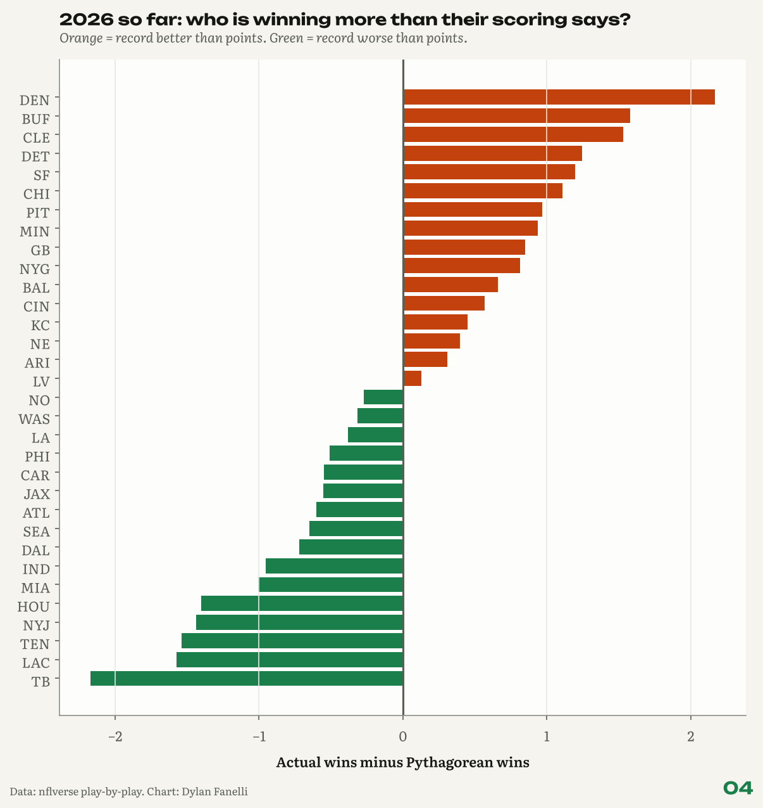

<sub>[← Portfolio](../../README.md) &nbsp;|&nbsp; [← 03 Sack Leverage](../03-sack-leverage/) &nbsp;|&nbsp; [05 Kickoff Value →](../05-kickoff-value/)</sub>

# 04 Luck Index
### How many wins does chance hand out?

    

**TL;DR**

- Fumble, field-goal and close-game luck do not repeat (year-to-year r = 0.04, 0.07, 0.06).
- Points predict next season a little better than record (r = 0.39 vs 0.35; gap 0.04, 95% interval 0.01 to 0.07).
- A win above what points predict is worth -0.02 wins next year (95% interval -0.18 to 0.15); a Pythagorean win is worth 0.49.

<p align="center"></p>
<p align="center"><sub>Wins above points this year vs change in wins next year.</sub></p>

## Key numbers

| Measure | Value |
|---|---|
| Fumble-recovery luck, year-to-year r | **0.04** |
| One-score record luck, year-to-year r | **0.06** |
| Next-year win %: r with Pythagorean win % | **0.39** |
| Next-year win %: r with actual win % | **0.35** |
| Next-year wins per Pythagorean win | **0.49 (0.38 to 0.57)** |
| Next-year wins per win above Pythagorean | **-0.02 (-0.18 to 0.15)** |
| Lucky teams vs same-record teams, next-year change | **-1.0 wins (-2.2 to +0.2)** |
| Unlucky teams vs same-record teams, next-year change | **+1.1 wins (-0.0 to +2.2)** |

## Why it matters for a club

- **Front office planning:** judge a season by points, not record, before extending a coach or buying at the deadline.
- **Projections:** start next year's win projection from Pythagorean wins.
- **Communication:** a simple, honest way to tell ownership how much of a record was the bounces.

## The question

**How many wins does chance hand out, and do lucky wins carry over to the next year?**

**Inspired by:** Michael MacKelvie, [We Measured "Luck" in the NFL. It's a BIG deal.](https://www.youtube.com/watch?v=Zfin10hS0YM), which builds on the NFL's own luck work (Tom Bliss).  

## Data

nflverse play-by-play, regular seasons 2006 to now.

## Results

### 1. Luck does not repeat.

Year-to-year correlation: fumble-recovery luck r = 0.04, opponent field-goal luck r = 0.07, one-score-game record r = 0.06, wins above Pythagorean r = 0.03.

### 2. Points predict next year a little better than wins do.

Next season's win % correlates r = 0.39 with this season's Pythagorean win % and r = 0.35 with actual win %. The gap is 0.04 (95% interval 0.01 to 0.07), small but above zero (608 team-season pairs, teams resampled 1,000 times).

### 3. Wins that points do not explain do not carry over.

In a regression of next year's wins on this year's Pythagorean wins and the wins above them, a Pythagorean win is worth 0.49 (95% interval 0.38 to 0.57) wins next year. A win above Pythagorean is worth -0.02 (95% interval -0.18 to 0.15), which is no different from zero.

### 4. The lucky fall back, mostly because every good record does.

Teams that won 2+ games more than their points said (44 of them) changed by -2.9 wins the next year (per 17 games); teams that far below (34) changed by +3.5. Against teams with the same record (within 1 win) whose record matched their points, the lucky fell 1.0 (95% interval -0.2 to 2.2) wins further and the unlucky rose 1.1 (95% interval -0.0 to 2.2) more. Both intervals include zero.

### 5. Which luck matters.

With Pythagorean wins held fixed, next year's wins move by -0.07 (95% interval -0.13 to 0.01) per extra fumble recovery, 0.01 (95% interval -0.04 to 0.05) per point of opponent field-goal luck, and -0.07 (95% interval -0.22 to 0.07) per one-score win above half. None is clearly different from zero, so none of them is a skill to pay for.

### 6. This season so far.

Above their points: DEN (7 wins, 4.8 expected), BUF (7 wins, 5.4 expected), CLE (5 wins, 3.5 expected). Below: TB (3 wins, 5.2 expected), LAC (0 wins, 1.6 expected), TEN (1 win, 2.5 expected).

<p align="center"></p>
<p align="center"><sub>This season: actual wins vs what points scored and allowed predict.</sub></p>

## Method

- **Pythagorean wins:** points for and against with exponent 2.37 (the usual NFL value).
- **Fumble luck:** fumbles recovered by the team in its games minus half of all fumbles in its games (a loose ball is close to a coin flip).
- **Field-goal luck:** points the opponent's kicker left short of a logistic make-probability model (distance, dome, season); positive = the opponent missed more than expected.
- **One-score luck:** wins in games decided by 8 or fewer minus half of those games.
- **Matched comparison:** each lucky team is compared with the teams within 1 win of its record (per 17 games) that finished within 1 win of their Pythagorean record.
- **Intervals:** 95%, from resampling the 32 teams with all their seasons 1,000 times.

**In equations**

- Pythagorean win % $`= \dfrac{PF^{2.37}}{PF^{2.37} + PA^{2.37}}`$
- Fumble luck $`=`$ fumbles recovered $`- \tfrac12 \times`$ all fumbles in the team's games; one-score luck $`=`$ one-score wins $`- \tfrac12 \times`$ one-score games.
- Carry-over test: $`W_{t+1} = a + b\,\text{Pyth}_t + c\,(W_t - \text{Pyth}_t)`$, wins per 17 games. Luck carries over only if $`c > 0`$.

## Validation

- Each luck type is tested for repeatability first: fumbles r = 0.04, field goals r = 0.07, one-score games r = 0.06.
- The fall-back is tested against teams with the same record, so regression to the mean is not counted as luck. 95% intervals resample teams 1,000 times.

## Limitations

- No dropped passes or dropped interceptions: public charting of drops starts in 2022 (FTN), so the 20-year version leaves them out.
- The raw fall-back in finding 4 mixes luck with ordinary regression to the mean. The matched comparison separates them, and with 44 lucky and 34 unlucky teams its intervals are wide.
- Fumble luck treats every loose ball as a coin flip. Recovery odds differ by fumble type, which this version ignores.
- Intervals resample teams, not seasons, so a league-wide shock in one year is not covered.

## Next steps

- Add drops and dropped interceptions (FTN charting, 2022 on).
- A weekly luck-adjusted standings table in season.

## Reproduce

```bash
pip install -r requirements.txt
python -m projects.luck_index
```
Code: [`projects/luck_index.py`](../../projects/luck_index.py)

## Files in this folder

| File | What it holds |
|---|---|
| [`team_season_luck.csv`](team_season_luck.csv) | Every team-season with each luck component |
| `luck_<season>.csv` | The season in progress |
| [`luck_2026.csv`](luck_2026.csv) | The season in progress |
| [`findings.json`](findings.json) | Every number quoted on this page, machine-readable |

---
<sub>[← Portfolio](../../README.md) &nbsp;|&nbsp; [← 03 Sack Leverage](../03-sack-leverage/) &nbsp;|&nbsp; [05 Kickoff Value →](../05-kickoff-value/)</sub>

<sub>© 2026 Dylan Fanelli. All rights reserved. To cite: Fanelli, D. (2026). *Luck Index*. NFL Analytics. https://github.com/IForSureI/NFL-Analytics/tree/main/reports/04-luck-index</sub>
