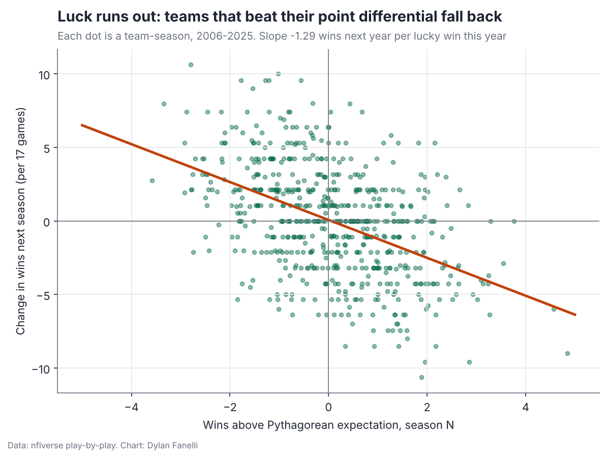
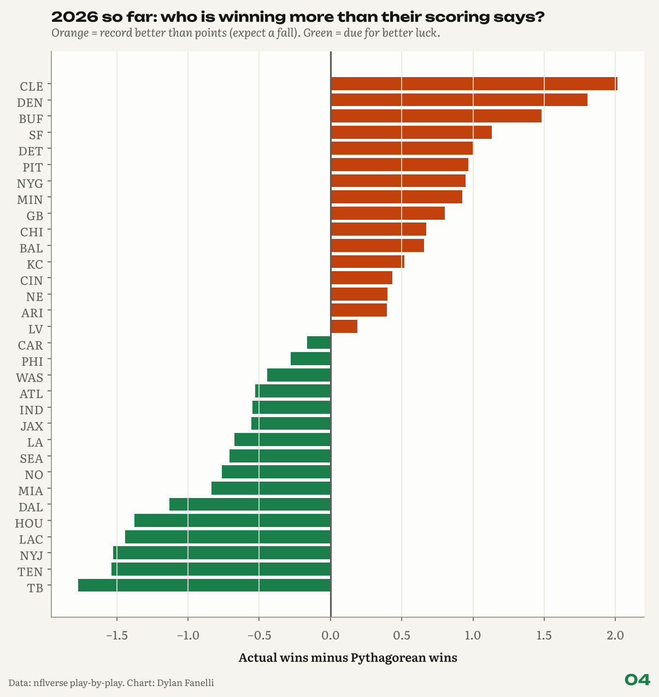

<sub>[← Portfolio](../../README.md) &nbsp;|&nbsp; [← 03 Sack Leverage](../03-sack-leverage/) &nbsp;|&nbsp; [05 Kickoff Value →](../05-kickoff-value/)</sub>

# 04 Luck Index
### How many wins does chance hand out?

    

> **TL;DR**
> - Fumble, field-goal and close-game luck do not repeat (year-to-year r = 0.04, 0.07, 0.06).
> - Points predict next season better than record (r = 0.39 vs 0.35).
> - Teams that won 2+ more games than their points said changed by -2.9 wins the next year; the unlucky ones by +3.5.

<p align="center"></p>
<p align="center"><sub>Wins above points this year vs change in wins next year.</sub></p>

## Key numbers

| Measure | Value |
|---|---|
| Fumble-recovery luck, year-to-year r | **0.04** |
| One-score record luck, year-to-year r | **0.06** |
| Next-year win %: r with Pythagorean win % | **0.39** |
| Next-year win %: r with actual win % | **0.35** |
| Teams 2+ wins over their points: next-year change | **-2.9 wins** |
| Teams 2+ wins under: next-year change | **+3.5 wins** |

## Why it matters for a club

- **Front office planning:** judge a season by points, not record, before extending a coach or buying at the deadline.
- **Projections:** start next year's win projection from Pythagorean wins.
- **Communication:** a simple, honest way to tell ownership how much of a record was the bounces.

## The question

**How many wins does chance hand out, and do the lucky teams fall back the next year?**

**Inspired by:** Michael MacKelvie, [We Measured "Luck" in the NFL. It's a BIG deal.](https://www.youtube.com/watch?v=Zfin10hS0YM), which builds on the NFL's own luck work (Tom Bliss).  

## Data

nflverse play-by-play, regular seasons 2006 to now.

## Results

### 1. Luck does not repeat.

Year-to-year correlation: fumble-recovery luck r = 0.04, opponent field-goal luck r = 0.07, one-score-game record r = 0.06, wins above Pythagorean r = 0.03.

### 2. Points predict next year better than wins do.

Next season's win % correlates r = 0.39 with this season's Pythagorean win % and r = 0.35 with actual win %.

### 3. The lucky fall back, the unlucky bounce.

Teams that won 2+ games more than their points said (44 of them) changed by -2.9 wins the next year (per 17 games). Teams 2+ games below (34) changed by +3.5.

### 4. This season so far.

Above their points: CLE (5 wins, 3.0 expected), DEN (6 wins, 4.2 expected), BUF (6 wins, 4.5 expected). Below: TB (3 wins, 4.8 expected), TEN (1 win, 2.5 expected), NYJ (2 wins, 3.5 expected).

<p align="center"></p>
<p align="center"><sub>This season: actual wins vs what points scored and allowed predict.</sub></p>

## Method

- **Pythagorean wins:** points for and against with exponent 2.37 (the usual NFL value).
- **Fumble luck:** fumbles recovered by the team in its games minus half of all fumbles in its games (a loose ball is close to a coin flip).
- **Field-goal luck:** points the opponent's kicker left short of a logistic make-probability model (distance, dome, season); positive = the opponent missed more than expected.
- **One-score luck:** wins in games decided by 8 or fewer minus half of those games.

**In equations**

- Pythagorean win % $= \dfrac{PF^{2.37}}{PF^{2.37} + PA^{2.37}}$
- Fumble luck $=$ fumbles recovered $- \tfrac12 \times$ all fumbles in the team's games; one-score luck $=$ one-score wins $- \tfrac12 \times$ one-score games.

## Validation

- Each luck type is tested for repeatability first: fumbles r = 0.04, field goals r = 0.07, one-score games r = 0.06.
- A unit test fails the build if any of these rises above 0.2.

## Limitations

- No dropped passes or dropped interceptions: public charting of drops starts in 2022 (FTN), so the 20-year version leaves them out.
- Part of the fall-back in finding 3 is ordinary regression in team quality, not only luck.

## Next steps

- Add drops and dropped interceptions (FTN charting, 2022 on).
- A weekly luck-adjusted standings table in season.

## Reproduce

```bash
pip install -r requirements.txt
python -m projects.luck_index
```
Code: [`projects/luck_index.py`](../../projects/luck_index.py)

## Files in this folder

| File | What it holds |
|---|---|
| [`team_season_luck.csv`](team_season_luck.csv) | Every team-season with each luck component |
| `luck_<season>.csv` | The season in progress |
| [`luck_2026.csv`](luck_2026.csv) | The season in progress |
| [`findings.json`](findings.json) | Every number quoted on this page, machine-readable |

---
<sub>[← Portfolio](../../README.md) &nbsp;|&nbsp; [← 03 Sack Leverage](../03-sack-leverage/) &nbsp;|&nbsp; [05 Kickoff Value →](../05-kickoff-value/)</sub>

<sub>© 2026 Dylan Fanelli. All rights reserved. To cite: Fanelli, D. (2026). *Luck Index*. NFL Analytics. https://github.com/IForSureI/NFL-Analytics/tree/main/reports/04-luck-index</sub>
