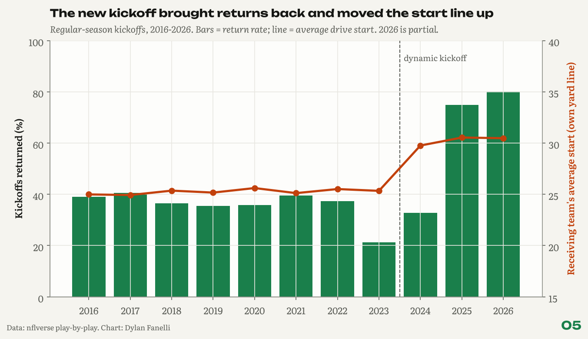
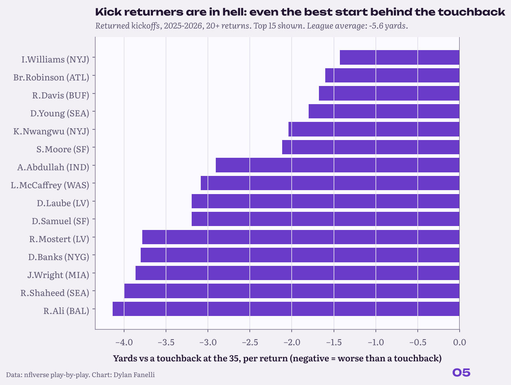

<sub>[← Portfolio](../../README.md) &nbsp;|&nbsp; [← 04 Luck Index](../04-luck-index/) &nbsp;|&nbsp; [06 Pass vs Run →](../06-pass-run/)</sub>

# 05 Kickoff Value
### The new kickoff, kickers and returners

    

**TL;DR**

- The new kickoff brought returns back: 21% of kickoffs returned in 2023, 75% in 2025.
- Drives start 5.2 yards further up than in 2023, but the average return still lands 5.6 yards behind a touchback.
- Kickers now create field position: J.Karty holds opponents 10.2 yards short of the touchback spot on average (41 kickoffs, so a small sample).

<p align="center"></p>
<p align="center"><sub>Return rate and drive start by season, across the 2024 and 2025 rule changes.</sub></p>

## Key numbers

| Measure | Value |
|---|---|
| Kickoffs returned, 2023 | **21%** |
| Kickoffs returned, 2025 | **75%** |
| Average drive start, 2023 to 2025 | **own 25.3 to 30.5** |
| Average return vs a touchback (2025 on) | **-5.6 yards** |
| Best kicker: opponent start short of the touchback spot | **J.Karty, 10.2 yards (41 kickoffs)** |

## Why it matters for a club

- **Kicker evaluation:** kickoff placement is now worth yards; it belongs in the kicker grade next to field goals.
- **Roster spots:** a returner who lands behind the touchback spot is costing field position.
- **Special-teams scheme:** where to aim kickoffs, by kicker and coverage unit.

## The question

**What did the new kickoff rule do to field position, and who creates value under it?**

**Inspired by:** Brett Kollmann, [Kick Returners are in Absolute Hell.](https://www.youtube.com/watch?v=ELjLAp4eyic) and [Kickers are taking over the NFL.](https://www.youtube.com/watch?v=UufAB2UcVMw).  

## Data

nflverse play-by-play, regular seasons 2016-2026. The NFL adopted the dynamic kickoff in 2024 (touchback to the 30) and moved the touchback to the 35 in 2025.

## Results

### 1. Returns came back.

Return rate: 21% in 2023, 33% in 2024, 75% in 2025, 81% in 2026 so far.

### 2. Drives start about five yards further up.

Average start: own 25.3 in 2023, 29.8 in 2024, 30.5 in 2025. Expected points at the first snap rose from 1.11 to 1.38.

### 3. Returners are in hell, as Kollmann said.

Since 2025 the average return starts 5.6 yards behind where a touchback would have put the ball. Even the best returners (min. 20 returns) average behind it: I.Williams (NYJ, -1.4), Br.Robinson (ATL, -1.6), R.Davis (BUF, -1.7).

<p align="center"></p>
<p align="center"><sub>Returners since 2025: average start vs where a touchback would have put the ball.</sub></p>

### 4. Kickers now create value.

With returns forced, the kicker decides field position. Best since 2025 (opponent start vs the touchback, 40+ kicks): J.Karty (-10.2 yards, 41 kicks), R.Fitzgerald (-6.8 yards, 104 kicks), J.Myers (-6.4 yards, 141 kicks).

## Method

- The receiving team's first snap after each kickoff (merge on game and play order); return touchdowns and lost fumbles drop out.
- Touchback spot by rule year: own 25 through 2023, 30 in 2024, 35 from 2025.

**In equations**

- Yards vs touchback $`=`$ receiving team's first-snap yard line $`-`$ touchback spot for that rule year (25 through 2023, 30 in 2024, 35 from 2025).

## Validation

- Fair catches are not counted as returns. Kickoffs returned for a touchdown or lost on a fumble have no receiving-team first snap, so they drop out of the whole sample.
- The rule-year touchback spot is applied by season, so eras are compared on their own terms.

## Limitations

- Kicker value mixes hang time and coverage; play-by-play cannot split them.
- Return touchdowns are excluded from the yards-vs-touchback average.

## Next steps

- Separate hang time from coverage once public tracking allows it.
- A return-or-kneel decision model for returners.

## Reproduce

```bash
pip install -r requirements.txt
python -m projects.kickoff_value
```
Code: [`projects/kickoff_value.py`](../../projects/kickoff_value.py)

## Files in this folder

| File | What it holds |
|---|---|
| [`kickoffs_by_season.csv`](kickoffs_by_season.csv) | Kickoffs, touchback and return rates, drive start and EP by season |
| [`kickers_2025_on.csv`](kickers_2025_on.csv) | Kickers since 2025: opponent start vs the touchback |
| [`returners_2025_on.csv`](returners_2025_on.csv) | Returners since 2025: start vs the touchback |
| [`findings.json`](findings.json) | Every number quoted on this page, machine-readable |

---
<sub>[← Portfolio](../../README.md) &nbsp;|&nbsp; [← 04 Luck Index](../04-luck-index/) &nbsp;|&nbsp; [06 Pass vs Run →](../06-pass-run/)</sub>

<sub>© 2026 Dylan Fanelli. All rights reserved. To cite: Fanelli, D. (2026). *Kickoff Value*. NFL Analytics. https://github.com/IForSureI/NFL-Analytics/tree/main/reports/05-kickoff-value</sub>
