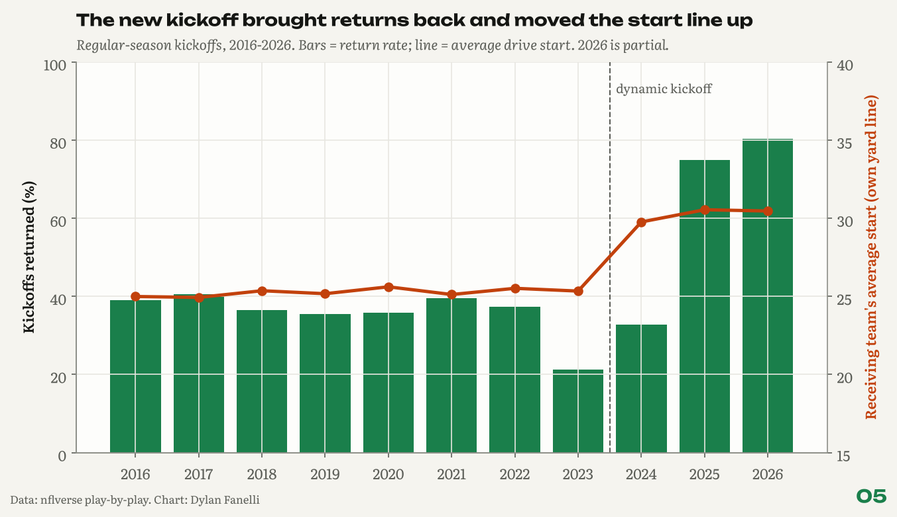
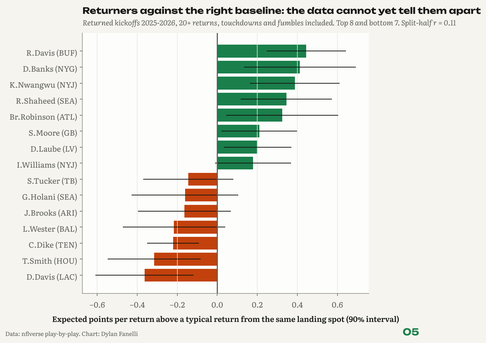

<sub>[← Portfolio](../../README.md) &nbsp;|&nbsp; [← 04 Luck Index](../04-luck-index/) &nbsp;|&nbsp; [06 Pass vs Run →](../06-pass-run/)</sub>

# 05 Kickoff Value
### The new kickoff, kickers and returners

     

**TL;DR**

- The new kickoff brought returns back: 21% of kickoffs returned in 2023, 75% in 2025, and drives start 5.2 yards further up.
- The average return lands 5.6 yards behind a touchback, but a returner cannot choose the touchback. Against a typical return from the same landing spot, returners cannot yet be told apart (split-half r = 0.11).
- Kickers show a small repeatable spread (split-half r = 0.26, about 0.035 expected points per kick), and 0 of 40 is clear of average after shrinkage.

<p align="center"></p>
<p align="center"><sub>Return rate and drive start by season, across the 2024 and 2025 rule changes.</sub></p>

## Key numbers

| Measure | Value |
|---|---|
| Kickoffs returned, 2023 / 2025 | **21% / 75%** |
| Average drive start, 2023 to 2025 | **own 25.3 to 30.5** |
| Average return vs a touchback (2025 on) | **-5.6 yards** |
| Returner value over expected, split-half r | **0.11 (58 returners)** |
| Kicker EPA allowed, split-half r | **0.26 (40 kickers)** |
| Kickers / returners clear of average | **0 of 40 / 10 of 58 (about 6 expected by chance)** |

## Why it matters for a club

- **Roster spots:** two seasons of the new rule do not yet separate one returner from another, so do not pay or cut on a return average alone.
- **Kicker evaluation:** kickoff placement shows a small repeatable effect; track it next to field goals, with its interval.
- **Special-teams scheme:** the value of a return by landing spot says where a kick is cheapest to give up.

## The question

**What did the new kickoff rule do to field position, and can kickers and returners be told apart under it?**

**Inspired by:** Brett Kollmann, [Kick Returners are in Absolute Hell.](https://www.youtube.com/watch?v=ELjLAp4eyic) and [Kickers are taking over the NFL.](https://www.youtube.com/watch?v=UufAB2UcVMw).  

## Data

nflverse play-by-play, regular seasons 2016-2026. The NFL adopted the dynamic kickoff in 2024 (touchback to the 30) and moved the touchback to the 35 in 2025.

## Results

### 1. Returns came back.

Return rate: 21% in 2023, 33% in 2024, 75% in 2025, 80% in 2026 so far.

### 2. Drives start about five yards further up.

Average start: own 25.3 in 2023, 29.8 in 2024, 30.5 in 2025. Expected points at the first snap rose from 1.11 to 1.38.

### 3. Returns start behind the touchback, but that is the rule, not the returner.

Since 2025 the average return starts 5.6 yards behind the touchback spot. A ball that lands in the landing zone has to be returned, so the returner cannot choose the 35. The fair baseline is a typical return from where the ball came down: worth +0.02 expected points from the end zone, +0.20 from the 1-5, +0.25 from the 6-10, +0.28 from the 11-15 and +0.58 from the 16-20 (touchback: +0.34).

### 4. Against that baseline the data cannot yet tell returners apart.

3,166 returns in 2025-2026, with the 7 return touchdowns and 22 lost fumbles included. For returners with 20+ returns (58), value per return over expected has a split-half r of 0.11, and the estimated true spread between returners is 0.00 points per return. 10 of 58 have a 90% interval that excludes zero; about 6 would by chance. The top of the raw list (R.Davis (BUF, +0.44 ± 0.20 on 40 returns), D.Banks (NYG, +0.41 ± 0.28 on 20 returns), K.Nwangwu (NYJ, +0.39 ± 0.22 on 31 returns)) is a list of results, not of proven skill.

<p align="center"></p>
<p align="center"><sub>Returners since 2025: expected points per return above a typical return from the same landing spot, with 90% intervals.</sub></p>

### 5. Kickers show a small, real spread, and no one is clear of average yet.

Expected points allowed per kickoff, all outcomes, onside kicks and squibs removed (68 dropped): split-half r = 0.26 across 40 kickers, and the estimated true spread is 0.035 points per kick, about 3.0 points over an 85-kick season for a kicker one standard deviation better. After shrinking toward average, the best estimates are R.Fitzgerald (-0.043 ± 0.051, 112 kicks), J.Myers (-0.033 ± 0.049, 148 kicks), J.Karty (-0.024 ± 0.054, 45 kicks); 0 of 40 intervals exclude zero.

## Method

- **Season trends:** the receiving team's first snap after each kickoff (merge on game and play order). Touchback spot by rule year: own 25 through 2023, 30 in 2024, 35 from 2025; the code raises an error for a season with no rule entered.
- **Player value:** nflfastR EPA on the kickoff play from the receiving team's side, on kickoffs from the 35. Return touchdowns and lost fumbles stay in. Onside kicks, squibs and kicks recovered by the kicking team are removed.
- **Expected return value:** a gradient-boosted fit of EPA on the yard line where the ball came down (65 minus kick distance), minimum 150 returns per leaf.
- **Estimates:** empirical Bayes (normal-normal): each player's mean is shrunk by signal variance / (signal variance + play variance / n). When the estimated signal variance is zero, every player's estimate is the league average, which is the returner result here.
- **Split-half:** each player's odd-numbered plays against his even-numbered plays, in game order.

**In equations**

- Return value over expected $`= 	ext{EPA}_{	ext{kickoff}} - \widehat{E}[	ext{EPA} \mid 	ext{landing spot}]`$, receiving team's side, touchdowns and fumbles included.
- Shrunk estimate $`= \dfrac{\sigma^2_{	ext{true}}}{\sigma^2_{	ext{true}} + \sigma^2_{	ext{play}}/n}\,ar{x}`$.

## Validation

- Stability before value: split-half r = 0.11 for returners and 0.26 for kickers, so neither board is published as a ranking.
- Return touchdowns (7) and lost fumbles (22) are in the player sample; 68 onside kicks, squibs and kicking-team recoveries are out.
- The rule-year touchback spot is set for every season, and the code stops if a season has none.

## Limitations

- Kicker value mixes the kick, the coverage unit and the opponent's return team; play-by-play cannot split them.
- Two seasons of the current rule (one partial) is a small sample: a returner has 20 to 60 returns, and one touchdown moves his average a lot.
- The expected-value fit and the players it grades use the same returns.
- Landing spot is taken from the kick distance in the play-by-play, not from tracking data.

## Next steps

- Separate the kick from the coverage unit with tracking data or coverage-unit fixed effects.
- Re-run when the current rule has three full seasons.

## Reproduce

```bash
pip install -r requirements.txt
python -m projects.kickoff_value
```
Code: [`projects/kickoff_value.py`](../../projects/kickoff_value.py)

## Files in this folder

| File | What it holds |
|---|---|
| [`kickoffs_by_season.csv`](kickoffs_by_season.csv) | Kickoffs, touchback and return rates, drive start and EP by season |
| [`return_value_by_landing_spot.csv`](return_value_by_landing_spot.csv) | What a return is worth by where the ball came down |
| [`kickers_2025_on.csv`](kickers_2025_on.csv) | Kickers since 2025: EPA allowed per kickoff vs average, raw and shrunk, with intervals |
| [`returners_2025_on.csv`](returners_2025_on.csv) | Returners since 2025: EPA per return over expected, with intervals |
| [`findings.json`](findings.json) | Every number quoted on this page, machine-readable |

---
<sub>[← Portfolio](../../README.md) &nbsp;|&nbsp; [← 04 Luck Index](../04-luck-index/) &nbsp;|&nbsp; [06 Pass vs Run →](../06-pass-run/)</sub>

<sub>© 2026 Dylan Fanelli. All rights reserved. To cite: Fanelli, D. (2026). *Kickoff Value*. NFL Analytics. https://github.com/IForSureI/NFL-Analytics/tree/main/reports/05-kickoff-value</sub>
