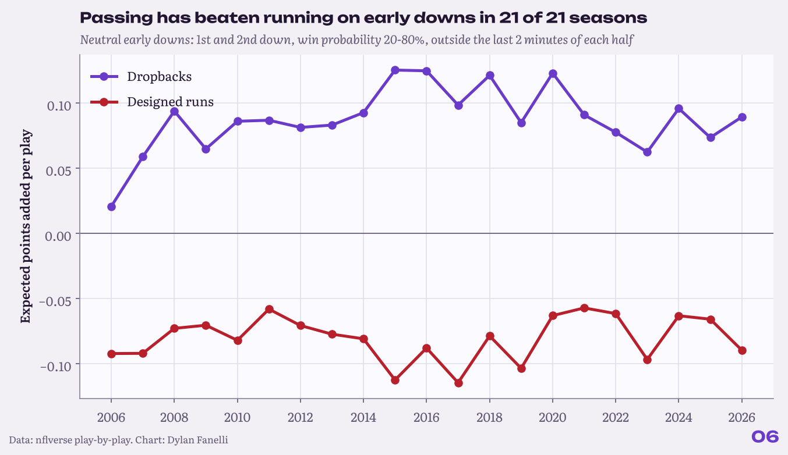
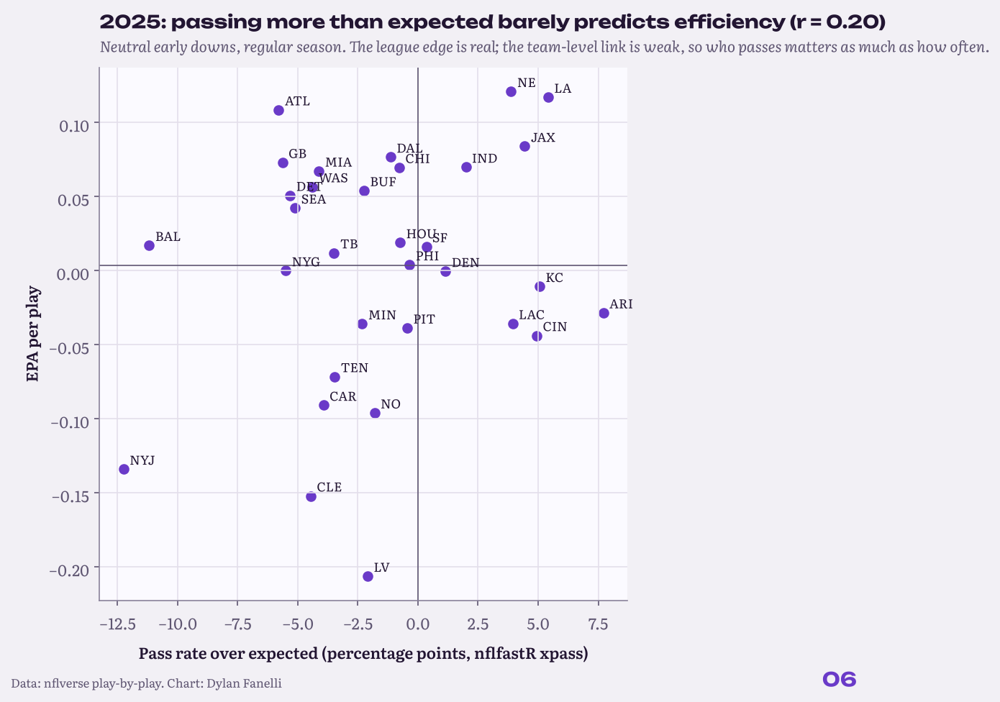

<sub>[← Portfolio](../../README.md) &nbsp;|&nbsp; [← 05 Kickoff Value](../05-kickoff-value/) &nbsp;|&nbsp; [07 The Box-Score Tax →](../07-box-score-tax/)</sub>

# 06 Pass vs Run
### Passing is better, so why run?

    

**TL;DR**

- Passing beat running on neutral early downs in 21 of 21 seasons.
- Teams moved slowly: early-down pass rate 48% to 52%.
- At team level, passing more tracks efficiency only at r = 0.20: the edge depends on the quarterback and line.

<p align="center"></p>
<p align="center"><sub>EPA per play on neutral early downs: dropbacks vs designed runs, by season.</sub></p>

## Key numbers

| Measure | Value |
|---|---|
| Seasons passing beat running (neutral early downs) | **21 of 21** |
| EPA per play gap, last full season | **0.14** |
| Pass rate, first to last full season | **48% to 52%** |
| Team pass rate over expected vs EPA (r) | **0.20** |

## Why it matters for a club

- **Offensive tendencies:** the league-wide edge for passing on early downs is real and stable.
- **Team-specific calls:** whether a team can cash it depends on its quarterback and line, so the answer is a personnel question, not a league average.
- **Opponent scouting:** pass rate over expected is a clean tendency number for the weekly packet.

## The question

**Passing has been more efficient for years. So why do teams still run, and does passing more make a team better?**

**Inspired by:** Michael MacKelvie, [Passing is better...so, why run?](https://www.youtube.com/watch?v=pPXZlK9puqw) and Brett Kollmann, [Does "establishing the run" even work?](https://www.youtube.com/watch?v=-W6orkJ_-Qg).  

## Data

nflverse play-by-play, regular seasons 2006-2026.

## Results

### 1. Passing beat running on neutral early downs in 21 of 21 seasons.

The gap in expected points per play ranged from 0.11 to 0.24; 2025 was 0.14. Success rate favored passing by 9.4 points in 2025.

### 2. Teams barely moved.

Neutral early-down pass rate went from 48% in 2006 to 52% in 2025.

### 3. But passing more is not a free lunch at team level.

In 2025, a team's pass rate over expected correlated only r = 0.20 with its EPA per play. The league edge is real; whether a given team can cash it depends on its QB and line. That is consistent with MacKelvie's game-theory point (the run keeps defenses honest), though this data cannot prove it.

<p align="center"></p>
<p align="center"><sub>Team pass rate over expected vs EPA per play, last full season.</sub></p>

## Method

- Neutral early downs: 1st and 2nd down, win probability 20-80%, more than 2 minutes left in the half; kneels, spikes and two-point tries removed.
- Dropbacks include sacks and scrambles (the true cost of calling a pass).
- Pass rate over expected uses nflfastR's `xpass` model.

**In equations**

- Pass rate over expected (PROE) $`=`$ actual dropback rate $`- \overline{\text{xpass}}`$, where xpass is nflfastR's dropback probability given the situation.

## Validation

- The pass edge holds in every season (21 of 21), so it is not one era.
- Dropbacks include sacks and scrambles, so passing is charged its true cost.

## Limitations

- EPA per play ignores sequencing (does a run set up play action later?). Kollmann's 2nd-down tendency idea is the next test.

## Next steps

- Sequencing: does an early run set up play action later (FTN charting, 2022 on)?
- Second-down run tendencies by personnel.

## Reproduce

```bash
pip install -r requirements.txt
python -m projects.pass_run
```
Code: [`projects/pass_run.py`](../../projects/pass_run.py)

## Files in this folder

| File | What it holds |
|---|---|
| [`neutral_early_downs_by_season.csv`](neutral_early_downs_by_season.csv) | Plays, EPA, success rate and pass rate by season |
| [`team_proe_vs_epa.csv`](team_proe_vs_epa.csv) | Team PROE and EPA per play, last full season |
| [`findings.json`](findings.json) | Every number quoted on this page, machine-readable |

---
<sub>[← Portfolio](../../README.md) &nbsp;|&nbsp; [← 05 Kickoff Value](../05-kickoff-value/) &nbsp;|&nbsp; [07 The Box-Score Tax →](../07-box-score-tax/)</sub>

<sub>© 2026 Dylan Fanelli. All rights reserved. To cite: Fanelli, D. (2026). *Pass vs Run*. NFL Analytics. https://github.com/IForSureI/NFL-Analytics/tree/main/reports/06-pass-run</sub>
