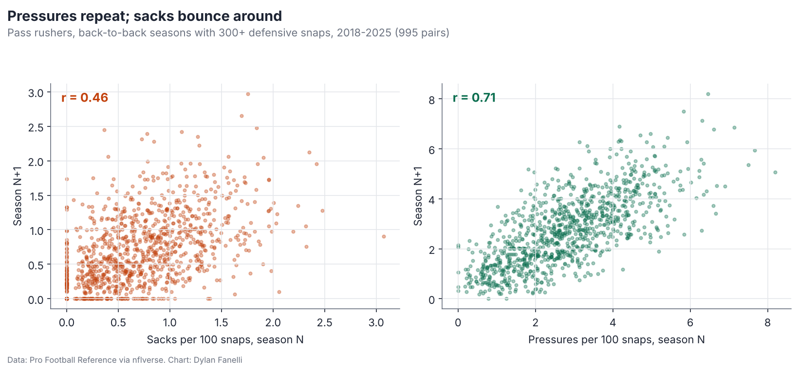
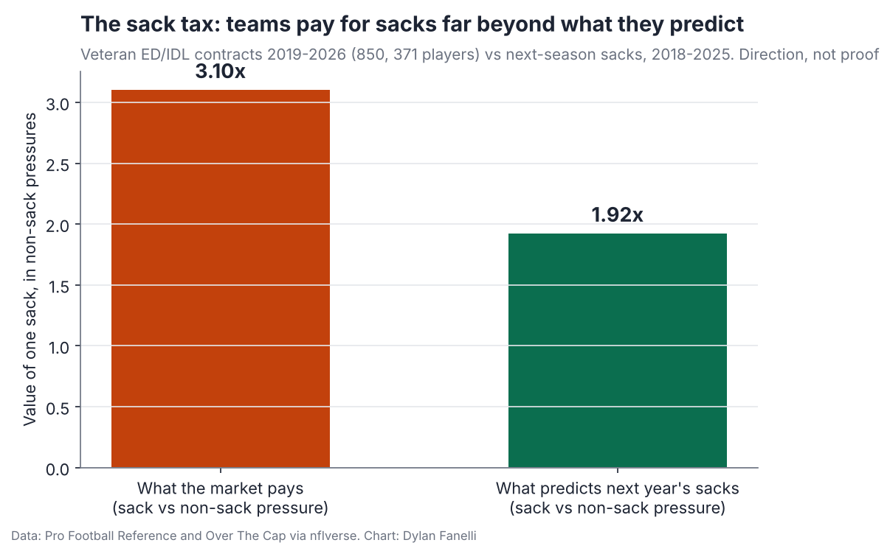
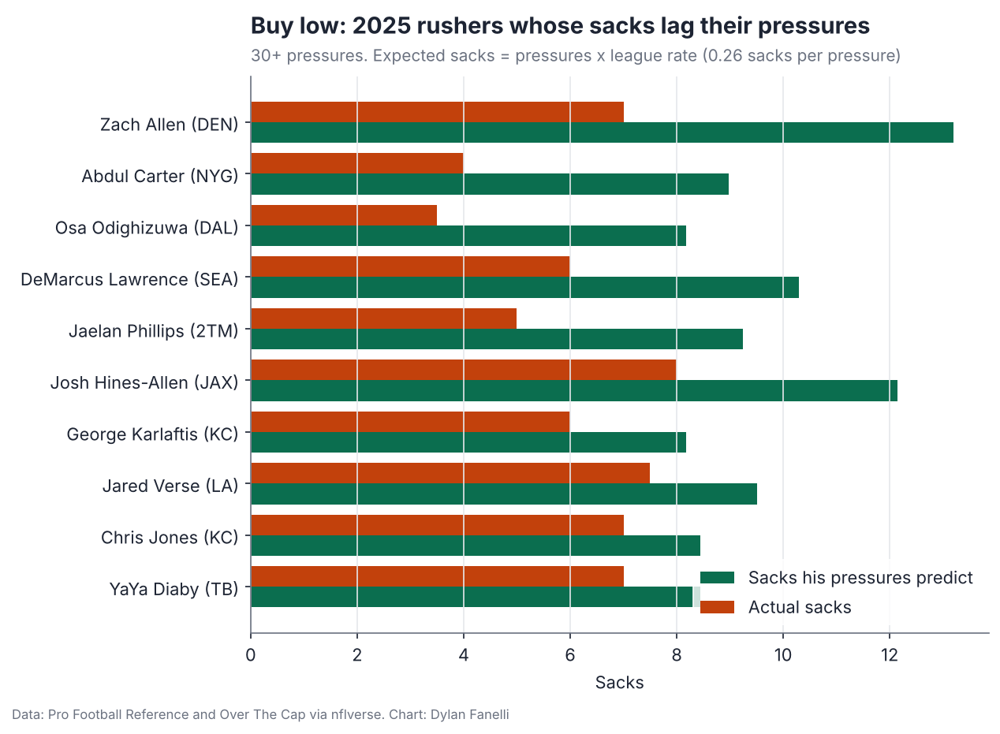
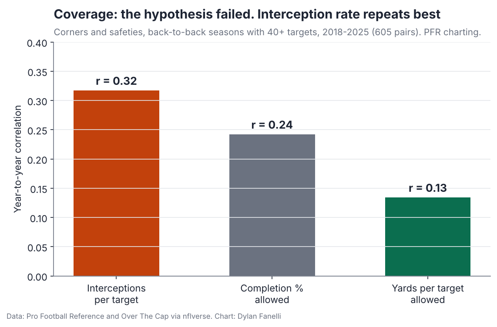

# 07 The Box-Score Tax: NFL teams pay for the stats that don't repeat

**The question:** where is value hiding that people aren't looking at? My bet: in the gap between what a stat says about the past and what it says about the future. Sacks are the headline pass-rush stat. They are also rare, so they are noisy. Pressures happen two to four times as often. If teams pay for sacks more than sacks predict, a team that shops by pressures buys the same future sacks for less.
**Data:** Pro Football Reference advanced defense (2018-2026), nflverse snap counts, and 850 veteran edge and interior DL contracts (371 players) from Over The Cap (signed 2019-2026), all via [nflverse](https://github.com/nflverse/nflverse-data). Dollars use the 2026 salary cap ($301.2M).
**Code:** [`projects/box_score_tax.py`](../../projects/box_score_tax.py). Prior work: PFF's Sam Monson made this argument in 2021 with player examples ([link](https://www.pff.com/news/nfl-teams-are-still-paying-for-sacks-in-free-agency-and-the-edge-defender-market-is-suffering-because-of-it)); this study puts a price on it with public data.

## What I found
1. **Pressures repeat; sacks bounce.** For pass rushers with 300+ snaps in back-to-back seasons (995 pairs), pressure rate repeats at r = 0.71, sack rate at r = 0.46. This year's pressure rate predicts next year's sack rate (r = 0.56) better than this year's sack rate does (r = 0.46).
2. **Teams pay full price for sack luck.** "Sack luck" means sacks above what a player's pressures predict (league rate: 0.26 sacks per pressure). It barely repeats (r = 0.10 year to year): holding pressures and snaps equal, one extra sack this year predicts only 0.16 extra sacks next year. Yet each one adds about **$0.62M a year** to a veteran contract (95% interval $0.29M to $0.94M, 2026 dollars, errors clustered by player). Per future sack, that is about **$3.92M** bought through sack luck vs **$2.14M** bought through pressures. The premium stays positive in all 6 versions in `robustness_lucky_sack_price.csv` ($0.36M to $0.78M: with age controls, edge or interior alone, multi-year deals, deals over 1% of the cap). One version is weaker and worth watching: for deals signed 2023-2026 it is $0.36M and not significant (interval -$0.10M to $0.82M), so the market may be starting to learn.
3. **The price gap.** In contracts, one sack is priced like 3.10 non-sack pressures. In predicting next season's sacks, one sack is worth 1.92. The 90% ranges overlap (market 1.94-5.18, prediction 1.26-2.71; the market ratio is higher in 92% of 1,000 bootstrap samples that resample players). Two more reasons to read this as direction, not proof: the prediction side includes linebackers with 15+ pressures while contracts are ED/IDL only, and a contract pays for several years and run defense, not only next year's sacks. Finding 2 is the firmer evidence.
4. **Buy low (2025).** Most pressure without the sacks: Zach Allen (DEN: 7 sacks on 50 pressures, 13.2 expected); Abdul Carter (NYG: 4 sacks on 34 pressures, 9.0 expected); Osa Odighizuwa (DAL: 3.5 sacks on 31 pressures, 8.2 expected); DeMarcus Lawrence (SEA: 6 sacks on 39 pressures, 10.3 expected).
5. **Regression risk (2025).** Most sacks above their pressures: Myles Garrett (CLE: 23 sacks on 53 pressures, 14.0 expected); Danielle Hunter (HOU: 15 sacks on 34 pressures, 9.0 expected); Brian Burns (NYG: 16.5 sacks on 41 pressures, 10.8 expected). Garrett's season set the single-season sack record, and elite rushers can beat the league rate; the point is that the excess over pressures is the part least likely to repeat, and the part a contract should pay least for.
6. **The 2027 free-agent rushers to target.** Contracts ending after 2026 (Over The Cap via nflverse), still active in 2026, ranked by 2025 pressure rate (rookie first-rounders with a fifth-year option left out): above-median pressure rate with fewer sacks than expected: Dante Fowler Jr. (ED, 20 pressures, 3 sacks), Khalil Mack (ED, 23 pressures, 5.5 sacks), YaYa Diaby (ED, 32 pressures, 7 sacks), Jihad Ward (ED, 27 pressures, 5 sacks), Jacob Martin (ED, 26 pressures, 5.5 sacks). Careful, sacks above pressures: Jadeveon Clowney (8.5 sacks on 22 pressures), Al-Quadin Muhammad (11 sacks on 26 pressures), Danielle Hunter (15 sacks on 34 pressures), Von Miller (9 sacks on 19 pressures).
7. **Coverage: the same idea failed, and that matters.** I expected interceptions to be the coverage version of sacks. In PFR's charting, interception rate repeats best (r = 0.32), above completion % allowed (r = 0.24) and yards per target allowed (r = 0.13). The market pays about $0.99M per platform-year interception. Public coverage stats are too noisy to call that a mistake, so I don't.

## Method
- **Traded players:** PFR lists a combined row plus one row per team; only the combined row is kept.
- **Pass rushers:** player-seasons with 300+ regular-season defensive snaps, listed DE/DT/DL/NT or with 15+ pressures (catches 3-4 outside linebackers). PFR pressures = sacks + hurries + knockdowns; "non-sack pressures" removes the sacks so the two are not double counted.
- **Contracts:** veteran deals only (rookie contracts dropped, duplicates removed), at least 0.4% of the cap, matched to the player's season right before signing. Pay is measured as APY as a share of that year's cap, so 2019 and 2026 deals compare fairly. Pay and prediction regressions cluster standard errors by player (many players sign several deals); full output in `models.txt`.
- **Like-for-like comparison:** the price ratio (sacks vs non-sack pressures in contracts) and the prediction ratio (sacks vs non-sack pressures in next season's sacks) both control for snaps.

## Limits
- Pressure charting is PFR's, which differs from PFF and NGS; all charting has judgment in it.
- Contracts reflect more than stats: age, injuries, scheme fit and run defense. The sack-luck result holds pressures and snaps fixed but not those.
- Free-agent status comes from Over The Cap via nflverse and can lag a new extension or a retirement. Check a player's status before acting.
- The platform season is the season before signing, which mis-times in-season extensions slightly.
- PFR's current-season file lags the snap counts, so player ratings use full seasons only.

## Files
`rusher_contracts_with_platform.csv`, `rusher_sack_luck_board.csv`, `free_agents_2027_rushers.csv`, `models.txt`, `findings.json`
