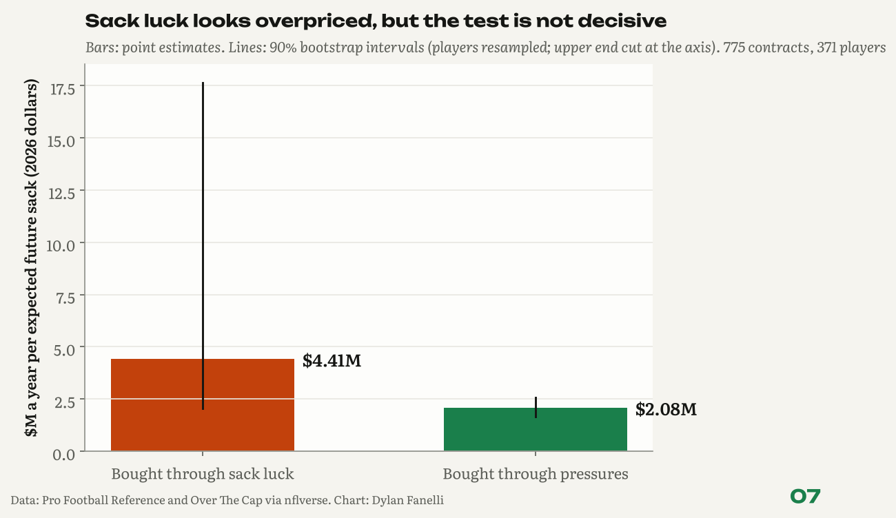
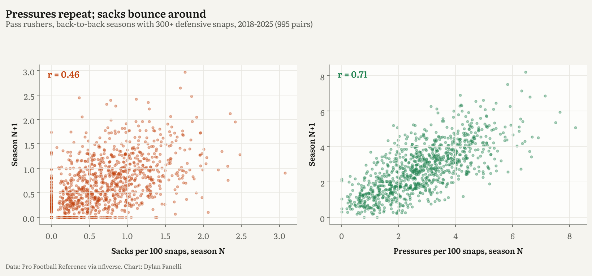
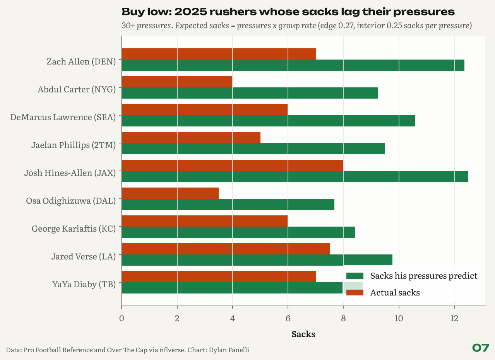
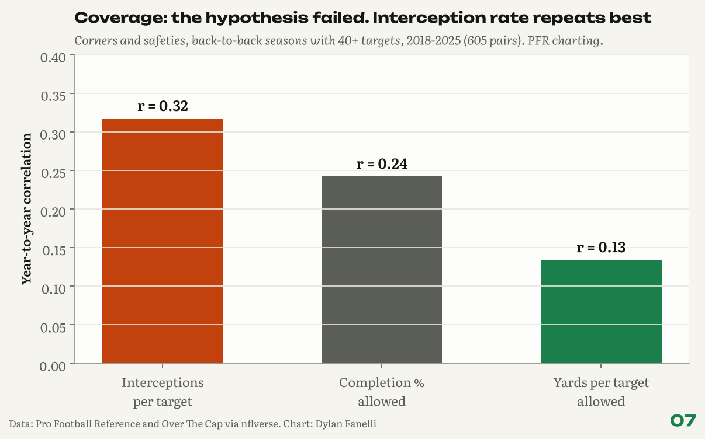

<sub>[← Portfolio](../../README.md) &nbsp;|&nbsp; [← 06 Pass vs Run](../06-pass-run/) &nbsp;|&nbsp; [08 The YAC Tax →](../08-yac-tax/)</sub>

# 07 The Box-Score Tax
### Do NFL teams overpay for sacks?

     

**TL;DR**

- Pressures repeat (r = 0.71); sacks bounce (r = 0.46); sacks beyond what pressures predict barely repeat (r = 0.08).
- A sack beyond what pressures predict adds about \$0.57M a year to a veteran contract (775 contracts, 95% CI \$0.30-0.84M) and predicts 0.13 extra sacks the next year.
- Priced against a pressure, that is 2.12 times what it predicts (90% interval 1.01 to 8.76; 95% interval 0.86 to 24.33). Suggestive of overpaying; the 95% interval includes 1, so it is not settled.

<p align="center"></p>
<p align="center"><sub>Cost of one expected future sack bought through sack luck vs through pressures, with 90% bootstrap intervals.</sub></p>

## Key numbers

| Measure | Value |
|---|---|
| Pressure rate, year-to-year r | **0.71** |
| Sack rate, year-to-year r | **0.46** |
| Sack luck, year-to-year r | **0.08** |
| Sacks per pressure: edge / interior | **0.271 / 0.247** |
| Paid per lucky sack, per year (2026 dollars) | **\$0.57M (95% CI \$0.30-0.84M)** |
| Next-year sacks per lucky sack | **0.13 (95% CI 0.01 to 0.24)** |
| Test ratio: relative price / relative prediction (1 = fair) | **2.12 (90% 1.01-8.76; 95% 0.86-24.33)** |
| Price per lucky sack, deals signed 2023-2026 | **\$0.52M (95% CI 0.10 to 0.94)** |
| Contracts / players | **775 / 371** |

## Why it matters for a club

- **Free agency:** read a sack total next to the pressure total. The gap between them is the part of the platform year least likely to come back.
- **Negotiation:** the evidence that the market overpays for that gap is suggestive, not settled, so it is a reason to hold a line on price, not a rule.
- **Pro scouting:** pair the film with the pressure-to-sack gap to separate a finisher from a hot year.

## The question

**Do NFL teams pay pass rushers more for sacks than sacks predict, when pressures predict future sacks better?**

My bet: in the gap between what a stat says about the past and what it says about the future. Sacks are the headline pass-rush stat. They are also rare, so they are noisy. Pressures happen two to four times as often. If teams pay for sacks more than sacks predict, a team that shops by pressures buys the same future sacks for less.


## Data

Pro Football Reference advanced defense (2018-2026), nflverse snap counts, and 775 veteran edge and interior DL contracts (371 players) from Over The Cap (signed 2019-2026), all via [nflverse](https://github.com/nflverse/nflverse-data). Dollars use the 2026 salary cap (\$301.2M).

## Results

### 1. Pressures repeat; sacks bounce.

For pass rushers with 300+ snaps in back-to-back seasons (995 pairs), pressure rate repeats at r = 0.71, sack rate at r = 0.46. This year's pressure rate predicts next year's sack rate (r = 0.56) better than this year's sack rate does (r = 0.46).

<p align="center"></p>
<p align="center"><sub>Year-to-year stability: pressure rate vs sack rate.</sub></p>

### 2. Teams pay for sack luck, and it does predict a little.

"Sack luck" means sacks above what a player's pressures predict at his group's rate (edge 0.271, interior 0.247 sacks per pressure). It barely repeats (r = 0.08 year to year). Holding pressures, snaps, age and the prior season fixed, one lucky sack predicts 0.13 extra sacks next year (95% interval 0.01 to 0.24), so it is not pure noise. Each one adds about **\$0.57M a year** to a veteran contract (95% interval \$0.30M to \$0.84M, 2026 dollars, one deal per player-year, errors clustered by player).

### 3. The test: sack luck looks overpriced, short of the 95% bar.

Stated before running it: relative to a pressure, is a lucky sack priced above what it predicts? The ratio is 2.12 (1.00 means fairly priced), with a 90% bootstrap interval of 1.01 to 8.76 and a 95% interval of 0.86 to 24.33; it is above 1 in 95% of 2,000 samples that resample players. In dollars, an expected future sack costs about \$4.41M bought through sack luck (90% interval \$2.06M to \$18.21M) against \$2.08M through pressures (\$1.66M to \$2.59M). The wide upper end comes from dividing by a small, noisy number.

### 4. It has not clearly faded.

Deals signed 2023-2026 (402 contracts): \$0.52M per lucky sack (95% interval \$0.10M to \$0.94M). Deals signed 2019-2022: \$0.52M (\$0.17M to \$0.86M). Across the 8 versions in `robustness_lucky_sack_price.csv` the price runs \$0.47M to \$0.68M, and 8 of 8 intervals exclude zero.

### 5. Sacks short of pressures (2025).

Zach Allen (DEN: 7 sacks on 50 pressures, 12.4 expected); Abdul Carter (NYG: 4 sacks on 34 pressures, 9.2 expected); DeMarcus Lawrence (SEA: 6 sacks on 39 pressures, 10.6 expected); Jaelan Phillips (2TM: 5 sacks on 35 pressures, 9.5 expected).

<p align="center"></p>
<p align="center"><sub>Sacks vs what pressures predict, last full season.</sub></p>

### 6. Sacks ahead of pressures (2025).

Myles Garrett (CLE: 23 sacks on 53 pressures, 14.4 expected); Danielle Hunter (HOU: 15 sacks on 34 pressures, 9.2 expected); Brian Burns (NYG: 16.5 sacks on 41 pressures, 11.1 expected). Elite rushers can beat the group rate for years, so this is a list of where the excess sits, not a forecast of decline for any one player.

### 7. The 2027 free-agent rushers.

Contracts ending after 2026 (Over The Cap via nflverse), still active in 2026, rookie first-rounders with a fifth-year option left out. A flag needs 20+ pressures in 2025 and a gap of 2+ sacks between actual and expected. Pressure without the sacks (1): Dante Fowler Jr. (ED, age 31 in 2025, 20 pressures, 3 sacks). Sacks ahead of pressures (6): Jadeveon Clowney (age 32, 8.5 sacks on 22 pressures), Al-Quadin Muhammad (age 30, 11 sacks on 26 pressures), Tuli Tuipulotu (age 23, 13 sacks on 32 pressures), Cameron Jordan (age 36, 10.5 sacks on 22 pressures), Montez Sweat (age 29, 10 sacks on 27 pressures). Ages and contract status come from the data files and were not news-checked; check both before acting.

### 8. Coverage: the same idea failed, and that matters.

I expected interceptions to be the coverage version of sacks. In PFR's charting, interception rate repeats best (r = 0.32), above completion % allowed (r = 0.24) and yards per target allowed (r = 0.13). The market pays about \$0.91M per platform-year interception. Public coverage stats are too noisy to call that a mistake, so I don't.

<p align="center"></p>
<p align="center"><sub>Coverage stats: how much each one repeats.</sub></p>

## Method

- **Traded players:** PFR lists a combined row plus one row per team; only the combined row is kept.
- **Pass rushers:** player-seasons with 300+ regular-season defensive snaps, listed DE/DT/DL/NT or with 15+ pressures (catches 3-4 outside linebackers). Edge and interior players get their own sacks-per-pressure rate. PFR pressures = sacks + hurries + knockdowns; "non-sack pressures" removes the sacks so the two are not double counted.
- **Contracts:** veteran deals only (rookie contracts dropped), one deal per player-year (a tag or tender and a long-term deal signed the same year count once: the longer, then richer, deal), at least 0.4% of the cap, matched to the player's season right before signing. Price and prediction models both control for snaps, age, age squared and the season before the platform year (pressures and sacks). Pay is measured as APY as a share of that year's cap, so 2019 and 2026 deals compare fairly. Pay and prediction regressions cluster standard errors by player (many players sign several deals); full output in `models.txt`.
- **The test statistic:** (price per lucky sack / price per pressure) divided by (next-year sacks per lucky sack / next-year sacks per pressure). Both samples are resampled by player 2,000 times. A lucky sack also predicts 0.20 extra pressures next year (95% interval -0.11 to 0.50), which is not distinguishable from zero.
- **Shrinkage:** a player's own conversion rate carries little signal. The method-of-moments prior is worth about 195 pressures, so a 40-pressure season moves the estimate of his true rate only slightly; the `sack_luck_shrunk` column shows it.

**In equations**

- $`\text{sack luck}_i = \text{sacks}_i - c_g \cdot \text{pressures}_i`$, where $`c_g`$ is the sacks-per-pressure rate of the player's group, edge or interior (see key numbers).
- Price: $`\dfrac{\text{APY}_i}{\text{cap}_t} = \beta_0 + \beta_1\,\text{pressures}_i + \beta_2\,\text{sack luck}_i + \beta_3\,\text{snaps}_i + \text{controls}_i + \varepsilon_i`$, standard errors clustered by player. Controls: age, age squared, prior-season pressures and sacks.
- Prediction: $`\text{sacks}_{i,t+1} = \gamma_0 + \gamma_1\,\text{pressures}_{i,t} + \gamma_2\,\text{sack luck}_{i,t} + \gamma_3\,\text{snaps}_{i,t} + \text{controls}_{i,t} + u_{i,t}`$.
- Test: $`T = \dfrac{\beta_2 / \beta_1}{\gamma_2 / \gamma_1}`$. $`T = 1`$ means a lucky sack is priced in line with what it predicts.

## Validation

- The test statistic was fixed before the run: relative price over relative prediction, players resampled 2,000 times. It is above 1 in 95% of samples.
- 8 versions of the price model (with and without age and prior-season controls, edge or interior only, multi-year deals, deals over 1% of the cap, earlier and recent deals): \$0.47M to \$0.68M per lucky sack; 8 of 8 intervals exclude zero.
- One deal per player-year. Before that fix the sample double-counted tags and extensions signed in the same year.
- The same idea was tested on coverage stats and rejected (finding 8).

## Limitations

- Pressure charting is PFR's, which differs from PFF and NGS; all charting has judgment in it.
- Contracts reflect more than stats: injuries, scheme fit and run defense. The models hold pressures, snaps, age and the prior season fixed but not those.
- The prediction sample needs 300+ snaps in back-to-back seasons, so players who were hurt or lost their jobs drop out.
- Pay is average per year, not guarantees or cash in the first three years.
- The future outcome is next season's sacks. A team may also be paying for pressure it expects in later years or for run defense.
- Free-agent status comes from Over The Cap via nflverse and can lag a new extension or a retirement. Check a player's status before acting.
- The platform season is the season before signing, which mis-times in-season extensions slightly.
- PFR's current-season file lags the snap counts, so player ratings use full seasons only.

## Next steps

- Repeat with a second charting source (NGS or PFF pressures).
- Price guarantees and three-year cash, not only average per year.
- Add run-defense value so the contract model credits the whole player.

## Reproduce

```bash
pip install -r requirements.txt
python -m projects.box_score_tax
```
Code: [`projects/box_score_tax.py`](../../projects/box_score_tax.py). Prior work: PFF's Sam Monson made this argument in 2021 with player examples ([link](https://www.pff.com/news/nfl-teams-are-still-paying-for-sacks-in-free-agency-and-the-edge-defender-market-is-suffering-because-of-it)); this study puts a price on it with public data.

## Files in this folder

| File | What it holds |
|---|---|
| [`rusher_contracts_with_platform.csv`](rusher_contracts_with_platform.csv) | Each veteran ED/IDL contract with the platform season's stats |
| [`rusher_sack_luck_board.csv`](rusher_sack_luck_board.csv) | Every rusher-season: sacks, pressures, expected sacks, sack luck |
| [`free_agents_2027_rushers.csv`](free_agents_2027_rushers.csv) | 2027 free-agent rushers with pressure rate and sack luck |
| [`models.txt`](models.txt) | Full regression output |
| [`robustness_lucky_sack_price.csv`](robustness_lucky_sack_price.csv) | Price per lucky sack under eight model versions |
| [`findings.json`](findings.json) | Every number quoted on this page, machine-readable |

---
<sub>[← Portfolio](../../README.md) &nbsp;|&nbsp; [← 06 Pass vs Run](../06-pass-run/) &nbsp;|&nbsp; [08 The YAC Tax →](../08-yac-tax/)</sub>

<sub>© 2026 Dylan Fanelli. All rights reserved. To cite: Fanelli, D. (2026). *The Box-Score Tax*. NFL Analytics. https://github.com/IForSureI/NFL-Analytics/tree/main/reports/07-box-score-tax</sub>
