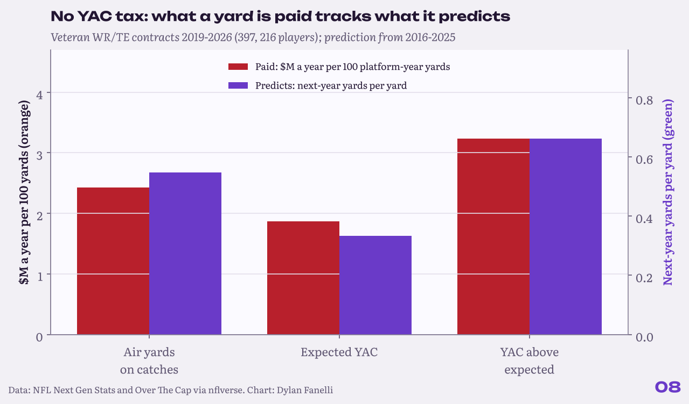
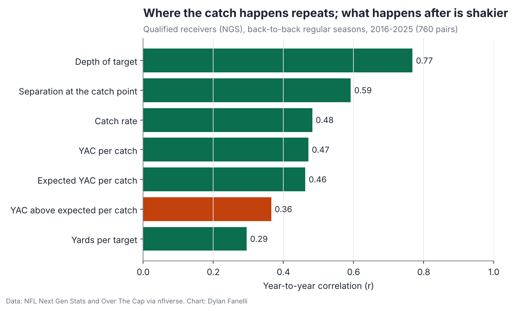

<sub>[← Portfolio](../../README.md) &nbsp;|&nbsp; [← 07 The Box-Score Tax](../07-box-score-tax/)</sub>

# 08 The YAC Tax
### Do teams pay receivers for yards after the catch that won't come back?

     

> **TL;DR**
> - YAC over expected is noisy per catch (r = 0.36), but a season of it predicts next year like air yards (0.66 vs 0.55 yards per yard).
> - Contracts price each part of receiving production about the same per future yard (\$4.89M per 100 YAC-over-expected yards vs \$4.44M per 100 air yards): no YAC tax.
> - The receiver market looks efficient where the pass-rush market (study 07) does not; 397 veteran WR/TE contracts.

<p align="center"></p>
<p align="center"><sub>Price per 100 future yards for each part of a receiver's production.</sub></p>

## Key numbers

| Measure | Value |
|---|---|
| YAC over expected per catch, year-to-year r | **0.36** |
| Next-year yards per yard: YAC over expected | **0.66** |
| Next-year yards per yard: air yards | **0.55** |
| Price per 100 future yards: YACOE / air / expected YAC | **\$4.89M / \$4.44M / \$5.62M** |
| Contracts / players | **397 / 216** |

## Why it matters for a club

- **Receiver evaluation:** don't discount a receiver's YAC as luck by default; a season of it predicts next year like air yards do.
- **Where to look for edges:** the receiver market prices production about right, unlike the pass-rush market in study 07.
- **Free agency:** the free-agent receiver list shows who leaned on YAC, as a reason to check the film, not to pass.

## The question

**Do teams pay receivers for yards after the catch that won't come back?**

Study 07 found teams pay for sacks beyond what pressures predict. Receivers have the same shape of problem. A receiver's yards split three ways, using NFL Next Gen Stats tracking: air yards on his catches, the yards after the catch a typical receiver would get on those same catches (expected YAC), and **YAC above expected**, where broken tackles, missed angles and luck live. If YAC above expected repeats less than the rest but is paid like the rest, it is a tax.


## Data

NFL Next Gen Stats receiving (2016-2025, qualified receivers, 1,251 player-seasons) and 397 veteran WR/TE contracts from Over The Cap (216 players, signed 2019-2026), via [nflverse](https://github.com/nflverse/nflverse-data). Dollars in 2026 cap terms (\$301.2M).

## Results

### 1. Where the catch happens repeats; what happens after is shakier.

Year to year: depth of target r = 0.77, separation r = 0.59, catch rate r = 0.48, YAC per catch r = 0.47, **YAC above expected per catch r = 0.36** (760 back-to-back receiver seasons).

<p align="center"></p>
<p align="center"><sub>Year-to-year stability of receiving traits.</sub></p>

### 2. But the YAC tax mostly isn't there.

Per catch, YAC above expected is noisy. Over a season of catches it adds up to something real: each yard of it predicts 0.66 yards the next season (95% interval 0.35-0.97), about the same as an air yard (0.55). Season-long YAC over expected carries over much more than the per-catch number suggests.

### 3. The market prices it about right.

Contracts pay \$3.24M a year per 100 yards of YAC above expected, \$2.43M per 100 air yards and \$1.87M per 100 expected-YAC yards. Per future yard, that works out to \$4.89M (YAC above expected), \$4.44M (air yards) and \$5.62M (expected YAC) per 100. Those are close, and the intervals overlap. Unlike sacks in study 07, I can't find a premium for the lucky part of receiving production. The robustness table (WR only, TE only, multi-year deals, deals over 1% of the cap, 2023-2026 deals) tells the same story.

### 4. What that means for a front office.

The data says not to discount a receiver's YAC as luck by default. The most stable traits are target depth and separation, and the market already pays for production built on them. The receiver market looks efficient where the pass-rush market (study 07) does not.

### 5. The 2027 free-agent receivers.

Contracts ending after 2026 (Over The Cap, extensions counted), still active: most 2025 yards came from Puka Nacua (WR, 1,715 yds, +170 YAC over expected), George Pickens (WR, 1,429 yds, +200 YAC over expected), Stefon Diggs (WR, 1,013 yds, +46 YAC over expected), Travis Kelce (TE, 851 yds, +33 YAC over expected). Leaned most on YAC above expected (100+ yards): Puka Nacua (WR, 1,715 yds, +170 YAC over expected), George Pickens (WR, 1,429 yds, +200 YAC over expected), Parker Washington (WR, 847 yds, +101 YAC over expected). Given finding 2, that is a reason to look closer, not to pass.

## Method

- **Yards split:** air yards on catches = yards - catches x YAC per catch; expected YAC = catches x NGS expected YAC per catch; YAC above expected = catches x NGS YAC above expectation per catch. The three add up to total receiving yards.
- **Prediction:** next season's yards on this season's three parts plus targets; **price:** APY as % of the cap on the platform season's three parts plus targets. Both cluster standard errors by player. Output in `models.txt`.
- **Contracts:** veteran WR/TE deals (rookie deals and duplicates dropped), at least 0.4% of the cap, platform season = the season before signing.
- **Free agents:** end year from each player's Over The Cap contract history, with extensions added after the deal they extend; first-round rookie deals (fifth-year option) left out; must have played offense this season.

**In equations**

- Receiving yards $=$ air yards on catches $+$ expected YAC $+$ YAC over expected (NGS), so the three parts add to the total.
- Price and prediction models regress APY share of the cap, and next-season yards, on the three parts plus targets, with standard errors clustered by player.

## Validation

- 5 robustness versions (WR only, TE only, multi-year deals, deals over 1% of the cap, 2023-2026 deals) recompute the price per 100 yards (not per future yard). YAC over expected is priced at or above air yards in 5 of them.
- 95% interval for next-year yards per YACOE yard: 0.35-0.97, overlapping air yards.
- A null result is reported as one: the hypothesis was a tax, and the data does not show it.

## Limitations

- NGS season tables only include qualified receivers, so part-time players and many tight ends are missing.
- Expected YAC is the NFL's model; the split is only as good as it is.
- Contract status can lag a new extension. Puka Nacua and George Pickens (franchise tag) were both in the final year of their deals as of this writing; check before acting.

## Next steps

- Route-level separation once public route data allows it.
- Tight ends below the NGS qualifying line.

## Reproduce

```bash
pip install -r requirements.txt
python -m projects.yac_tax
```
Code: [`projects/yac_tax.py`](../../projects/yac_tax.py)

## Files in this folder

| File | What it holds |
|---|---|
| [`receivers_2025.csv`](receivers_2025.csv) | Last full season: each receiver's yards split three ways |
| [`free_agents_2027_receivers.csv`](free_agents_2027_receivers.csv) | 2027 free-agent receivers |
| [`robustness_price_per_100_yards.csv`](robustness_price_per_100_yards.csv) | Price per 100 yards under each model version |
| [`models.txt`](models.txt) | Full regression output |
| [`findings.json`](findings.json) | Every number quoted on this page, machine-readable |

---
<sub>[← Portfolio](../../README.md) &nbsp;|&nbsp; [← 07 The Box-Score Tax](../07-box-score-tax/)</sub>

<sub>© 2026 Dylan Fanelli. All rights reserved. To cite: Fanelli, D. (2026). *The YAC Tax*. NFL Analytics. https://github.com/IForSureI/NFL-Analytics/tree/main/reports/08-yac-tax</sub>
