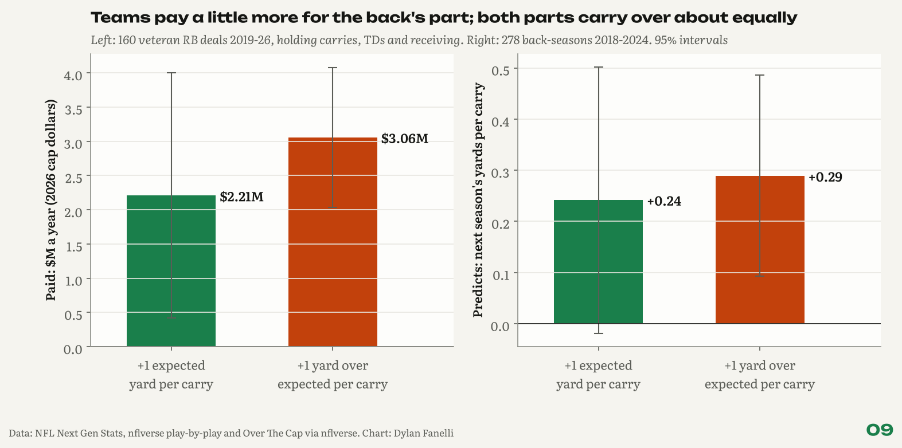
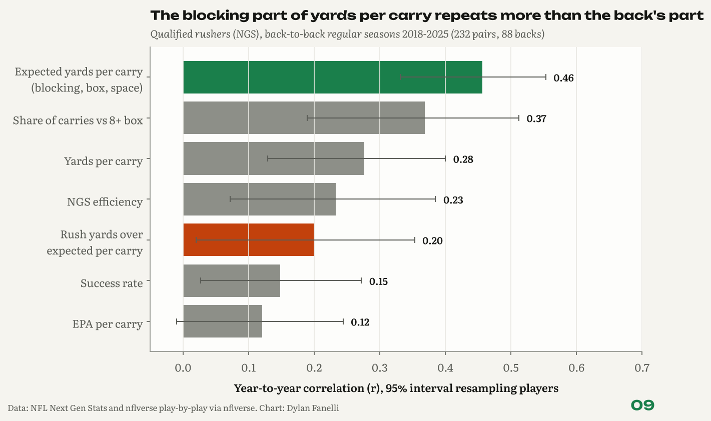
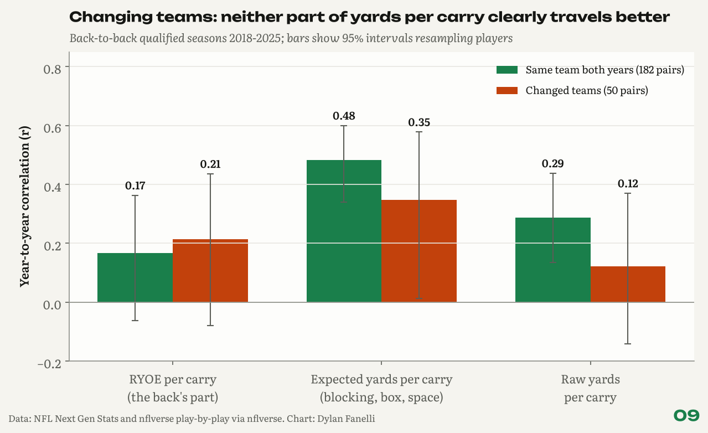
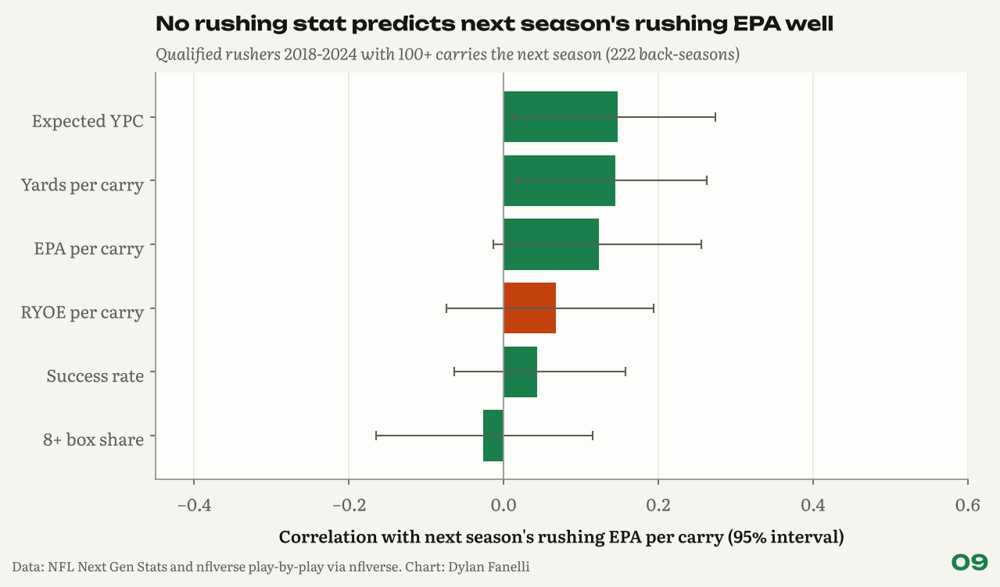
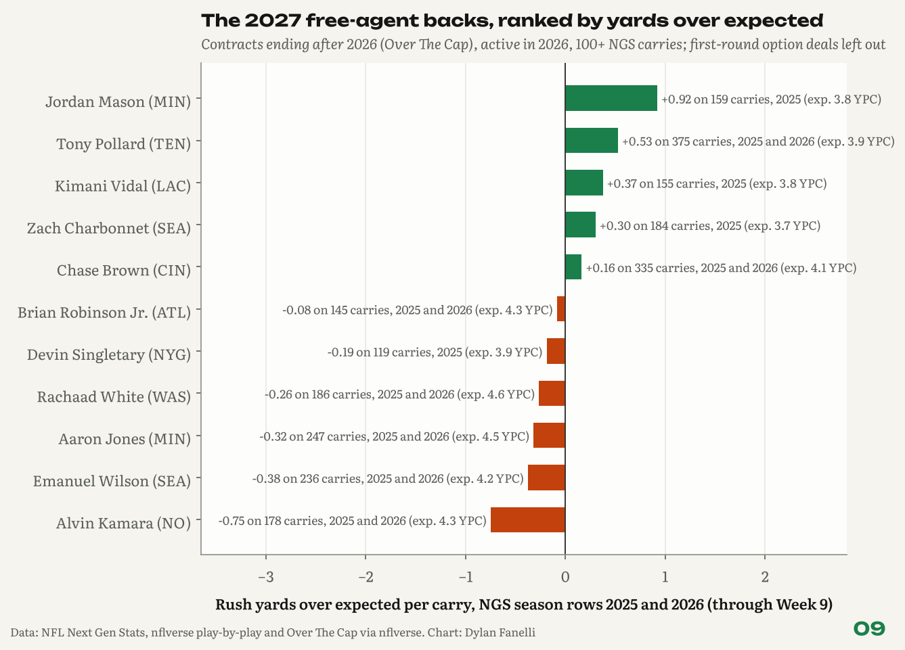

<sub>[← Portfolio](../../README.md) &nbsp;|&nbsp; [← 08 The YAC Tax](../08-yac-tax/)</sub>

# 09 Run Game Value
### Teams pay a little more for the back's part, and neither part looks mispriced

      

**TL;DR**

- The blocking part of yards per carry repeats more than the back's part (expected YPC r = 0.46 vs RYOE per carry r = 0.20; 0.41 vs 0.33 for 150+ carry backs), and no rushing stat predicts next season's rushing EPA well.
- Hypothesis failed: teams don't pay blocked yards like the back's own. Holding carries fixed, +1 yard over expected per carry adds \$3.06M a year vs \$2.21M for +1 expected yard per carry (160 contracts); per yard the gap is 2.54x but fades to 1.23x with workload controlled.
- Per carry, both parts predict next season about equally (+1 yard per carry of each adds 0.29 vs 0.24 to next season's yards per carry), so the market looks roughly right; includes the 2027 free-agent backs, every name news-checked.

<p align="center"></p>
<p align="center"><sub>What contracts pay for each part of yards per carry, and what each part predicts next season.</sub></p>

## Key numbers

| Measure | Value |
|---|---|
| Expected yards per carry, year-to-year r | **0.46** |
| RYOE per carry, year-to-year r (150+ carry backs) | **0.20 (0.33)** |
| Raw yards per carry, year-to-year r | **0.28** |
| Best r with next-season EPA per carry | **0.15** |
| Paid per 100 yards: over expected / expected (2026 dollars) | **\$1.68M / \$0.66M** |
| Next-season YPC per +1 YPC: over expected / expected | **0.29 / 0.24** |
| Back-to-back pairs (backs) / contracts (backs) | **232 (88) / 160 (99)** |

## Why it matters for a club

- **Free agency:** split a back's yards per carry before paying for it; about half of what repeats is the expected part, which depends on the line, the box and his role.
- **Contract talks:** the market pays for yards per carry, not workload; a big carry total is not worth paying for in itself.
- **Expectations:** rushing EPA per carry barely carries over for any back, so a contract should not assume last year's efficiency comes back.

## The question

**How much of a running back's production is his, and do contracts pay for that part?**

Brett Kollmann's line is that the offensive line sets a back's floor and the back sets his ceiling. NFL Next Gen Stats lets that be measured. It splits every carry into the yards a typical back would gain given his blockers, the defenders, the box count and the space at the handoff (**expected yards**), and the yards he gains over that (**rush yards over expected, RYOE**). If RYOE is the back's part, it should repeat, follow him to a new team, predict next season and be what contracts pay for. My hypothesis going in was that teams pay backs for yards their blocking made as if the back had made them. It failed: contracts pay more for the back's part than for the blocking part, though they pay for both. The back's part also turned out noisier than I expected (most of the spread in yards per carry, but the part that repeats less), and I cannot show the market misprices either part.

**Inspired by:** Brett Kollmann, [The Running Back Problem.](https://www.youtube.com/watch?v=PLGJLH4xQcA) and [Should Running Backs go in the Top 10?](https://www.youtube.com/watch?v=8ymN2_OBGuE). Method mirrors studies [07](../07-box-score-tax/) and [08](../08-yac-tax/).  

## Data

NFL Next Gen Stats rushing (2018-2025, qualified rushers only: 405 back-seasons, 146 backs), nflverse play-by-play 2018-2026 (through Week 9 of 2026), and 160 veteran RB contracts from Over The Cap (99 backs, signed 2019-2026), all via [nflverse](https://github.com/nflverse/nflverse-data). Dollars in 2026 cap terms (\$301.2M).

## Results

### 1. The blocking part of yards per carry repeats more than the back's part.

Year to year (232 back-to-back qualified seasons, 88 backs): expected yards per carry r = 0.46 (95% interval 0.33 to 0.55), raw yards per carry r = 0.28, RYOE per carry r = 0.20 (0.02 to 0.35). The gap is positive in 99% of 1,000 bootstrap samples that resample backs, but it narrows for workhorse backs: with 150+ carries in both seasons (130 pairs) it is 0.41 against 0.33. RYOE makes up most of the spread in yards per carry (76% of its variance), yet of the yards per carry that carry into next season, 50% comes through the expected part. Facing more eight-man boxes goes with fewer expected yards (r = -0.31), and the box share itself repeats (r = 0.37).

<p align="center"></p>
<p align="center"><sub>Year-to-year stability of rushing stats, with 95% intervals.</sub></p>

### 2. Changing teams: neither part clearly travels better.

For backs who changed teams (50 pairs), RYOE per carry repeated at r = 0.21 (-0.08 to 0.44) and expected yards per carry at r = 0.35 (0.01 to 0.58); for those who stayed (182 pairs), 0.17 and 0.48. The changer-minus-stayer differences have 95% intervals of -0.30 to 0.36 (RYOE) and -0.50 to 0.18 (expected yards): too few team changes to tell. Expected yards following a back to a new team at all says they are not only the line's; they also carry the back's role and how he is used.

<p align="center"></p>
<p align="center"><sub>Stability for backs who stayed vs backs who changed teams.</sub></p>

### 3. No rushing stat predicts next season's rushing EPA well.

Among 222 qualified back-seasons followed by 100+ carries, expected yards per carry (r = 0.15, 0.01 to 0.27) and raw yards per carry (r = 0.14) do best; this season's EPA per carry gives r = 0.12 and RYOE per carry r = 0.07. A model with four of them explains 3% of next season's EPA per carry.

<p align="center"></p>
<p align="center"><sub>What predicts next season's rushing EPA per carry.</sub></p>

### 4. Contracts pay more per yard for the back's part, not less.

In veteran deals, each 100 platform-year rush yards over expected is paid \$1.68M a year (95% interval \$1.12M to \$2.25M) against \$0.66M per 100 expected yards (\$0.33M to \$0.99M), holding rushing touchdowns and receiving yards fixed: 2.54 times as much (difference p = 0.002). Teams pay for the expected part too; its interval excludes zero. The premium is fragile: it stays significant in 6 of 9 model versions, but falls to 1.55 times without the receiving control (p = 0.13), 1.23 times once platform carries are added (p = 0.61) and 1.67 times in multi-year deals (p = 0.22). Per carry, +1 yard over expected per carry is paid \$3.06M a year and +1 expected yard per carry \$2.21M, holding carries, touchdowns and receiving fixed (difference p = 0.42). Seen through the box score, the market pays for yards per carry, not workload: with yards fixed, 100 more carries lowers pay by \$4.28M a year (interval \$1.44M to \$7.12M), and RYOE per carry adds nothing measurable once yards and carries are known (R² +0.001). A rushing touchdown adds about \$0.21M, and its 95% interval reaches zero (up to \$0.43M).

### 5. Per carry, both parts carry over about equally, so I can't call the premium a mistake.

Next season's yards per carry (backs with 50+ carries, weighted by carries, 278 back-seasons) rise 0.29 for each yard over expected per carry (0.09 to 0.49) and 0.24 for each expected yard per carry (-0.02 to 0.50); the difference is not significant (p = 0.79). In season totals, a yard over expected comes back as 0.78 rushing yards next season and an expected yard as 0.61, but expected yards are mostly workload (r = 0.97 with carries), and a signing team sets the workload itself. Paid somewhat more and predicting slightly more per carry, the back's part looks roughly fairly priced. The evidence does not support a tax in either direction.

### 6. The 2027 free-agent backs.

Contracts ending after 2026 (Over The Cap, extensions counted), active in 2026, first-round option deals left out, each name checked against news on November 12, 2026. 11 have 100+ carries in NGS season rows for 2025 and 2026; ranked by RYOE per carry, above expectation: Jordan Mason (MIN, +0.92 on 159 carries, 2025); Tony Pollard (TEN, +0.53 on 375 carries, 2025 and 2026); Kimani Vidal (LAC, +0.37 on 155 carries, 2025); Zach Charbonnet (SEA, +0.30 on 184 carries, 2025); Chase Brown (CIN, +0.16 on 335 carries, 2025 and 2026). Below: Brian Robinson Jr. (ATL, -0.08 on 145 carries, 2025 and 2026); Devin Singletary (NYG, -0.19 on 119 carries, 2025); Rachaad White (WAS, -0.26 on 186 carries, 2025 and 2026); Aaron Jones (MIN, -0.32 on 247 carries, 2025 and 2026); Emanuel Wilson (SEA, -0.38 on 236 carries, 2025 and 2026); Alvin Kamara (NO, -0.75 on 178 carries, 2025 and 2026). Value flags (RYOE over +0.3 a carry, at or below the list's median pay of \$2.00M): Kimani Vidal, Zach Charbonnet. Kimani Vidal is a restricted free agent; Zach Charbonnet tore his ACL in the January 2026 playoffs; Brian Robinson Jr. went on injured reserve on November 7. Given finding 1, one or two seasons of RYOE per carry is a weak signal; the CSV also gives each back's RYOE shrunk toward zero, and the news note behind every name. Removed after the news check: Christian McCaffrey (not a 2027 free agent: his 2024 two-year extension runs through 2027; Over The Cap's end year misses the fifth-year option year on his rookie deal). 4 more free-agent backs have 100+ carries in play-by-play but fewer than 100 in NGS season rows, so no RYOE: Samaje Perine (CIN, 130 carries: final year of a two-year Cincinnati deal, 2025-26); Zonovan Knight (ARI, 110 carries: one-year deal with Arizona for 2026); Kendre Miller (NO, 104 carries: released by New Orleans on November 7, 2026, a year after an October 2025 ACL tear; a free agent now unless claimed); Sean Tucker (TB, 101 carries: signed a one-year deal with Tampa Bay in August 2026).

<p align="center"></p>
<p align="center"><sub>The 2027 free-agent backs by rush yards over expected per carry.</sub></p>

## Method

- **Yards split:** for each back-season, RYOE = NGS `rush_yards_over_expected`; expected yards = rushing yards minus RYOE, so the two parts add to his rushing yards exactly. Per-carry versions divide both by all carries, so yards per carry = expected yards per carry + RYOE per carry. NGS's own expected-yards column runs about 13 yards a season below this because a few carries have no tracking; using it instead leaves the price ratio about the same (see `robustness_price_per_100_yards.csv`).
- **Samples:** NGS season rows (week 0, regular season) list qualified rushers only; RYOE starts in 2018. EPA, success rate and touchdowns come from nflverse play-by-play (designed runs: `rush_attempt` with no QB scramble and no two-point try). "Changed teams" means the NGS team differs between seasons; 7 NGS rows with no team are filled with the team the back carried for most that season.
- **Prediction:** next season comes from play-by-play for every back. The season-total yards model counts zero for a back who did not carry the ball; the per-carry model uses backs with 50+ carries next season, weighted by those carries. Models cluster standard errors by player; output in `models.txt`.
- **Contracts:** veteran RB deals (rookie deals dropped), at least 0.4% of the cap, one deal per back per signing year (a tag or tender and a long-term deal in the same year count once, as the longer deal), platform season = the NGS-qualified season before signing. Pay is APY as a share of that year's cap, priced in 2026 dollars.
- **Free agents:** end year from each player's Over The Cap contract history (extensions added; the active deal wins a same-year tie), checked against news; RYOE combines the 2025 and 2026 NGS season rows. RYOE shrunk toward zero adds about 774 carries of league-average play, set by the year-to-year r of RYOE per carry.

**In equations**

- Yards per carry $`=`$ expected yards per carry $`+`$ RYOE per carry (NGS), so the two parts add to the total.
- Price: $`\dfrac{\text{APY}_i}{\text{cap}_t} = \beta_0 + \beta_1\,\text{expected yds}_i + \beta_2\,\text{RYOE}_i + \beta_3\,\text{rush TD}_i + \beta_4\,\text{rec yds}_i + \varepsilon_i`$, standard errors clustered by player.
- Prediction per carry: $`\text{YPC}_{i,t+1} = \gamma_0 + \gamma_1\,\text{xYPC}_{i,t} + \gamma_2\,\text{RYOE per carry}_{i,t} + u_{i,t}`$, weighted by next-season carries.

## Validation

- 9 versions of the price model (age controls, deals over 1% of the cap, multi-year deals, 2019-2022 and 2023-2026 deals, no receiving control, plus platform carries, NGS's own expected-yards column): yards over expected are paid 1.23 to 2.90 times as much as expected yards; the difference is significant (p < 0.05) in 6 of 9. Weak versions are in the table, not hidden.
- Every year-to-year r carries a 95% interval from 1,000 bootstrap samples that resample backs. Weighting pairs by carries: expected YPC 0.44, RYOE per carry 0.26.
- A bigger-sample check on raw yards per carry (every back with 100+ carries in back-to-back seasons, 216 pairs): r = 0.35.
- Adding platform carries to the season-yards prediction leaves a yard over expected at 0.78 future yards and an expected yard at 0.63 (interval -0.18 to 1.44).
- An independent review re-ran the study, checked every number against findings.json and news-checked the main free-agent list; its corrections (a team-change coding bug, duplicate same-year contracts, an over-read workload model) are in this version.

## Limitations

- Only qualified rushers have NGS season rows (about 50 a season), so backups and part-time backs are missing and the samples are small (232 back-to-back pairs, 50 of them team changes, 160 contracts).
- Expected yards is the NFL's model. It sees the blockers and defenders at the handoff, not how well the line sustains its blocks, so some line play sits inside RYOE; and it reflects the back's role and usage, so some of the back sits inside expected yards.
- A contract buys several years, pass protection and receiving; receiving yards are controlled for, pass protection is not measured.
- Back-to-back pairs need two qualified seasons, so backs who lost the job are missing from the stability numbers (the season-total yards prediction counts them, with zero yards).
- Over The Cap end years miss fifth-year option years on older first-round deals (Christian McCaffrey's case), which is why every name was checked by hand.

## Next steps

- Separate line play from the back with blocking data (run-block win rates) once public.
- Add pass protection and receiving value per snap so the contract model credits the whole back.
- Rookie-contract backs: what a draft pick at RB buys compared with a veteran at the same price.

## Reproduce

```bash
pip install -r requirements.txt
python -m projects.run_game_value
```
Code: [`projects/run_game_value.py`](../../projects/run_game_value.py)

## Files in this folder

| File | What it holds |
|---|---|
| [`back_to_back_seasons.csv`](back_to_back_seasons.csv) | Each back's stats in back-to-back qualified seasons, with team changes |
| [`rb_contracts_with_platform.csv`](rb_contracts_with_platform.csv) | Each veteran RB contract with the platform season's NGS split |
| [`robustness_price_per_100_yards.csv`](robustness_price_per_100_yards.csv) | Price per 100 yards and the p-value of the difference under nine model versions |
| [`free_agents_2027_rbs.csv`](free_agents_2027_rbs.csv) | 2027 free-agent backs: RYOE, shrunk RYOE, expected YPC, value flag, news note |
| [`free_agents_2027_rbs_no_ngs.csv`](free_agents_2027_rbs_no_ngs.csv) | 2027 free-agent backs with 100+ carries but under 100 in NGS season rows, with news notes |
| [`models.txt`](models.txt) | Full regression output |
| [`findings.json`](findings.json) | Every number quoted on this page, machine-readable |

---
<sub>[← Portfolio](../../README.md) &nbsp;|&nbsp; [← 08 The YAC Tax](../08-yac-tax/)</sub>

<sub>© 2026 Dylan Fanelli. All rights reserved. To cite: Fanelli, D. (2026). *Run Game Value*. NFL Analytics. https://github.com/IForSureI/NFL-Analytics/tree/main/reports/09-run-game-value</sub>
