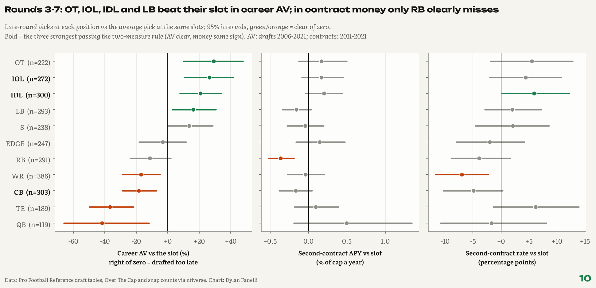
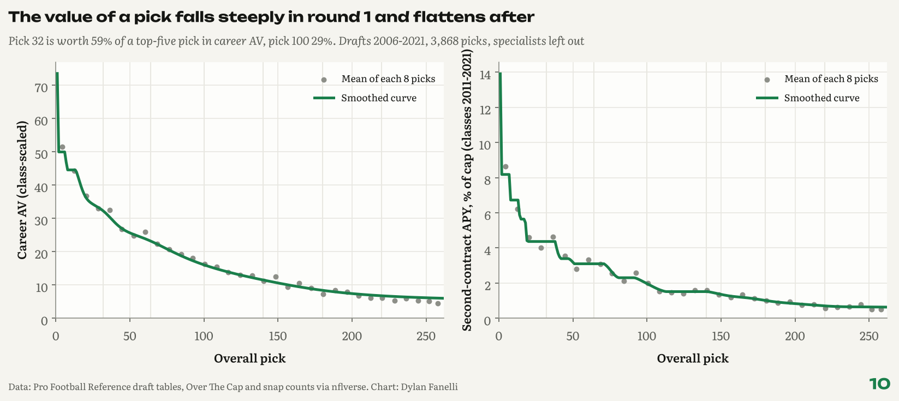
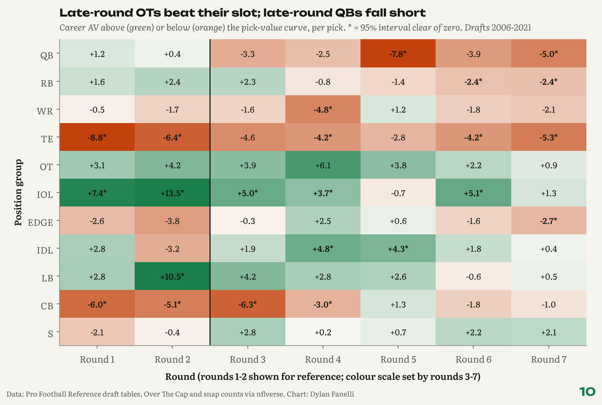
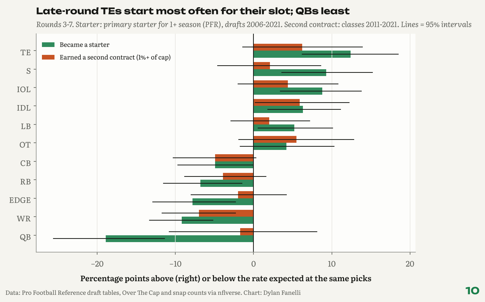
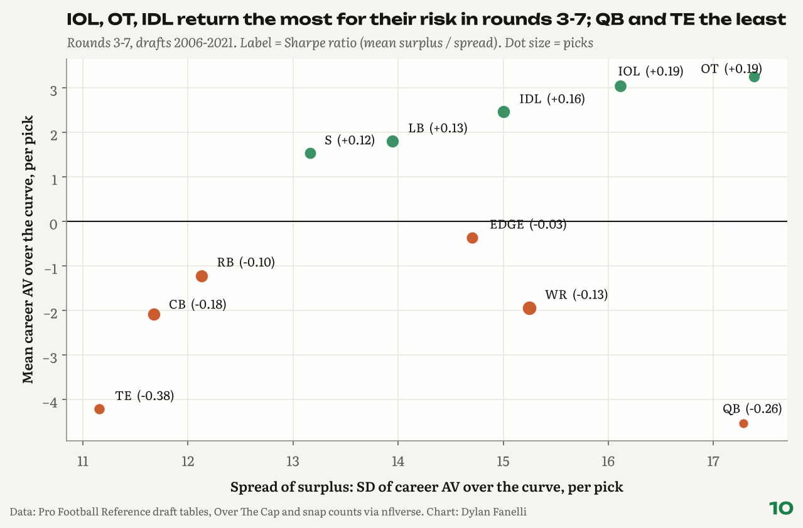

<sub>[← Portfolio](../../README.md) &nbsp;|&nbsp; [← 09 Run Game Value](../09-run-game-value/) &nbsp;|&nbsp; [11 Turnovers Forced →](../11-turnovers-forced/)</sub>

# 10 Draft Value
### Late-round linemen beat their slot in career AV, but second-contract money does not clearly confirm it

      

**TL;DR**

- The value of a pick falls steeply through round 1 and flattens after: on the smoothed curve pick 32 keeps 59% of a top-five pick's career AV and pick 100 29% (3,868 picks, drafts 2006-2021).
- In rounds 3-7, linemen beat their slot in career AV (OT +29%, IOL +26%, IDL +21%, intervals clear of zero) but second-contract money does not clearly confirm it; the only clear money gap is running backs (-0.36 points of cap a year, -28% vs slot), and the two measures disagree most on quarterbacks and tight ends (rank r across 11 positions 0.18, 0.58 without quarterbacks).
- By a rule set before the results, the three clearest inefficiencies are IDL (drafted too late), CB (drafted too early), IOL (drafted too late): clear in AV, same direction but not clear in contract APY, and CB stays in the top three under every alternative I tried. Only 32% of late-round picks beat their slot, so no position is a safe bet (best Sharpe ratio +0.19).

<p align="center"></p>
<p align="center"><sub>Rounds 3-7 by position: career AV, second-contract money and second-contract rate, each against the average pick at the same slots.</sub></p>

## Key numbers

| Measure | Value |
|---|---|
| Picks (drafts) / rounds 3-7 | **3,868 (2006-2021) / 2,860** |
| Pick 32 / pick 100 as a share of a top-five pick (career AV) | **59% / 29%** |
| Rounds 3-7 positions clear of the slot in AV (after Holm) | **8 of 11 (6)** |
| Rounds 3-7 positions clear of the slot in second-contract money | **1 of 11 (RB)** |
| Rank correlation, AV vs money, 11 positions (without QB) | **0.18 (0.58)** |
| OT / IOL / IDL career AV vs slot | **+29% / +26% / +21%** |
| RB second-contract APY vs slot (95% interval) | **-0.36 pts of cap (-0.52 to -0.19)** |
| Late-round picks that beat their slot | **32%** |

## Why it matters for a club

- **Draft room:** on a tie in rounds 3-7, the evidence leans to the interior lineman over the corner or the running back; it is a tiebreaker, not a reason to reach.
- **Trade value:** the curve says what a pick is expected to return, so a pick-for-pick trade can be checked against it in AV or in second-contract money.
- **Roster planning:** late-round running backs return less second-contract money than their slot and late-round quarterbacks rarely become starters, so a depth chart that counts on either is a depth chart with a hole.

## The question

**In rounds 3-7, which positions return the most value per pick, and are some positions drafted too late?**

If the draft prices positions correctly, a pick at any position should return about what the average pick at the same slot returns. A position whose late-round picks beat their slot on more than one measure is being taken too late; one that falls short is being taken too early. My hypothesis going in was that the AV results would hold up in the money test. They did not: career AV and second-contract money rank the positions very differently, and only one money gap is clear.

**Inspired by:** Michael MacKelvie, [The Safest Pick is the Most Dangerous in the NFL](https://www.youtube.com/watch?v=H8rolEibsPg) and [NFL Teams Know How To Draft - Why Don't They?](https://www.youtube.com/watch?v=2Kdb2b0em-I).  

## Data

nflverse `draft_picks` (Pro Football Reference draft tables) for the 2006-2021 drafts: 4,076 picks, 3,868 after dropping 69 kickers, punters and long snappers and 139 picks whose generic position (DB, LB) could not be split; 2,860 of them in rounds 3-7. Over The Cap contracts via nflverse for second contracts (2011-2021 classes, 2,755 picks: Over The Cap lists every drafted player from 2011 on). nflverse snap counts for rookie-deal playing time (2013-2021 classes, 2,256 picks). The 2021 class is the cutoff: it has played five seasons, so careers are mostly observed; career AV is scaled to the class average so short careers are not punished for being short.

## Results

### 1. The value of a pick falls steeply through round 1, then flattens.

On the smoothed curve, the top five picks expect 55 career AV on average, pick 32 32, pick 100 16 and pick 200 7: pick 32 keeps 59% of a top-five pick's value, pick 100 29%. (Pick 1 alone, 74, rests on 16 players, so I anchor on the top five.) Round 1 alone loses 41 AV; picks 64 to 250 together lose 17. In second-contract money the curve runs from 6.7% of the cap a year at pick 10 to 2.0% at pick 100 and 0.64% at pick 250. The chance of becoming a starter falls from 56% at pick 100 to 21% at pick 250, and of earning a second contract worth 1%+ of the cap from 45% to 15%. Fit on all classes but one and scored on the class left out, the curve beats plain round averages for every outcome (career AV 3.2% lower squared error, money 7.3%); most of the spread between players is not explained by the slot at all.

<p align="center"></p>
<p align="center"><sub>The pick-value curve in career AV and second-contract money.</sub></p>

### 2. In career AV, late-round linemen beat their slot; quarterbacks, tight ends, corners and receivers fall short.

Rounds 3-7, career AV against the curve at the same picks: OT +29% (+10% to +48%, 222 picks); IOL +26% (+10% to +41%, 272 picks); IDL +21% (+8% to +34%, 300 picks); LB +16% (+3% to +31%, 293 picks). Below: QB -42% (-66% to -12%, 119 picks); TE -37% (-50% to -22%, 189 picks); CB -18% (-29% to -7%, 303 picks); WR -17% (-29% to -5%, 386 picks). 8 of 11 intervals clear zero, 6 after correcting for testing 11 positions (Holm); QB and LB does not survive the correction. In picks, OT output sits about 31 picks earlier than where they were taken (95% interval 12 to 46), IOL 29 and IDL 23. In the round-by-round table, 16 of 55 position-round cells in rounds 3-7 clear zero, where about 3 would by chance.

**Positions by round.** Career AV over the pick-value curve per pick (rounds 1-2 for reference), and rounds 3-7 pooled in AV (% vs slot) and second-contract money (APY points of cap a year). * = 95% bootstrap interval clear of zero.

| Position | Rd 1 | Rd 2 | Rd 3 | Rd 4 | Rd 5 | Rd 6 | Rd 7 | Rds 3-7 AV vs slot | Rds 3-7 money vs slot (pts of cap) | Rds 3-7 picks |
|---|---|---|---|---|---|---|---|---|---|---|
| QB | +1.2 | +0.4 | -3.3 | -2.5 | -7.8* | -3.9 | -5.0* | -42%* | +0.50 | 119 |
| RB | +1.6 | +2.4 | +2.3 | -0.8 | -1.4 | -2.4* | -2.4* | -11% | -0.36* | 291 |
| WR | -0.5 | -1.7 | -1.6 | -4.8* | +1.2 | -1.8 | -2.1 | -17%* | -0.04 | 386 |
| TE | -8.8* | -6.4* | -4.6 | -4.2* | -2.8 | -4.2* | -5.3* | -37%* | +0.09 | 189 |
| OT | +3.1 | +4.2 | +3.9 | +6.1 | +3.8 | +2.2 | +0.9 | +29%* | +0.17 | 222 |
| IOL | +7.4* | +13.5* | +5.0* | +3.7* | -0.7 | +5.1* | +1.3 | +26%* | +0.17 | 272 |
| EDGE | -2.6 | -3.8 | -0.3 | +2.5 | +0.6 | -1.6 | -2.7* | -3% | +0.15 | 247 |
| IDL | +2.8 | -3.2 | +1.9 | +4.8* | +4.3* | +1.8 | +0.4 | +21%* | +0.20 | 300 |
| LB | +2.8 | +10.5* | +4.2 | +2.8 | +2.6 | -0.6 | +0.5 | +16%* | -0.16 | 293 |
| CB | -6.0* | -5.1* | -6.3* | -3.0* | +1.3 | -1.8 | -1.0 | -18%* | -0.17 | 303 |
| S | -2.1 | -0.4 | +2.8 | +0.2 | +0.7 | +2.2 | +2.1 | +14% | -0.04 | 238 |

<p align="center"></p>
<p align="center"><sub>Career AV over the curve by position and round.</sub></p>

### 3. Second-contract money does not confirm the AV ranking, mostly because of quarterbacks and tight ends.

The money a player earned on his second deal, as a share of the cap, is the market's own price for him, so it measures position value the way teams pay for it. On it, only RB clears zero in rounds 3-7: RB -0.36 points of cap a year (-0.52 to -0.19, -28% vs slot). Across the 11 positions the AV rank and the money rank correlate at 0.18, 0.58 without quarterbacks and 0.70 without quarterbacks and tight ends (11 points, so these are rough). Late-round quarterbacks are -42% in AV but +37% in money (backups get paid; interval -0.19 to +1.34), and tight ends are -37% in AV while becoming starters +12 points more often than their slot. Among the other positions the two measures mostly agree in direction, but only running backs are clear in money. AV gives linemen credit through games started and team offense, so part of the linemen's AV edge may be how AV is built.

### 4. The three clearest inefficiencies, by a rule set before the results, hold in AV and only point the same way in contract money.

The rule: rounds 3-7 pooled, the AV interval clear of zero, second-contract APY with the same sign, ranked by the weaker of the two z-scores. 5 positions pass (IDL, CB, IOL, OT and WR); the three strongest are below, and none of them clears zero in APY on its own. (1) **IDL, drafted too late.** Career AV +21% against the slot (+8% to +34%); became a starter +6.3 points (+1.8 to +11.1); earned a second contract +5.9 points (+0.2 to +12.2); second-contract APY +0.20 points of cap a year (-0.04 to +0.44); half-snap games in seasons 1-4 -1.8 (-3.4 to -0.1). Same sign as the main result in 11 of 12 versions of the test. (2) **CB, drafted too early.** Career AV -18% against the slot (-29% to -7%); became a starter -4.9 points (-9.7 to -0.1); earned a second contract -4.9 points (-10.3 to +0.3); second-contract APY -0.17 points of cap a year (-0.38 to +0.05); half-snap games in seasons 1-4 +0.8 (-1.2 to +2.8). Same sign as the main result in 11 of 12 versions of the test. (3) **IOL, drafted too late.** Career AV +26% against the slot (+10% to +41%); became a starter +8.8 points (+3.4 to +13.8); earned a second contract +4.4 points (-2.0 to +10.8); second-contract APY +0.17 points of cap a year (-0.09 to +0.45); half-snap games in seasons 1-4 +5.7 (+2.8 to +8.3). Same sign as the main result in 12 of 12 versions of the test. IDL's second-contract rate does clear zero, but its rookie-deal snap measure is below the slot: interior linemen rotate, so fewer of their games reach half the snaps, and on that measure the case for IDL is weaker. The list is fragile: classes 2006-2018: CB, IDL and WR; draft label only: CB, S and IOL; second contract window 3-6 years: CB, IDL and IOL. CB is in the top three in all 4 versions. The late-round hits behind the "too late" groups include Geno Atkins (IDL, 2010 round 4, pick 120: 8 Pro Bowls, 2 first-team All-Pro); Kyle Williams (IDL, 2006 round 5, pick 134: 6 Pro Bowls, 0 first-team All-Pro); Jurrell Casey (IDL, 2011 round 3, pick 77: 5 Pro Bowls, 0 first-team All-Pro); Jason Kelce (IOL, 2011 round 6, pick 191: 7 Pro Bowls, 6 first-team All-Pro); Joe Thuney (IOL, 2016 round 3, pick 78: 4 Pro Bowls, 3 first-team All-Pro); Corey Linsley (IOL, 2014 round 5, pick 161: 1 Pro Bowl, 1 first-team All-Pro). Running backs miss the rule only because their AV interval reaches +0.18 AV (-24% to +2% against the slot), a borderline miss; they are one of 4 positions (RB, WR, OT and IOL) on the same side of the slot in all 12 versions of the test, and the only position clear in money under both the pick and the class bootstrap: RB -0.36 points of cap a year (-0.52 to -0.19, -28% vs slot), and -6.8 points (-11.5 to -1.5) on becoming a starter.

<p align="center"></p>
<p align="center"><sub>Starter and second-contract rates against the rate expected at the same picks.</sub></p>

### 5. Risk and return: no late-round position is a safe bet.

MacKelvie's Sharpe ratio (mean surplus over its spread, rounds 3-7) is highest for IOL, OT and IDL (+0.19, +0.19, +0.16) and lowest for QB and TE (-0.26, -0.38). Even the best is small: a late-round pick's career AV spreads 14.5 around the curve, and only 32% of all late-round picks beat their slot (the average is pulled up by a few stars). The best positions raise that to 41-41% (IDL and LB); late-round quarterbacks beat it 10% of the time.

<p align="center"></p>
<p align="center"><sub>Mean surplus against its spread, rounds 3-7 (MacKelvie's Sharpe ratio).</sub></p>

### 6. MacKelvie's "safe pick" claim partly holds in round 1.

He argues that "safe" first-round picks at non-premium positions (TE, S, LB, IOL, RB) are the riskiest for what they return. First-round picks at RB, LB and S returned less second-contract money than their slot (RB -1.93, LB -1.54, S -2.36 points of cap a year; each interval below zero), and first-round TE and CB fell short in AV. First-round IOL beat their slot in AV (+7.4 AV, interval +0.20 to +15.4), so not every non-premium position is a bad first-round bet. Round-1 cells hold 15 to 77 picks each, so these intervals are wide.

## Method

- **Outcomes.** Career AV is PFR's weighted career Approximate Value (`w_av`: 100% of a player's best season, 95% of the next, and so on), set to 0 for a pick who never played and scaled so each class has the pooled class mean (the 2021 class is scaled up 1.48x, 2006 down to 0.78x). "Became a starter": `seasons_started` (PFR's seasons as primary starter) of 1 or more. Second contract: the largest veteran deal (signed 2 to 5 years after the draft; rookie deals excluded) as APY share of the cap, 0 if none; "earned a second contract" means that deal is worth 1%+ of the cap a year, about twice a veteran minimum. Rookie-deal snaps: games with half or more of the offense's or defense's snaps in seasons 1-4.
- **Positions.** The PFR draft label when it is specific (T, G, C, DT, CB, S...). Generic labels (DB, LB, OLB, DE, DL, OL) are split with the player's Over The Cap position, then his nflverse players position: DB becomes CB or S, a 3-4 outside linebacker who rushes becomes EDGE. Groups: QB, RB (with FB), WR, TE, OT, IOL, EDGE, IDL, LB, CB, S.
- **The curve.** A Gaussian kernel smoother in log pick (narrow at the top of the draft, wide late), then isotonic regression so the expected outcome never rises with the pick. The bandwidth for each outcome is the one with the lowest squared error when each class is left out in turn.
- **Value over the curve.** Each pick's outcome minus the curve at his pick; means by position and round. Intervals: 1,000 bootstrap samples that resample picks and refit the curve each time, so the curve's own uncertainty is in the interval. "Picks earlier" solves for the shift k that makes the curve, averaged over the position's actual picks moved k spots up, equal the position's mean outcome; it is capped at 200 picks either way, which the QB and TE intervals reach.
- **Sharpe ratio:** mean surplus divided by the standard deviation of surplus, per position, rounds 3-7, with bootstrap intervals.

**In equations**

- Curve: $`\hat{y}(p) = \text{isotonic}\!\left(\dfrac{\sum_i K_h(\log p - \log p_i)\, y_i}{\sum_i K_h(\log p - \log p_i)}\right)`$, Gaussian $`K_h`$, bandwidth $`h`$ chosen by leaving out one draft class at a time.
- Surplus of pick $`i`$: $`s_i = y_i - \hat{y}(p_i)`$; a position's value over the curve is $`\bar{s}`$ over its picks, and AV vs slot is $`\bar{y}/\bar{\hat{y}} - 1`$.
- Sharpe ratio for position $`g`$: $`\bar{s}_g / \text{sd}(s_g)`$, rounds 3-7.

## Validation

- Out of sample: fit on all classes but one, scored on the class left out, the smoothed curve beats plain round averages for every outcome (career AV 3.2%, money 7.3%, starter 1.0%, second contract 0.5%, snaps 2.7% lower squared error).
- 12 versions of the rounds 3-7 position test (classes 2006-2017 only, 2011-2021 only, 2019-2021 left out, AV not class-scaled, AV for the drafting team, positions from the draft label only, second-contract money in a 2-5 and a 3-6 year window, second-contract rate, rookie-deal snaps, starter rate) are in `robustness_rounds_3_7.csv`. OT and IOL keep their sign in 12 and 12 of 12; RB stays below its slot in 12 of 12; TE flips in 5 (below in AV, above in starts).
- A bootstrap that resamples whole draft classes instead of picks keeps the same AV result (QB, WR, TE, OT, IOL, IDL, LB and CB clear) and widens the money result to RB, IDL and LB; the pick bootstrap is the more conservative for money, so the page reports it.
- Intervals come from 1,000 bootstrap samples that refit the curve each time. A regression check with errors clustered by drafting team gives the same rounds 3-7 position means (`models.txt`), and with draft-class fixed effects and log pick, OT, IOL, IDL, LB, S stay clearly above WR.
- Multiple tests: 6 of 11 AV results and 1 of 11 money results survive a Holm correction; in the full table 23 of 77 cells clear zero against about 4 expected by chance.
- An independent review re-ran the study, checked every number on this page against findings.json, tested robustness, checked the definition of each nflverse column used and web-checked the named players; its corrections are in this version.

## Limitations

- AV is a crude value measure. It credits linemen through games started and team scoring, defenders partly through tackles and turnovers, and it values a starting guard and a starting edge rusher on scales that do not match what teams pay. That is why the money test exists, and where the two disagree I don't call it an inefficiency.
- Second-contract money is the market's price, which is not value either: it rewards positions teams pay (quarterbacks, edge rushers) and penalizes ones they don't (running backs), and it misses players who were cut but useful. It is only observable for the 2011-2021 classes.
- Positions for generic labels use a player's later Over The Cap position, which can reflect a move after the draft. With the draft label alone (3,503 picks; generic DBs dropped, outside linebackers counted as LB) the top three change (see finding 4).
- Surplus is measured against the average pick at the same slot, not against the player a team would have taken instead, and position mix by slot reflects how teams already draft.
- 77 position-round cells are tested; with 95% intervals about 1 in 20 clears zero by chance, so single cells in the table should not be read alone.
- The rookie wage scale changed in 2011 and the 17-game season began in 2021; class scaling and the 2011-2021 version in the robustness table cover the first only partly.

## Next steps

- Replace AV with a position-neutral value measure (wins above replacement by position) when a public one covers 2006 onward.
- Price the surplus in cap dollars: what a late-round starter at each position saves against the veteran market for the same snaps.
- Add pre-draft consensus boards, so the test is against where a player was expected to go, not only where he went.

## Reproduce

```bash
pip install -r requirements.txt
python -m projects.draft_value
```
Code: [`projects/draft_value.py`](../../projects/draft_value.py)

## Files in this folder

| File | What it holds |
|---|---|
| [`surplus_by_position_round.csv`](surplus_by_position_round.csv) | Every position-round cell for all six outcomes: mean, expected, surplus, 95% interval, n |
| [`rounds_3_7_summary.csv`](rounds_3_7_summary.csv) | Rounds 3-7 by position: AV, money, hit rates, snaps, Sharpe ratio, Holm-adjusted p |
| [`rounds_3_7_by_position.csv`](rounds_3_7_by_position.csv) | Rounds 3-7 by position for each outcome: picks earlier and Sharpe ratio with intervals |
| [`robustness_rounds_3_7.csv`](robustness_rounds_3_7.csv) | The rounds 3-7 position test (% vs slot) under nine outcomes and samples |
| [`pick_value_curve.csv`](pick_value_curve.csv) | The smoothed curve at every pick for each outcome |
| [`late_round_picks.csv`](late_round_picks.csv) | Every round 3-7 pick with its outcomes and AV surplus |
| [`models.txt`](models.txt) | Regression output: position means with team-clustered errors, and the fixed-effects check |
| [`findings.json`](findings.json) | Every number quoted on this page, machine-readable |

---
<sub>[← Portfolio](../../README.md) &nbsp;|&nbsp; [← 09 Run Game Value](../09-run-game-value/) &nbsp;|&nbsp; [11 Turnovers Forced →](../11-turnovers-forced/)</sub>

<sub>© 2026 Dylan Fanelli. All rights reserved. To cite: Fanelli, D. (2026). *Draft Value*. NFL Analytics. https://github.com/IForSureI/NFL-Analytics/tree/main/reports/10-draft-value</sub>
