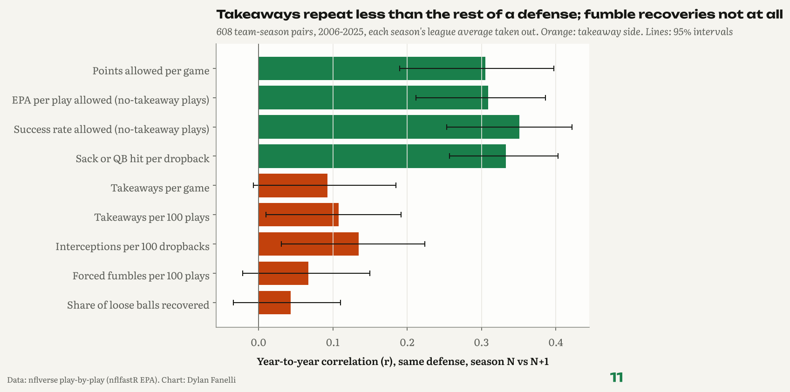
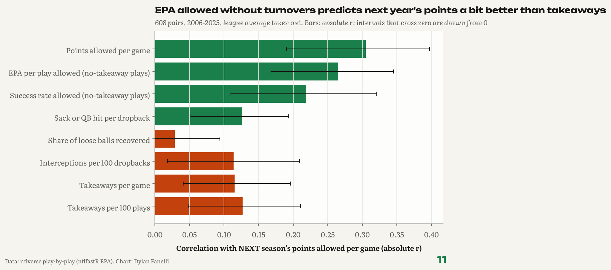
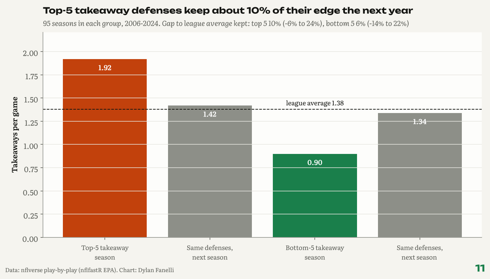
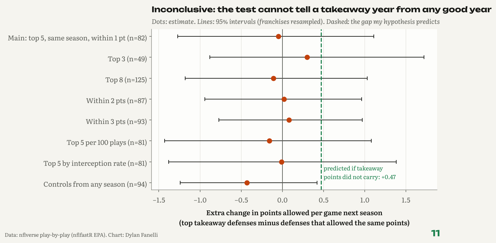
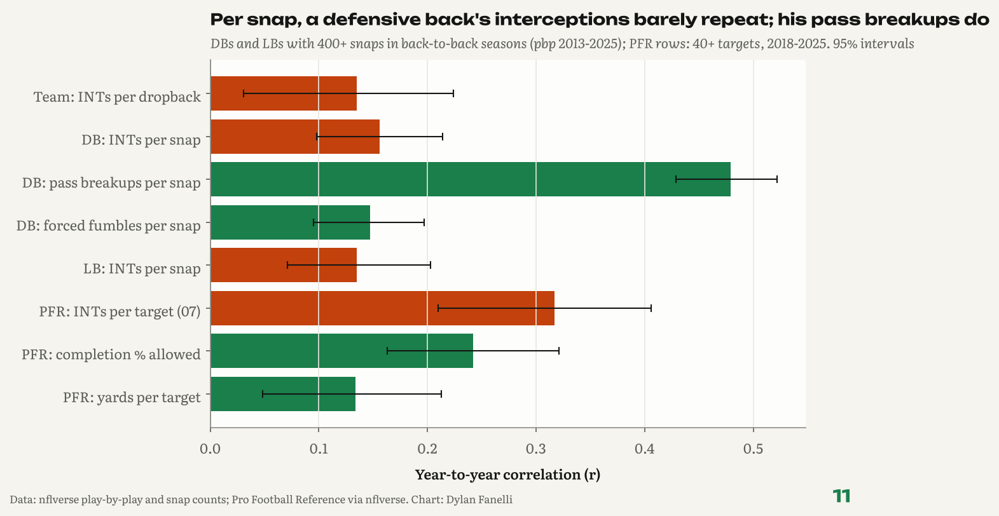
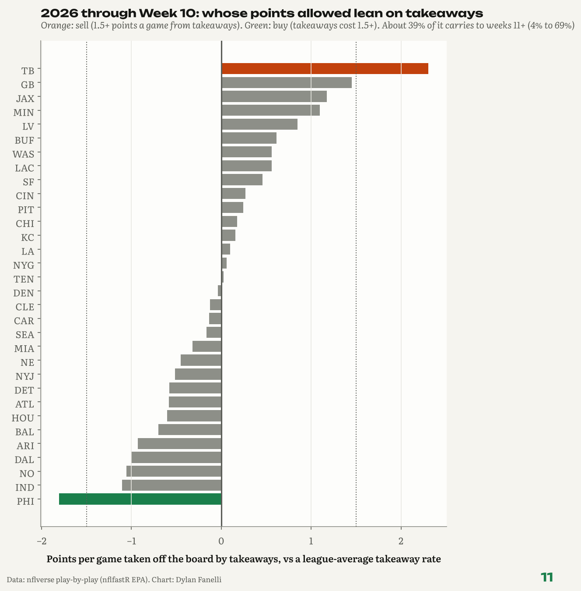

<sub>[← Portfolio](../../README.md) &nbsp;|&nbsp; [← 10 Draft Value](../10-draft-value/) &nbsp;|&nbsp; [13 Metric Stability Atlas →](../13-metric-stability-atlas/)</sub>

# 11 Turnovers Forced
### Takeaways don't repeat like the rest of a defense, but whether a takeaway year fools people, the data cannot tell

      

**TL;DR**

- Takeaways repeat less than the rest of a defense: with the league trend taken out, takeaways per play repeat year to year at r = 0.11 against 0.31 for EPA allowed without takeaways (gap 0.20, 95% interval 0.06 to 0.34), and who recovers a fumble does not repeat at all (r = 0.04; 608 team-season pairs, 2006-2025).
- Top-5 takeaway defenses keep 10% of their takeaway edge next year, but whether a takeaway year fools people is inconclusive: against same-points defenses their points allowed move -0.05 per game (95% interval -1.27 to +1.11), and my hypothesis predicts +0.47.
- EPA without turnovers predicts next year's points allowed better than takeaways in 3 of 3 out-of-sample splits, by a small margin; a defensive back's interceptions per snap repeat at r = 0.16, his pass breakups at 0.48.

<p align="center"></p>
<p align="center"><sub>Year-to-year stability of each defensive measure, with each season's league average taken out.</sub></p>

## Key numbers

| Measure | Value |
|---|---|
| Year-to-year r (league trend out): takeaways per play / INT rate / recovery share | **0.11 / 0.14 / 0.04** |
| Year-to-year r: EPA without takeaways / sack or hit rate / points allowed | **0.31 / 0.33 / 0.30** |
| Next-year points, base out-of-sample RMSE: takeaways / EPA / points allowed | **3.16 / 3.08 / 3.05** |
| Top-5 takeaway edge kept next year (95% interval) | **10% (-6% to 24%)** |
| Top-5 extra points allowed next year vs same-points defenses / predicted if fooled | **-0.05 (-1.27 to +1.11) / +0.47** |
| Carry share of points: takeaways / EPA without takeaways | **24% (-6% to 55%) / 35%** |
| DB year-to-year r: INTs per snap / breakups per snap / INTs per target (PFR) | **0.16 / 0.48 / 0.32** |
| 2026 sell / buy flags (through Week 10; no tested forecast edge) | **TB / PHI** |

## Why it matters for a club

- **Pro personnel and the coaching staff:** a defense's takeaway count is mostly this year's bounces; its success rate, EPA allowed without takeaways and pass rush are what carry, and fumble recoveries carry nothing.
- **Front office and free agency:** a big interception year from one defensive back mostly goes away; his pass breakups are the steadier sign of coverage, though they do not predict next year's interceptions.
- **Projecting next season:** start from points allowed and EPA without takeaways, not takeaways; whether a takeaway-heavy defense needs extra regression beyond that is not settled by this data.

## The question

**Do defenses that force turnovers keep doing it, and does a takeaway-heavy year fool people?**

Do defenses that force a lot of turnovers keep doing it, and does a takeaway-heavy year fool people about a defense? This is the defensive version of [study 04](../04-luck-index/) (luck in the win column) and [study 07](../07-box-score-tax/) (headline stats that do not repeat). My bet going in: takeaways are rare, noisy events, so a defense's takeaway rate would repeat less than the rest of its work, and next year's points allowed would follow the defense underneath the takeaways.


## Data

nflverse play-by-play, regular seasons 2006-2025 (640 team-seasons, 608 back-to-back pairs) plus 2026 through Week 10 (pulled 2026-11-20, last game 2026-11-16); nflverse snap counts 2013-2025 for 3,817 defensive back and linebacker seasons with 400+ snaps; Pro Football Reference advanced defense via [nflverse](https://github.com/nflverse/nflverse-data) (2018-2025) for the comparison with study 07.

## Results

### 1. Takeaways repeat less than the rest of a defense, and who falls on the ball does not repeat at all.

With each season's league average taken out (league interceptions fell from 2.88 to 1.92 per 100 dropbacks over these years, a shared trend that would otherwise look like a team trait), takeaways per play repeat year to year at r = 0.11 (95% interval 0.01 to 0.19) and interceptions per dropback at r = 0.14. EPA per play allowed on plays without a takeaway repeats at r = 0.31; the gap is 0.20 (95% interval 0.06 to 0.34) against takeaways and 0.17 (95% interval 0.04 to 0.30) against interceptions. The share of the offense's loose balls a defense recovers repeats at r = 0.04 (95% interval -0.03 to 0.11), forced fumbles at 0.07. The pass-rush proxy, a sack or QB hit per dropback, repeats at 0.33, success rate allowed at 0.35 and points allowed at 0.30. Without taking the league trend out, interceptions look stickier (0.26) than they are.

### 2. For next year's points, EPA without turnovers beats takeaways, modestly.

This year's EPA allowed without takeaways correlates r = 0.27 with next year's points allowed per game (both against the league average); takeaways per play, r = -0.13 (negative: more takeaways, fewer points). The gap is 0.14 (95% interval 0.05 to 0.22). Out of sample, EPA has the lower error in 3 of 3 splits (points per game, takeaways vs EPA: reversed 3.69 vs 3.52; leave one season out 3.40 vs 3.31; base 3.16 vs 3.08); in the base split (fit on seasons 2006-2015, scored on 2016-2024, each predicting the next, 288 pairs) the difference is 0.08 (95% interval -0.02 to 0.17). Adding takeaways to EPA lowers the error in 1 of 3 splits, so I find no signal in takeaways that EPA misses. The best single predictor is this year's points allowed, and none of them explains more than 9% of next year's points.

<p align="center"></p>
<p align="center"><sub>How well each measure predicts next season's points allowed.</sub></p>

### 3. How much of the points takeaways save carries into next year is too imprecise to pin down.

In the same season, a one-standard-deviation higher takeaway rate goes with 0.87 fewer points allowed per game, holding EPA without takeaways fixed; next season, 0.21 fewer, a carry share of 24% (95% interval -6% to 55%). For EPA without takeaways the share is 35% (22% to 47%). Split into parts, interceptions keep 0.23 of 0.75 points per SD (next-year interval -0.52 to +0.07); forced fumbles (+0.08, -0.20 to +0.36) and recovery share (+0.07, -0.18 to +0.32) keep nothing I can detect, and were worth little to begin with (0.21 and 0.16 points per SD).

### 4. Top-5 takeaway defenses lose most of the takeaways; whether their points allowed fall back further than other good defenses', the test cannot tell.

The 95 top-5 takeaway seasons (2006-2024) averaged 1.92 defensive takeaways per game against a league 1.38; the next year, 1.42. They kept 10% of their edge (95% interval -6% to 24%); 24% were top-5 again. Their points allowed rose 1.28 per game. Against defenses from the same season that allowed the same points (within 1) without the takeaways (82 of the 95 found such controls), the difference is -0.05 points per game (-1.27 to +1.11). My hypothesis predicts a gap of about +0.47 points per game (if takeaway points carried nothing next year and the rest carried like EPA, the 1.33 points a game these defenses' takeaways saved would cost them about that much more than their controls). The main interval holds both that value and zero (7 of the 8 versions hold the predicted value): the test cannot tell a takeaway year from any other good year, so I call it inconclusive, not failed. Across all 8 versions in `robustness_top5.csv` the gap runs -0.43 to +0.30, and 8 of the 8 intervals cross zero.

<p align="center"></p>
<p align="center"><sub>Top-5 and bottom-5 takeaway defenses, the year of and the year after.</sub></p>

<p align="center"></p>
<p align="center"><sub>Next-year change in points allowed: top takeaway defenses minus same-season defenses that allowed the same points, against the gap my hypothesis predicts.</sub></p>

### 5. Players: a defensive back's interceptions per snap barely repeat; his pass breakups do.

For defensive backs with 400+ snaps in back-to-back seasons (1,507 pairs, 2013-2025, each season's average taken out), interceptions per snap repeat at r = 0.16 (95% interval 0.10 to 0.21), pass breakups at r = 0.48, and this year's breakups say nothing about next year's interceptions (r = 0.01). The 95 defensive back seasons with 5+ interceptions averaged 5.75, then 2.60 the next year, keeping 20% of their per-snap edge over the average (9% to 31%).

<p align="center"></p>
<p align="center"><sub>Year-to-year stability of interceptions and coverage stats for players.</sub></p>

### 6. How that fits study 07.

Study 07 found interception rate repeats best of the public coverage stats in PFR's charting, and it still does here: per target (40+ targets, 605 pairs, 2018-2025) r = 0.32, above completion % allowed (0.24) and yards per target (0.13). Both findings hold. Per target is the friendlier denominator: the same players' interceptions per snap repeat at r = 0.23, and all defensive backs with 400+ snaps at 0.16. Being the stickiest of a noisy set is not the same as being sticky: even at r = 0.32, about 68% of a big interception year should be expected to go away.

### 7. The 2026 list, through Week 10: a description, not a forecast.

The rule, set before I ran it: flag a defense when its takeaway rate is worth 1.5+ points per game against a league-average rate (points per takeaway from a weeks 1-10 model on 640 team-seasons). Sell, points allowed lean on takeaways (1): **TB** (9 games: 19 defensive takeaways, 16 interceptions, 3 of 4 loose balls recovered; takeaway rate #1; 19.8 points allowed per game, #6; EPA allowed without takeaways #5). Takeaways took about 2.3 points a game off the board against a league-average rate; history says about 0.9 of that carries into weeks 11+. Buy, takeaways have cost points (1): **PHI** (9 games: 4 defensive takeaways, 3 interceptions, 1 of 7 loose balls recovered; takeaway rate #32; 24.6 points allowed per game, #19; EPA allowed without takeaways #24). Takeaways cost about 1.8 points a game onto the board against a league-average rate; history says about 0.7 of that carries into weeks 11+. The same rule run at Week 10 in 2006-2025 flagged 36 sells and 24 buys; against same-season defenses that had allowed about the same points, the sells' points allowed moved by -0.83 per game over the rest of the season (-2.29 to +0.79) and the buys' by +0.93 (-1.24 to +2.94). Neither interval excludes zero and the sell and buy estimates point the wrong way, so the flags show where points lean on takeaways and carry no tested forecast edge. Individual interception leaders so far (team where the interceptions came): Xavier McKinney (GB, 6), Amani Hooker (TEN, now BUF, 5), Zyon McCollum (TB, 4), Jevon Holland (NYG, 4), Byron Murphy (MIN, 4), Alex Anzalone (TB, 4), Renardo Green (SF, 4). Over full seasons, a defensive back keeps about 20% of a big interception year's edge into the next.

<p align="center"></p>
<p align="center"><sub>2026 through the latest completed week: points per game from takeaways against a league-average rate.</sub></p>

## Method

- **Plays:** regular-season runs and dropbacks with an EPA value and a down (penalty no-plays, special teams and two-point tries are left out). Teams are tracked as franchises (STL to LA, SD to LAC, OAK to LV), so relocations keep their year-to-year pairs.
- **Takeaways:** defensive takeaways only: an interception (`interception`) or a fumble lost by the offense (`fumble_lost`) on those plays. Muffed punts and kickoff fumbles a team recovers are not counted, so official takeaway totals can run a few higher. A fumble after an interception return belongs to the defense, so it is not counted twice.
- **Forced fumbles and recovery share:** offense fumbles (`fumbled_1_team` = the offense) with `fumble_forced`; recovery share = fumbles the defense recovered (`fumble_recovery_1_team`) over offense fumbles with a recovery team (out-of-bounds fumbles have none and are left out). League share over 2006-2025: 0.516.
- **Pass-rush proxy:** dropbacks (`qb_dropback`) with a sack or a QB hit, each dropback counted once (most sacks are also marked as hits). Play-by-play has no full pressure charting before 2023.
- **EPA and success without takeaways:** nflfastR EPA per play and success rate allowed, on plays with no takeaway. Points allowed are final scores, so they include return touchdowns given up by the offense and special teams.
- **League trend out:** for stability, prediction and carry, every team measure is taken relative to that season's league average (player rates relative to their position group's season average). The raw year-to-year values are kept in findings.json (`yoy_r_raw`).
- **Intervals:** 95%, from 1,000 resamples of franchises (team questions) or players (player questions) with all their seasons. Regressions in `models.txt` cluster errors by franchise.
- **Carry share:** the coefficient on a measure in next year's points-allowed regression divided by its coefficient in this year's, both with EPA without takeaways and takeaway rate together.
- **Top-5 test:** top 5 by takeaways per game each season (2006-2024, so a next season exists); ties at the cut (14 seasons) are broken by takeaways per play. Controls are teams from the same season outside the top 10 that allowed within 1 point per game of the top-5 team; the gap is the top-5 team's change minus the controls' mean change. The predicted gap is the EPA carry share times the points per game the top-5 teams' takeaways saved against the league (same-year regression).
- **2026 list:** takeaway points = (team takeaways per 100 plays minus the league's) times 1.36 points per game, the weeks 1-10 coefficient with EPA without takeaways held fixed. The carry share for the rest of a season is 39% (4% to 69%). The back-test matches each flagged team with same-season teams within 2 points per game.
- **Players:** from `interception_player_id`, `forced_fumble_player_1/2_player_id` and `pass_defense_1/2_player_id` (the interceptor, also credited with the pass defensed, is taken out of breakups), joined to snap counts through the nflverse player table. A leader's current team comes from his latest snap-count row.

**In equations**

- Takeaway rate $`= 100 \times (\text{INT} + \text{fumbles lost by the offense}) / \text{scrimmage plays}`$; recovery share $`= \text{defense recoveries} / \text{offense fumbles with a recovering team}`$.
- Carry share $`= \beta_{\text{next}} / \beta_{\text{same}}`$ from $`\text{PA}_{t} \text{ or } \text{PA}_{t+1} = \alpha + \beta_1 \text{EPA}^{\text{no TO}}_t + \beta_2 \text{TO rate}_t + \varepsilon`$, every term relative to its season's league average.
- Top-5 gap $`= \overline{\Delta \text{PA}}_{\text{top 5}} - \overline{\Delta \text{PA}}_{\text{same-season controls within 1 point}}`$; predicted gap if fooled $`=`$ EPA carry share $`\times`$ points per game the takeaways saved.

## Validation

- Out of sample in three splits (seasons 2006-2015 to 2016-2024, the reverse, and leave one season out): EPA without takeaways beats takeaways in 3 of 3, and adding takeaways to EPA helps in 1. The in-season version fits weeks 1-10 to weeks 11+ (points so far: RMSE 4.27; takeaways: 4.40; EPA without takeaways: 4.43).
- 8 versions of the top-5 test (top 3, top 8, match windows of 2 and 3 points, ranking per play, ranking by interception rate, controls from any season) are in `robustness_top5.csv`; the gap runs -0.43 to +0.30 points per game and 8 of 8 intervals cross zero.
- Within a season, which no league trend can touch, odd-week and even-week halves agree at r = 0.18 for takeaway rate, 0.20 for interception rate and -0.01 for recovery share, against 0.33 for EPA without takeaways: the same order as year to year.
- The player result does not depend on era: defensive backs' interceptions per snap repeat at r = 0.15 (0.07 to 0.24) in 2018 onward, the seasons study 07 covers. Study 07's PFR numbers are recomputed here with its own code and match.
- The buy/sell rule was fixed before the list was run and back-tested at the same week of every season since 2006; the back-test found no forecast edge, and the page says so.
- An independent review re-ran the study and checked every number, column definition and named player. It found that the year-to-year correlations were inflated by the league-wide fall in interceptions (now taken out), that the top-5 test matched controls across seasons (now within the season) and could not tell the two answers apart (now reported as inconclusive, with the predicted effect shown), that a claimed gain from adding takeaways to EPA did not survive other splits (removed), and that special-teams recoveries are outside the takeaway count and one interception leader had been traded (both now stated).

## Limitations

- No opponent adjustment: a defense that faced interception-prone quarterbacks gets credit for them.
- Points allowed include points the defense did not give up (pick-sixes and return touchdowns), which adds noise to every prediction here.
- The top-5 test has low power: its intervals are about 2.4 points per game wide, against a predicted effect of +0.47.
- The in-season test splits at Week 10; with a 9-10 game sample, a team's takeaway rate is about 20% signal by the split-half test (0.18 between odd and even weeks over a season).
- Player rates are per snap, not per target or per coverage snap: public data has no coverage assignments. The per-target check covers only 2018-2025.
- Interceptions include tipped balls and quarterback errors the defender did little to cause, and play-by-play cannot tell them apart.

## Next steps

- Opponent-adjust takeaway rates for the quarterbacks a defense faced.
- Use FTN charting (2022+) for dropped interceptions and tipped balls, so interceptions can be split into the defender's part and the quarterback's.
- A more powerful version of the fooled test: points per drive allowed by the defense alone, without return touchdowns, and more seasons as they come.

## Reproduce

```bash
pip install -r requirements.txt
python -m projects.turnovers_forced
```
Code: [`projects/turnovers_forced.py`](../../projects/turnovers_forced.py)

## Files in this folder

| File | What it holds |
|---|---|
| [`team_season_defense.csv`](team_season_defense.csv) | Every team-season, 2006 to the last full season: defensive takeaways, recovery share, pass rush, EPA and points allowed |
| [`top5_takeaway_seasons.csv`](top5_takeaway_seasons.csv) | The top-5 takeaway seasons and the season after |
| [`robustness_top5.csv`](robustness_top5.csv) | The top-5 test under eight versions |
| [`backtest_week10_flags.csv`](backtest_week10_flags.csv) | The buy/sell rule applied at the split week of every past season, with the rest-of-season result |
| [`buy_sell_2026.csv`](buy_sell_2026.csv) | This season through the latest completed week: every defense, its takeaway points and flag |
| [`models.txt`](models.txt) | Regression output, errors clustered by franchise |
| [`findings.json`](findings.json) | Every number quoted on this page, machine-readable |

---
<sub>[← Portfolio](../../README.md) &nbsp;|&nbsp; [← 10 Draft Value](../10-draft-value/) &nbsp;|&nbsp; [13 Metric Stability Atlas →](../13-metric-stability-atlas/)</sub>

<sub>© 2026 Dylan Fanelli. All rights reserved. To cite: Fanelli, D. (2026). *Turnovers Forced*. NFL Analytics. https://github.com/IForSureI/NFL-Analytics/tree/main/reports/11-turnovers-forced</sub>
