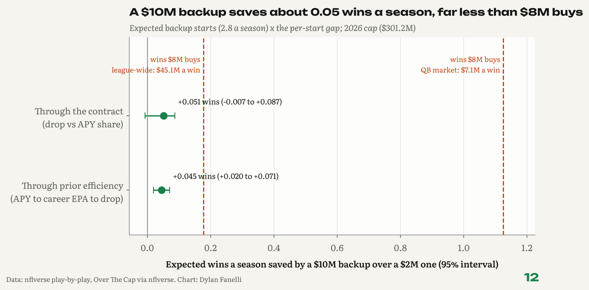
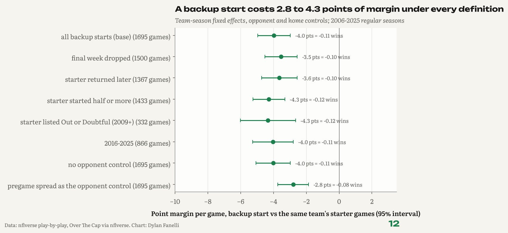
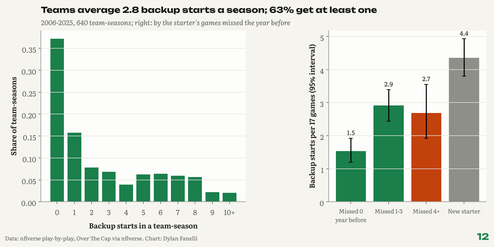
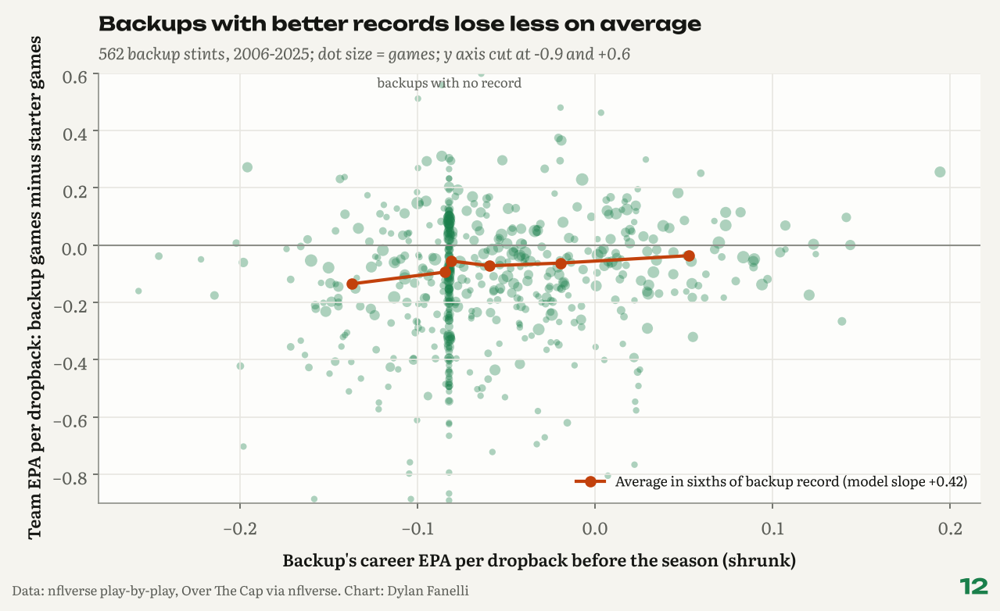
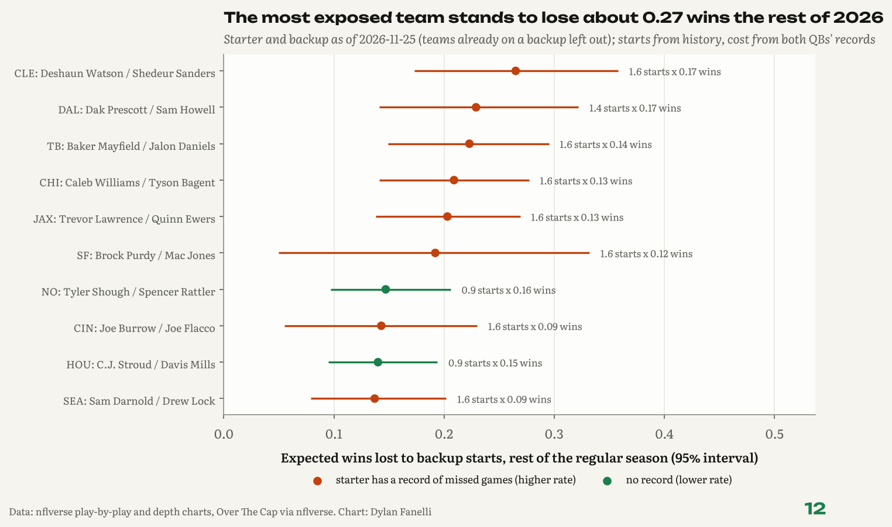

<sub>[← Portfolio](../../README.md) &nbsp;|&nbsp; [← 11 Turnovers Forced](../11-turnovers-forced/) &nbsp;|&nbsp; [13 Metric Stability Atlas →](../13-metric-stability-atlas/)</sub>

# 12 The Backup Quarterback
### A start costs a tenth of a win, but a \$10M backup does not pay for itself

       

**TL;DR**

- A backup start costs about 4.0 points of margin, 0.11 wins (95% interval 0.09 to 0.14), against the same team's starter games (1,695 backup starts, 2006-2025); teams average 2.8 backup starts a season, so about 0.31 wins.
- A \$10M backup over a \$2M one saves about 0.05 wins a season (95% interval -0.007 to +0.087), worth \$0.4M to \$2.3M depending on the price per win: my bet that a good backup is underpriced insurance failed.
- A better record helps more than a bigger contract: +0.10 of the backup's career EPA per dropback is worth 0.065 wins a start; in 2026 the most exposed team whose starter has an injury history (CLE) stands to lose about 0.27 wins to backup starts the rest of the way.

<p align="center"></p>
<p align="center"><sub>Expected wins a season saved by a 10-million-dollar backup over a 2-million-dollar one, against what the extra 8 million buys at each price per win.</sub></p>

## Key numbers

| Measure | Value |
|---|---|
| Point margin per backup start (95% interval) | **-4.0 (-5.0 to -3.0)** |
| Wins per backup start: via margin / via EPA / direct | **-0.111 / -0.095 / -0.121** |
| Backup starts per 17 games, all seasons / last ten | **2.77 (2.41-3.17) / 2.79** |
| Wins per point of margin per game | **0.0279** |
| Margin per start per +0.10 backup career EPA per dropback | **+2.33 (+1.22 to +3.45)** |
| Dollars per win: QB market / league-wide (replacement = 3 wins) | **\$7.1M / \$45.1M** |
| \$10M vs \$2M backup: wins a season saved | **+0.051 (-0.007 to +0.087)** |
| Value of those wins: QB market / league-wide price vs the \$8M cost | **\$0.36M / \$2.28M** |

## Why it matters for a club

- **Cap planning:** a backup's expected-win value is small next to his price; a club should not pay for a big backup contract on expected wins alone, and should say so when it does it for other reasons (a contender's leverage, a fragile starter).
- **Pro personnel:** shop on the backup's record, not his contract; a better record is worth more per start than extra pay buys.
- **Front office and coaching:** backup starts cost an average team a fraction of a win a season; a starter with missed games behind him raises the expected starts, and the team-by-team exposure shows where.

## The question

**How many wins does a backup quarterback start cost, and what is a good backup worth in cap dollars?**

Every March a club decides how much to spend on the quarterback who is not supposed to play, and few people put a price on it. How many wins does a team lose when its starter misses a game, how much does the backup's quality change that, and what is a good backup worth in cap dollars? My bet going in: backup starts are common and costly enough that a good backup is underpriced insurance. The first half held; the second did not.


## Data

nflverse play-by-play, regular seasons 2006-2025 (10,398 team-games, 640 team-seasons) plus 2026 through Week 11 (pulled 2026-11-26, last game 2026-11-23); Over The Cap contracts via [nflverse](https://github.com/nflverse/nflverse-data) (the deal each backup was playing on, and 149 veteran quarterback deals for the market price); nflverse injury reports (2009+) and the nflverse depth chart of 2026-11-25. Dollars are in 2026 cap terms (\$301.2M).

## Results

### 1. A backup start costs about 4.0 points of margin, or 0.11 wins.

Against the same team's games with its starter in the same season (402 team-seasons, 1,695 backup starts), holding opponent and home field fixed, a backup start lowers team EPA per dropback by 0.092 (95% interval 0.074 to 0.109), points scored by 2.9 (2.2 to 3.5) and point margin by 4.0 (3.0 to 5.0). Three ways to wins agree: EPA to points (0.092 x 37 dropbacks = 3.4 points) to wins gives 0.095; margin to wins gives 0.111 (95% interval 0.085 to 0.138); the win rate itself falls 0.121 (0.091 to 0.150). Across the other 7 definitions in `robustness_cost_per_start.csv` (final week dropped, starter came back later, starter listed Out or Doubtful on the injury report, and others) the cost runs 3.5 to 4.3 points. With the closing point spread as the opponent control it is 2.8 (1.9 to 3.7), 0.078 wins; that version understates the cost, because the line already prices a backup start announced before kickoff.

<p align="center"></p>
<p align="center"><sub>Point margin in backup starts against the same team's starter games, under each definition.</sub></p>

### 2. Teams average 2.8 backup starts a season, and a starter who missed games the year before misses more.

Over 2006-2025 a quarterback other than the season starter started 16.3% of games (benchings included): 2.77 per 17 (95% interval 2.41 to 3.17); 2.79 in 2016-2025. 63% of team-seasons had at least one backup start and 32% had four or more. A starter who missed no games the year before was followed by 1.5 backup starts (1.2 to 1.9; 252 team-seasons); one who missed 1-3, 2.9; 4+, 2.7 (1.9 to 3.5; only 53 team-seasons); a new starter, 4.4, which includes benchings. At about 0.11 wins a start, the average team loses about 0.31 wins a season to backup starts.

<p align="center"></p>
<p align="center"><sub>Backup starts per team-season, and by the starter's missed games the year before.</sub></p>

### 3. A backup with a better record loses less, but backups' records are bunched together.

Each +0.10 of the backup's career EPA per dropback before the season (shrunk toward what backups do when they start, -0.082, with a prior worth 195 dropbacks) is worth 2.3 points of margin a start (95% interval 1.2 to 3.5), or 0.065 wins. But the spread of backups' records is narrow (SD 0.066 after shrinkage; 23% of backup starts went to quarterbacks with no prior dropbacks), so one standard deviation of backup quality is worth about 0.043 wins a start. The starter's own record should matter too (a better starter leaves more to lose), and the estimate points that way, but it is not clear of zero: -0.65 points a start per +0.10 of the starter's record (95% interval -2.49 to +1.19).

<p align="center"></p>
<p align="center"><sub>The drop in team EPA per dropback against the backup's record before the season.</sub></p>

### 4. Paying a backup more goes with a smaller drop, but the link is weak: 0.25 points a start per 1% of the cap.

For the 75% of backup starts where I found the deal the backup was playing on (1,264 starts, 311 team-seasons; average 3.2% of the cap), each extra 1% of the cap in APY goes with 0.25 points of margin a start (95% interval 0.02 to 0.47 with errors clustered by franchise; -0.03 to 0.42 when franchises are resampled, which crosses zero). With the backup's record in the same model, pay adds 0.12 (-0.16 to 0.40): once the record is known, the contract tells me little more. Pay buys a better record, but not much of one: +1% of the cap goes with +0.0094 career EPA per dropback (95% interval +0.0077 to +0.0111; 413 backup stints).

### 5. Dollars per win: \$7.1M from the quarterback market, \$45M league-wide.

Veteran quarterback deals (149 contracts, 67 players, 2011-2026) pay 4.2% of the cap (95% interval 2.8% to 5.7%) per +0.10 platform-season EPA per dropback, \$12.7M in 2026 dollars; +0.10 over a season is worth 1.78 wins (0.10 x 38 dropbacks x 17 games x 0.0279 wins per point of margin), so the market pays \$7.1M a win (5.0 to 9.6). The league-wide check, cap spent above a minimum-salary roster over wins above a replacement team, gives \$38M to \$55M a win for a replacement team of 2 to 4 wins. The league-wide figure is 6.3 times the quarterback-market one. One likely reason is that the cap holds the best quarterbacks' pay below their value, so the quarterback market is cheap per win; another is that platform EPA is a noisy measure of what teams pay for. I show both.

### 6. A \$10M backup over a \$2M one saves about 0.05 wins a season, worth \$0.4M to \$2.3M, short of the \$8M it costs.

Value = expected backup starts (2.8) x the per-start gap (2.66% of the cap x 0.25 points = 0.65 points, x 0.0279) x dollars per win: 0.051 wins (95% interval -0.007 to +0.087; above zero in 96% of draws). Through prior efficiency instead (what the extra pay buys in career EPA, times what that is worth) it is 0.045 (0.020 to 0.071). At the quarterback-market price that is \$0.36M (-\$0.05M to \$0.69M) and no bootstrap draw reaches \$8M; at the league-wide price, \$2.28M. The upgrade breaks even only for a team expecting 10+ backup starts a season at the league price (62+ at the quarterback-market price). Across the 6 samples in `robustness_two_vs_ten.csv` the value runs \$2.11M to \$3.46M at the league price. The data favors shopping on a backup's record over his price: the record predicts the drop (finding 3), and pay buys little record (finding 4).

### 7. No 2026 team with its starter in place stands to lose more than 0.27 wins to backup starts the rest of the way.

For each team I take the starter and backup from the depth chart of 2026-11-25, expect backup starts at the rate history shows after game 10 for a team's starter so far with or without a record of missed games (22.9% of remaining games, 95% interval 17.3% to 28.6%, vs 13.4%; 2008-2025), and cost each start from both quarterbacks' records. Starters with an injury history (checked against news on 2026-11-26), most exposed first: **CLE** (Deshaun Watson, backup Shedeur Sanders: 1.6 expected backup starts x 0.17 wins = 0.27, 95% interval 0.17 to 0.36; Watson tore his Achilles in 2024 and missed all of 2025; Sanders started in Week 9 of 2026 while Watson was in the concussion protocol); **DAL** (Dak Prescott, backup Sam Howell: 1.4 expected backup starts x 0.17 wins = 0.23, 95% interval 0.14 to 0.32; Prescott missed the second half of 2024 with a hamstring injury); **TB** (Baker Mayfield, backup Jalon Daniels: 1.6 expected backup starts x 0.14 wins = 0.22, 95% interval 0.15 to 0.29; Mayfield missed three 2026 games with a thumb injury and is back); **CHI** (Caleb Williams, backup Tyson Bagent: 1.6 expected backup starts x 0.13 wins = 0.21, 95% interval 0.14 to 0.28; Williams missed three 2026 games with a hamstring injury and is back); **JAX** (Trevor Lawrence, backup Quinn Ewers: 1.6 expected backup starts x 0.13 wins = 0.20, 95% interval 0.14 to 0.27; Lawrence missed most of the second half of 2024 (shoulder, concussion)). Also in the chart: SF (Brock Purdy, backup Mac Jones, 0.19: Purdy missed 2025 games with a toe injury; an ankle sprain has him uncertain for Week 12); NO (Tyler Shough, backup Spencer Rattler, 0.15: Shough has no missed starts as the starter); CIN (Joe Burrow, backup Joe Flacco, 0.14: Burrow missed much of 2025 with a turf toe injury; Flacco returned as his backup); HOU (C.J. Stroud, backup Davis Mills, 0.14: Stroud missed games with a concussion in 2025); SEA (Sam Darnold, backup Drew Lock, 0.14: Darnold missed 2026 games with an oblique injury; reported on Nov. 25 as expected to start Week 12). Exposure across all teams with their starter in place runs 0.03 to 0.27 wins, and the top team's interval reaches down to 0.17, inside the range of the teams below it, so the order is a guide, not a ranking. 10 teams now start a quarterback other than the one who started most of their games (injuries, benchings and releases), among them IND (Daniel Jones was released on Nov. 20; Richardson is the starter); MIA (Malik Willis is on injured reserve with a groin injury; McCord is starting); BAL (Lamar Jackson is on injured reserve with a fractured thumb; Brissett is starting); PIT (Aaron Rodgers was benched and released on Nov. 25; Rudolph is the starter).

<p align="center"></p>
<p align="center"><sub>Expected wins lost to backup starts for the rest of 2026, teams with their starter in place.</sub></p>

## Method

- **Games and quarterbacks:** regular-season games 2006-2025. The game's quarterback is the passer with the most dropbacks for his team (`qb_dropback` = 1 with an EPA and a down, credited by `passer_id`, which nflverse fills for scrambles and sacks too). A team's season starter is the quarterback who was the game's quarterback most often (ties: more dropbacks). A backup start is any game the season starter did not quarterback, so benchings count too. Team EPA per dropback uses every dropback with an EPA and a down, including those wiped out by penalties. Two robustness versions move it toward injuries (the starter returned later; the starter was listed Out or Doubtful). Teams are franchises (STL to LA, SD to LAC, OAK to LV).
- **Cost per start:** game-level regressions of team EPA per dropback, points scored, point margin and win (ties = 0.5) on a backup-start indicator with a fixed effect for every team-season, a home indicator and the opponent's quality that season with this game left out (defensive EPA per dropback allowed for EPA; point margin per game for points, margin and wins). Only team-seasons with both kinds of game count. Errors are clustered by franchise; bootstrap intervals resample franchises.
- **Points to wins:** EPA is in points (nflfastR's expected points model), so EPA per dropback x dropbacks per game is points per game. Points to wins: win share on point margin per game across 640 team-seasons gives 0.0279 wins per point (95% interval 0.0269 to 0.0290), the slope behind the Pythagorean expectation in [study 04](../04-luck-index/). I did not use study 02's win-probability model: it prices game states, and a whole game's margin already carries what it would add.
- **Backup and starter quality:** career EPA per dropback in seasons before the current one (from 2006), shrunk toward a prior mean with a prior worth k = 195 dropbacks (per-dropback noise variance over the variance of true EPA per dropback between quarterbacks, quarterback-seasons with 100+ dropbacks). Backups are shrunk toward what backups do when they start (-0.082), starters toward starters. Both enter as interactions with the backup indicator.
- **Contracts:** the deal in force for the backup that season from his Over The Cap contract history (the latest deal signed on or before the season whose years cover it; an extension covers the years after the deal it extends), APY over the cap in the year signed (the cap read from Over The Cap's own APY and cap-share columns). Rookie and veteran deals are both kept; the veteran-only version is in the robustness file.
- **Dollars per win, quarterback market:** veteran QB deals from 2011 (rookie deals dropped, one deal per player-year, 2%+ of the cap), APY share of the cap on the platform season's EPA per dropback (shrunk toward the league with the same k = 195 dropbacks) and dropbacks, platform season = the year before signing, 200+ dropbacks, errors clustered by player. **League-wide check:** 98% of the 2026 cap minus a 53-man roster at the first-year minimum (\$46.9M), over 8.5 minus a replacement team's wins.
- **Value:** expected backup starts per 17 games x wins per start gap x dollars per win. Intervals multiply independent bootstrap draws (franchises resampled for the start rate, the per-start gap and the points-to-wins slope; players for the dollars per win), so they treat those pieces as independent.
- **2026 exposure:** the starter and backup are the depth chart's first two quarterbacks. The rest-of-season rate is measured the way it is used: for every team-season 2008-2025 in which the quarterback who started game 10 was also the team's starter so far (475 team-seasons), the share of the remaining games someone else started. A record of missed games means 4+ games with no dropback, after his first start, as his team's season starter in either of the two seasons before, or a game this season, after his first start, with no dropback (a game he left hurt does not count). Where the news check found that the missed games were a benching (CAR), the lower rate is used. Every team in the chart was checked against news on 2026-11-26.

**In equations**

- $`y_{g} = \alpha_{\text{team-season}} + \beta\,\text{backup}_g + \gamma\,\text{home}_g + \delta\,\text{opp}_g + \varepsilon_g`$, errors clustered by franchise.
- $`\text{wins per start} = \beta_{\text{margin}} \times \partial\,\text{win\%}/\partial\,\text{margin per game}`$; $`\text{points} = \Delta\text{EPA per dropback} \times \text{dropbacks per game}`$.
- Value $`= E[\text{backup starts}] \times (\text{wins lost}_{\text{cheap}} - \text{wins lost}_{\text{pricey}}) \times \text{dollars per win}`$.

## Validation

- The cost of a start holds in 8 versions (final week dropped, starter returned later, starter started half or more, starter listed Out or Doubtful on the injury report, 2016-2025, no opponent control, the closing spread as the control): margin -4.3 to -2.8 points a start; 8 of 8 intervals are below zero.
- Three routes from the effect to wins: EPA to points to wins -0.095, margin to wins -0.111, the win rate directly -0.121.
- Franchise-bootstrap intervals (1000 samples, every season of a franchise together) match the clustered ones: margin -4.91 to -3.06.
- The \$10M vs \$2M value under 6 samples (veteran deals only, final week dropped, starter returned later, last ten seasons, injury-report starts) runs \$2.11M to \$3.46M at the league-wide price; 6 of 6 are below the \$8M cost.
- The rest-of-season rate used for 2026 is measured the same way in 475 past team-seasons (2008-2025), not taken from full-season averages.
- Every team in the exposure chart was checked against news on 2026-11-26; teams now starting someone other than their starter so far are left out.
- An independent review re-ran the study and checked every number, column definition and named player. It found that a game the starter left hurt was being read as a missed game (NYJ), that the starter rule could pick a quarterback the team had released (PIT, IND), that the rest-of-season rate counted a fill-in's starter returning as a backup start, that the extension logic in the contract lookup started an extension too early, and that the pay effect's interval crosses zero when franchises are resampled; all are fixed or reported.

## Limitations

- Play-by-play cannot tell an injury from a benching. The injury-report version (332 backup starts with the starter listed Out or Doubtful) gives 4.3 points against 4.0, but players on injured reserve are not on that report, so it is a narrow sample.
- Games where the starter left hurt after the backup had the most dropbacks count as backup starts; games where he left late count as his. A partial game in either direction blurs the cost a little.
- Backup quality is seen only for backups who played. A team that trusts its backup may also have a starter it is willing to rest, and teams with a bad backup may sign a veteran when the starter goes down.
- Expected value is not the whole case for insurance. A contender's marginal win is worth more than an average one, playoff games are not in this sample, and a club may pay to cut the chance of a lost season, not the average loss.
- The two prices per win differ by 6.3 times, and both rest on assumptions (the quarterback market's EPA-to-pay slope; a replacement team's wins). The conclusion that \$10M over \$2M does not pay holds at both, but the dollar value does not.
- Careers before 2006 are not in the backup's record, which understates the record of a few veteran backups early in the sample.
- I found the contract in force for 75% of backup starts; the rest have no Over The Cap deal covering that season in the nflverse file, so the contract sample may not match the full one.
- The depth chart is nflverse's copy of 2026-11-25 and can lag a move made since; the team notes are as of 2026-11-26.

## Next steps

- Use snap-level participation to find games the starter left hurt, so partial games are split correctly.
- Add playoff leverage: weight a backup start by how much the game moves a team's playoff odds.
- Price backups on a forecast of their efficiency that adds college and preseason data for quarterbacks with no NFL record.

## Reproduce

```bash
pip install -r requirements.txt
python -m projects.backup_qb_value
```
Code: [`projects/backup_qb_value.py`](../../projects/backup_qb_value.py). Builds on [study 04](../04-luck-index/) (points to wins).

## Files in this folder

| File | What it holds |
|---|---|
| [`robustness_cost_per_start.csv`](robustness_cost_per_start.csv) | The cost of a backup start under each definition |
| [`robustness_two_vs_ten.csv`](robustness_two_vs_ten.csv) | The 10-million vs 2-million-dollar backup value under each sample, at both prices per win |
| [`team_seasons.csv`](team_seasons.csv) | Every team-season: games, backup starts and the starter's missed starts the year before |
| [`rest_of_season_history.csv`](rest_of_season_history.csv) | Past team-seasons: the game-10 starter (when he was the starter so far), his record, and the remaining games someone else started |
| [`exposure_2026.csv`](exposure_2026.csv) | This season: each team's starter and backup, expected backup starts and wins lost for the rest of the season, with the news note |
| [`models.txt`](models.txt) | Regression output, errors clustered by franchise |
| [`findings.json`](findings.json) | Every number quoted on this page, machine-readable |

---
<sub>[← Portfolio](../../README.md) &nbsp;|&nbsp; [← 11 Turnovers Forced](../11-turnovers-forced/) &nbsp;|&nbsp; [13 Metric Stability Atlas →](../13-metric-stability-atlas/)</sub>

<sub>© 2026 Dylan Fanelli. All rights reserved. To cite: Fanelli, D. (2026). *The Backup Quarterback*. NFL Analytics. https://github.com/IForSureI/NFL-Analytics/tree/main/reports/12-backup-qb-value</sub>
