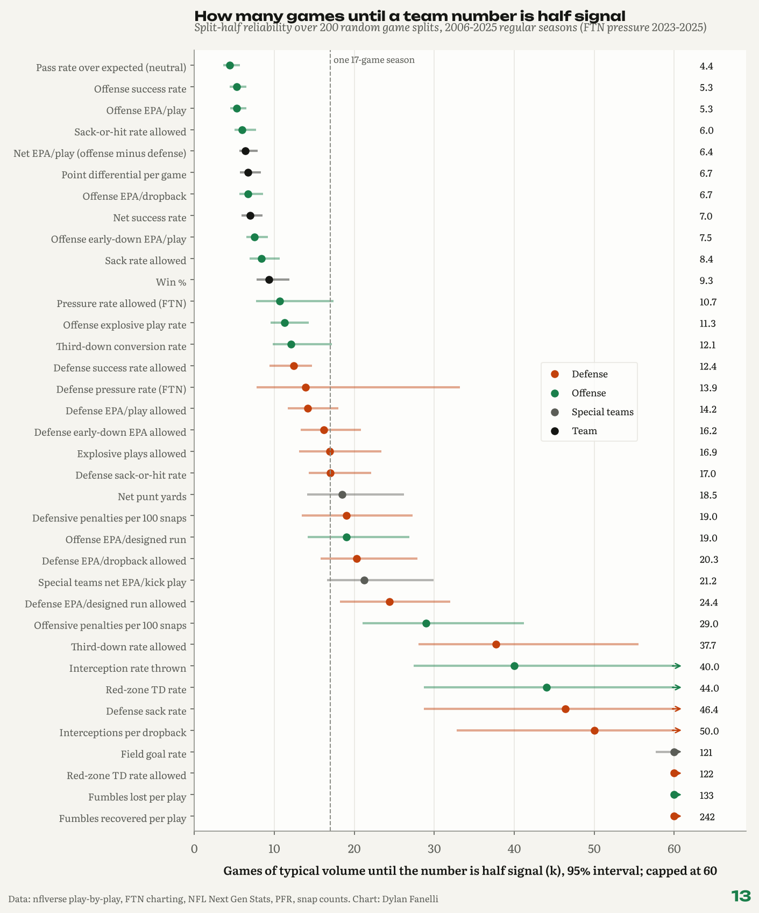
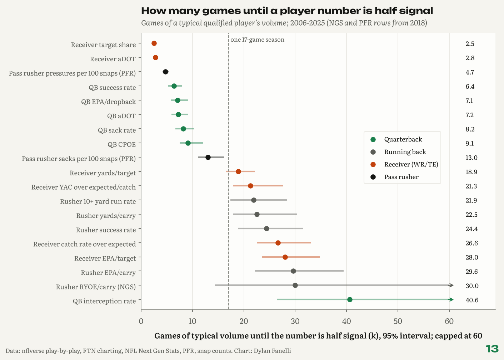
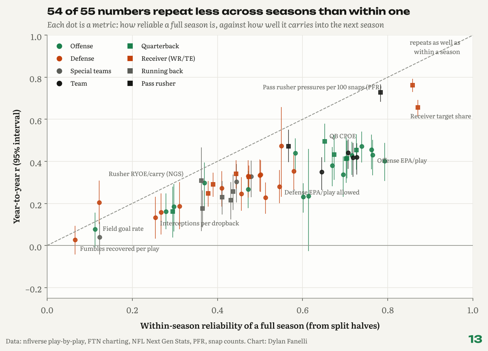
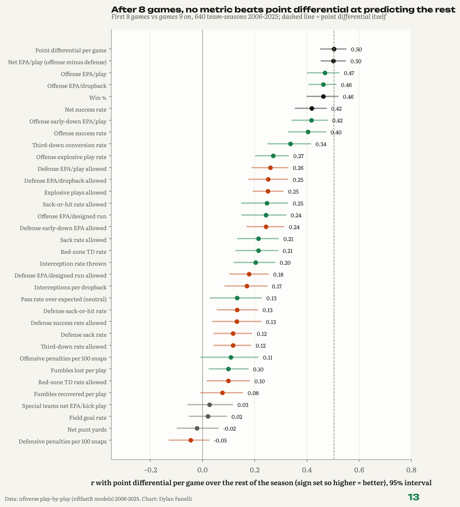
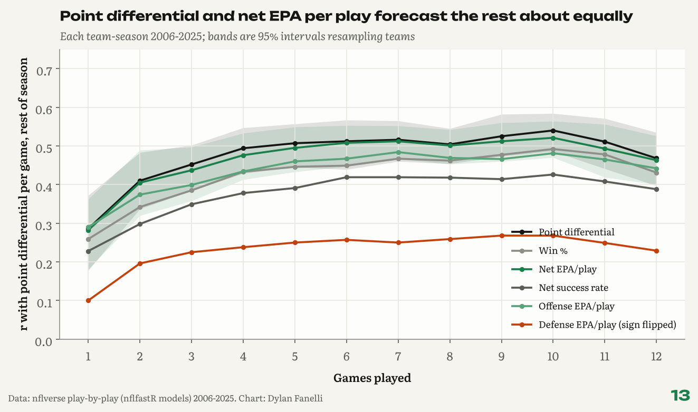
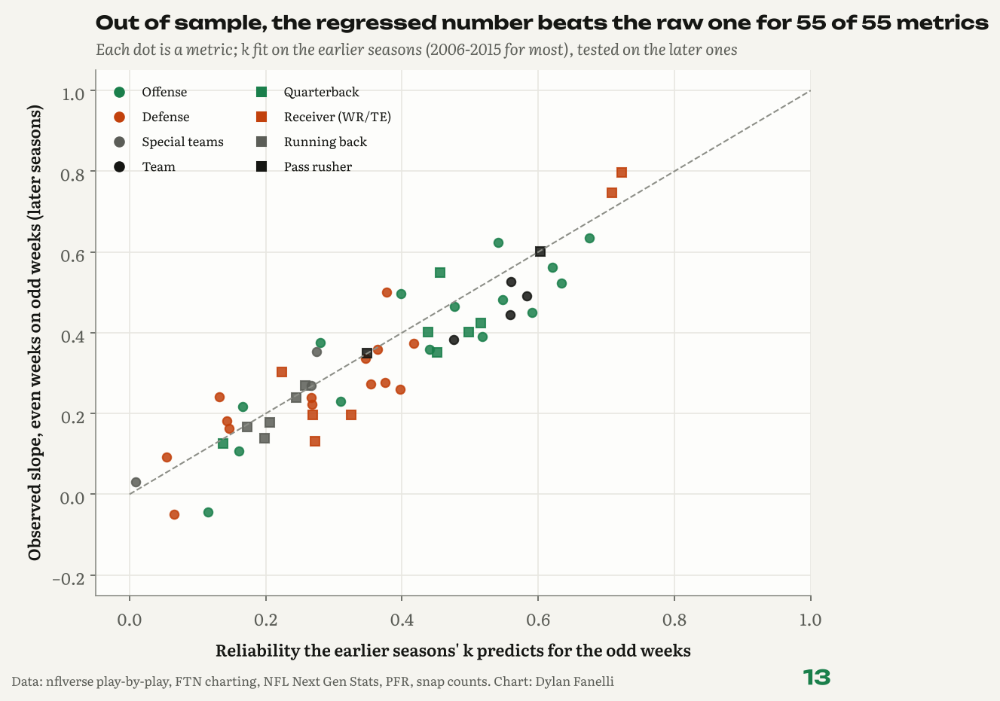

<sub>[← Portfolio](../../README.md) &nbsp;|&nbsp; [← 12 Backup QB Value](../12-backup-qb-value/)</sub>

# 13 The Metric Stability Atlas
### Which numbers a club can trust, and after how many games

      

**TL;DR**

- Offense numbers settle faster than defense numbers: offense EPA per play is half signal after 5.3 games (95% interval 4.5 to 6.5), defense EPA per play after 14.2 (11.7 to 18.0), and 16 of 36 team numbers are still less than half signal after a full season.
- After 8 games, no metric beats point differential at predicting the rest of the season; net EPA per play ties it (r = 0.50 vs 0.50, 640 team-seasons), and out of sample it lifts R² only from 0.251 to 0.257.
- A defense's pressure rate is half signal after 13.9 games, its sack rate after 46.4; target share settles in 2.5 games, receiver and rusher efficiency in more than a season. Regressing by these rules beat the raw number out of sample for 55 of 55 metrics.

<p align="center"></p>
<p align="center"><sub>Games until each team number is half signal, with 95% intervals (resampling teams).</sub></p>

## Key numbers

| Measure | Value |
|---|---|
| Offense EPA/play: games to half signal (95% interval) | **5.3 (4.5 to 6.5)** |
| Defense EPA/play allowed: games to half signal | **14.2 (11.7 to 18.0)** |
| Offense more reliable than defense, matched pairs | **13 of 14** |
| Defense pressure rate / sack rate: games to half signal | **13.9 / 46.4** |
| Team numbers under half signal after 17 games | **16 of 36** |
| After 8 games, r with rest-of-season point differential: point differential / net EPA | **0.50 / 0.50** |
| QB Weeks 1-9 to Weeks 10+ EPA/dropback: r from EPA / from CPOE | **0.50 / 0.36** |
| Regressed beats raw out of sample | **55 of 55 metrics** |

## Why it matters for a club

- **Self-scouting and game planning:** by Week 5 or 6 an offense's EPA, success rate and pass rate over expected are mostly signal; a defense's are not until late in the season, so a staff should not rebuild a defensive plan on four games.
- **Pro personnel, the trade deadline and free agency:** a receiver's target share and a pass rusher's pressure rate are trustworthy after a few games; a receiver's or back's per-touch efficiency is not, even after a full season, so regress it hard (the atlas says how far) before paying for it.
- **Front office and ownership:** at midseason, point differential and net EPA per play are the honest read of a team; turnovers forced, fumble recoveries, red-zone and field-goal rates are mostly noise and should not drive personnel moves.
- **Analytics staff:** every weekly board can carry the regression constant from this atlas, so a hot month is shown next to what it is likely to be worth. The rule was tested out of sample before it is offered.

## The question

**Which team and player numbers can a club trust, and after how many games?**

A club reads dozens of team and player numbers every week. Some are mostly signal after a month; some are still mostly noise after a full season, and a staff that reacts to those is chasing luck. For 36 team numbers and 19 player numbers, I measured how fast each one becomes signal within a season, how well it carries into the next season, and which early-season team numbers predict the rest of the season. Two earlier studies here found boards that do not repeat (the fourth-down team card, the pass-rusher sack board); this study asks the same question of everything else. It is the football twin of the [Reliability Atlas](https://github.com/IForSureI/Dylan-Fanelli-Baseball-Analytics-Portfolio/blob/main/reports/2026-reliability-atlas.md) in my baseball portfolio.

**Inspired by:** Michael MacKelvie, [Does Defense Win Championships...?](https://www.youtube.com/watch?v=exOWLuFCkwg) (offense is more stable week to week than defense). The regression constant is the idea behind Russell Carleton's stabilization work in baseball.  

## Data

nflverse play-by-play 2006-2025 regular seasons (648,479 offensive plays, 640 team-seasons; nflfastR EPA, success, CPOE, xpass and xYAC), FTN pressure charting via nflverse participation (2023-2025), NFL Next Gen Stats weekly rushing (RYOE, 2018-2025), Pro Football Reference weekly defense (pressures and sacks, 2018-2025), snap counts and players, all via [nflverse](https://github.com/nflverse/nflverse-data), pulled 2026-11-15. The 2026 season (through Week 10) is left out of every estimate and used only for the current-season table. Not measured: Yards per route run, because there are no public per-player route counts, since nflverse participation lists only the targeted receiver's route. Team pressure rate before 2023, because the 2016-2022 participation pressure field comes from a different source and leaves sacks out. Pass-rusher pressure per pass-rush snap, because there are no public pass-rush snap counts, so pressures per defensive snap are used instead.

## Results

### 1. Offense numbers settle faster than defense numbers.

Across the 14 offense and defense pairs, the offensive version is more reliable over a full season in 13. The median team number is half signal after 10.7 games on offense and 19.6 on defense. Offense EPA per play is half signal after 5.3 games (4.5 to 6.5) and 76% signal over 17 games; defense EPA per play allowed takes 14.2 games (11.7 to 18.0) and reaches 55%. The fastest team number to settle is pass rate over expected (neutral), half signal after 4.4 games (3.6 to 5.7); it is a choice, not a result. Point differential is half signal after 6.7 games (5.7 to 8.3), win % after 9.3 games (7.8 to 11.9).

### 2. Pressure settles; sacks, takeaways, fumbles, red-zone and field-goal rates mostly do not.

A defense's pressure rate (FTN charting, 2023-2025 only, so a wide interval) is half signal after 13.9 games (7.8 to 33.2); its sack rate after 46.4 games (28.7 to 92.1). Interceptions per dropback take 50.0 games (32.8 to 91.3). Fumbles recovered per play, red-zone TD rate allowed and field-goal rate are close to pure noise within a season: split-half r = 0.03 (-0.02 to 0.09), 0.06 (-0.00 to 0.11) and 0.06 (0.01 to 0.11). 16 of 36 team numbers are still less than half signal after a full 17-game season.

**The team atlas, most to least reliable over a full season.** Regress = how far to pull the number toward the league mean after 4, 8 and 17 games of typical volume.

| # | Metric | Trial | Split-half r (95%) | Half signal after k trials (games) | Signal in a full season | Regress after 4 / 8 / 17 games | Year-to-year r (95%) |
|---|---|---|---|---|---|---|---|
| 1 | Pass rate over expected (neutral) | neutral plays | 0.65 (0.59 to 0.69) | 118 (4.4) | 79% | 53% / 36% / 21% | 0.40 (0.31 to 0.49) |
| 2 | Offense EPA/play | plays | 0.61 (0.56 to 0.64) | 328 (5.3) | 76% | 57% / 40% / 24% | 0.43 (0.33 to 0.50) |
| 3 | Offense success rate | plays | 0.60 (0.55 to 0.65) | 332 (5.3) | 76% | 57% / 40% / 24% | 0.46 (0.36 to 0.53) |
| 4 | Sack-or-hit rate allowed | dropbacks | 0.57 (0.52 to 0.62) | 226 (6.0) | 74% | 60% / 43% / 26% | 0.47 (0.39 to 0.54) |
| 5 | Net EPA/play (offense minus defense) | plays | 0.56 (0.51 to 0.59) | 398 (6.4) | 73% | 62% / 44% / 27% | 0.42 (0.34 to 0.49) |
| 6 | Point differential per game | games | 0.55 (0.49 to 0.59) | 7 (6.7) | 72% | 63% / 46% / 28% | 0.42 (0.33 to 0.49) |
| 7 | Offense EPA/dropback | dropbacks | 0.55 (0.49 to 0.59) | 253 (6.7) | 72% | 63% / 46% / 28% | 0.43 (0.34 to 0.49) |
| 8 | Net success rate | plays | 0.54 (0.49 to 0.58) | 440 (7.0) | 71% | 64% / 47% / 29% | 0.44 (0.36 to 0.50) |
| 9 | Offense early-down EPA/play | early-down plays | 0.52 (0.47 to 0.56) | 360 (7.5) | 70% | 65% / 48% / 30% | 0.34 (0.23 to 0.42) |
| 10 | Sack rate allowed | dropbacks | 0.49 (0.43 to 0.54) | 315 (8.4) | 67% | 68% / 51% / 33% | 0.38 (0.28 to 0.47) |
| 11 | Win % | games | 0.47 (0.41 to 0.51) | 9 (9.3) | 64% | 70% / 54% / 36% | 0.35 (0.26 to 0.42) |
| 12 | Pressure rate allowed (FTN) | dropbacks | 0.44 (0.33 to 0.53) | 398 (10.7) | 61% | 73% / 57% / 39% | 0.23 (-0.03 to 0.46) |
| 13 | Offense explosive play rate | plays | 0.42 (0.36 to 0.46) | 706 (11.3) | 60% | 74% / 59% / 40% | 0.23 (0.16 to 0.30) |
| 14 | Third-down conversion rate | third downs | 0.40 (0.32 to 0.45) | 158 (12.1) | 58% | 75% / 60% / 42% | 0.44 (0.35 to 0.51) |
| 15 | Defense success rate allowed | plays | 0.40 (0.36 to 0.46) | 769 (12.4) | 58% | 76% / 61% / 42% | 0.35 (0.27 to 0.43) |
| 16 | Defense pressure rate (FTN) | dropbacks | 0.38 (0.20 to 0.52) | 518 (13.9) | 55% | 78% / 64% / 45% | 0.47 (0.23 to 0.66) |
| 17 | Defense EPA/play allowed | plays | 0.36 (0.31 to 0.41) | 881 (14.2) | 55% | 78% / 64% / 45% | 0.28 (0.20 to 0.36) |
| 18 | Defense early-down EPA allowed | early-down plays | 0.34 (0.28 to 0.38) | 778 (16.2) | 51% | 80% / 67% / 49% | 0.23 (0.15 to 0.30) |
| 19 | Explosive plays allowed | plays | 0.33 (0.26 to 0.38) | 1,052 (16.9) | 50% | 81% / 68% / 50% | 0.34 (0.26 to 0.41) |
| 20 | Defense sack-or-hit rate | dropbacks | 0.32 (0.27 to 0.36) | 640 (17.0) | 50% | 81% / 68% / 50% | 0.33 (0.26 to 0.41) |
| 21 | Net punt yards | punts | 0.30 (0.23 to 0.36) | 83 (18.5) | 48% | 82% / 70% / 52% | 0.33 (0.23 to 0.40) |
| 22 | Offense EPA/designed run | runs | 0.30 (0.23 to 0.37) | 466 (19.0) | 47% | 83% / 70% / 53% | 0.27 (0.18 to 0.35) |
| 23 | Defensive penalties per 100 snaps | snaps | 0.30 (0.23 to 0.38) | 1,268 (19.0) | 47% | 83% / 70% / 53% | 0.33 (0.23 to 0.41) |
| 24 | Defense EPA/dropback allowed | dropbacks | 0.29 (0.23 to 0.34) | 764 (20.3) | 46% | 84% / 72% / 54% | 0.25 (0.17 to 0.33) |
| 25 | Special teams net EPA/kick play | kick plays | 0.28 (0.21 to 0.33) | 583 (21.2) | 44% | 84% / 73% / 56% | 0.30 (0.20 to 0.39) |
| 26 | Defense EPA/designed run allowed | runs | 0.25 (0.20 to 0.31) | 601 (24.4) | 41% | 86% / 75% / 59% | 0.27 (0.18 to 0.35) |
| 27 | Offensive penalties per 100 snaps | snaps | 0.22 (0.17 to 0.28) | 1,944 (29.0) | 37% | 88% / 78% / 63% | 0.30 (0.17 to 0.39) |
| 28 | Third-down rate allowed | third downs | 0.18 (0.13 to 0.23) | 490 (37.7) | 31% | 90% / 82% / 69% | 0.19 (0.08 to 0.30) |
| 29 | Interception rate thrown | dropbacks | 0.17 (0.10 to 0.23) | 1,504 (40.0) | 30% | 91% / 83% / 70% | 0.18 (0.07 to 0.29) |
| 30 | Red-zone TD rate | red-zone trips | 0.15 (0.09 to 0.22) | 140 (44.0) | 28% | 92% / 85% / 72% | 0.16 (0.08 to 0.25) |
| 31 | Defense sack rate | dropbacks | 0.15 (0.08 to 0.22) | 1,747 (46.4) | 27% | 92% / 85% / 73% | 0.16 (0.05 to 0.25) |
| 32 | Interceptions per dropback | dropbacks | 0.14 (0.08 to 0.20) | 1,881 (50.0) | 25% | 93% / 86% / 75% | 0.13 (0.03 to 0.23) |
| 33 | Field goal rate | attempts | 0.06 (0.01 to 0.11) | 262 (121) | 12% | 97% / 94% / 88% | 0.04 (-0.04 to 0.11) |
| 34 | Red-zone TD rate allowed | red-zone trips | 0.06 (-0.00 to 0.11) | 396 (122) | 12% | 97% / 94% / 88% | 0.20 (0.10 to 0.31) |
| 35 | Fumbles lost per play | plays | 0.06 (0.00 to 0.12) | 8,289 (133) | 11% | 97% / 94% / 89% | 0.08 (-0.01 to 0.16) |
| 36 | Fumbles recovered per play | plays | 0.03 (-0.02 to 0.09) | 15,093 (242) | 7% | 98% / 97% / 93% | 0.03 (-0.04 to 0.09) |

### 3. For players, usage settles within a few games; receiver and running back efficiency takes more than a season.

Target share is half signal after 2.5 games (2.3 to 2.8), receiver aDOT after 2.8 games (2.6 to 3.1) and a pass rusher's pressures per snap after 4.7 games (4.2 to 5.4). Quarterbacks sit in between: EPA per dropback 7.1 games (5.8 to 9.1), CPOE 9.1 games (7.5 to 12.0), interception rate 40.6 games (26.5 to 79.6). Per touch, receiver EPA per target takes 28.0 games (23.6 to 34.8), YAC over expected per catch 21.3 games (17.9 to 27.7), rusher EPA per carry 29.6 games (22.2 to 39.4) and RYOE per carry 30.0 games (14.4 to 170), all past one season of a starter's volume.

**The player atlas.** Games are a typical qualified player's volume per game.

| # | Metric | Trial | Split-half r (95%) | Half signal after k trials (games) | Signal in a full season | Regress after 4 / 8 / 17 games | Year-to-year r (95%) |
|---|---|---|---|---|---|---|---|
| 1 | Receiver target share | team targets | 0.74 (0.72 to 0.76) | 84 (2.5) | 87% | 39% / 24% / 13% | 0.66 (0.61 to 0.69) |
| 2 | Receiver aDOT | targets | 0.72 (0.70 to 0.74) | 16 (2.8) | 86% | 41% / 26% / 14% | 0.76 (0.73 to 0.79) |
| 3 | Pass rusher pressures per 100 snaps (PFR) | defensive snaps | 0.61 (0.58 to 0.64) | 178 (4.7) | 78% | 54% / 37% / 22% | 0.73 (0.68 to 0.77) |
| 4 | QB success rate | dropbacks | 0.50 (0.45 to 0.55) | 228 (6.4) | 73% | 62% / 44% / 27% | 0.45 (0.36 to 0.53) |
| 5 | QB EPA/dropback | dropbacks | 0.48 (0.42 to 0.53) | 254 (7.1) | 70% | 64% / 47% / 30% | 0.41 (0.32 to 0.50) |
| 6 | QB aDOT | attempts | 0.47 (0.41 to 0.52) | 231 (7.2) | 70% | 64% / 47% / 30% | 0.41 (0.30 to 0.51) |
| 7 | QB sack rate | dropbacks | 0.44 (0.39 to 0.49) | 292 (8.2) | 67% | 67% / 51% / 33% | 0.43 (0.31 to 0.53) |
| 8 | QB CPOE | attempts | 0.41 (0.35 to 0.46) | 284 (9.1) | 65% | 69% / 53% / 35% | 0.49 (0.40 to 0.58) |
| 9 | Pass rusher sacks per 100 snaps (PFR) | defensive snaps | 0.36 (0.32 to 0.40) | 490 (13.0) | 57% | 76% / 62% / 43% | 0.47 (0.40 to 0.55) |
| 10 | Receiver yards/target | targets | 0.28 (0.25 to 0.31) | 111 (18.9) | 47% | 82% / 70% / 53% | 0.33 (0.26 to 0.38) |
| 11 | Receiver YAC over expected/catch | catches | 0.26 (0.21 to 0.29) | 84 (21.3) | 44% | 84% / 73% / 56% | 0.34 (0.27 to 0.41) |
| 12 | Rusher 10+ yard run rate | carries | 0.25 (0.20 to 0.29) | 287 (21.9) | 44% | 85% / 73% / 56% | 0.26 (0.17 to 0.34) |
| 13 | Rusher yards/carry | carries | 0.24 (0.19 to 0.29) | 294 (22.5) | 43% | 85% / 74% / 57% | 0.21 (0.12 to 0.30) |
| 14 | Rusher success rate | carries | 0.23 (0.19 to 0.28) | 319 (24.4) | 41% | 86% / 75% / 59% | 0.23 (0.15 to 0.31) |
| 15 | Receiver catch rate over expected | targets | 0.22 (0.18 to 0.25) | 156 (26.6) | 39% | 87% / 77% / 61% | 0.29 (0.23 to 0.35) |
| 16 | Receiver EPA/target | targets | 0.21 (0.17 to 0.24) | 165 (28.0) | 38% | 88% / 78% / 62% | 0.25 (0.18 to 0.31) |
| 17 | Rusher EPA/carry | carries | 0.20 (0.15 to 0.24) | 387 (29.6) | 36% | 88% / 79% / 64% | 0.18 (0.09 to 0.26) |
| 18 | Rusher RYOE/carry (NGS) | carries | 0.16 (0.03 to 0.28) | 474 (30.0) | 36% | 88% / 79% / 64% | 0.31 (0.07 to 0.47) |
| 19 | QB interception rate | attempts | 0.14 (0.07 to 0.20) | 1,299 (40.6) | 30% | 91% / 84% / 70% | 0.16 (0.04 to 0.28) |

<p align="center"></p>
<p align="center"><sub>Games of a typical qualified player's volume until each player number is half signal, with 95% intervals.</sub></p>

### 4. 54 of 55 numbers repeat less from one season to the next than within a season.

Offense EPA per play is 76% signal within a season but repeats at year-to-year r = 0.43 (0.33 to 0.50); defense EPA per play 55% against 0.28 (0.20 to 0.36). Rosters, schemes and health change, so a full season is an upper bound on what carries over. The numbers that carry best are usage: target share 0.66 (0.61 to 0.69), receiver aDOT 0.76 (0.73 to 0.79) and pass-rusher pressures per snap 0.73 (0.68 to 0.77).

<p align="center"></p>
<p align="center"><sub>Within-season reliability of a full season against year-to-year r, one dot per metric.</sub></p>

### 5. After 8 games, no metric beats point differential at predicting the rest of the season; net EPA per play ties it.

Over 640 team-seasons, the first 8 games' point differential correlates with the rest of the season's at r = 0.50 (0.45 to 0.55); net EPA per play at 0.50 (0.46 to 0.55), a difference of -0.002 (-0.024 to +0.019). Offense EPA per play gives 0.47 and defense EPA per play 0.26; special teams numbers give about zero. Out of sample (fit 2006-2015, tested 2016-2025), point differential alone explains 25.1% of rest-of-season point differential, adding net EPA per play 25.7%, and adding net success rate too 26.0%. Game by game from week 1 to 12, the two never differ by more than 0.02 in r. Into next season, point differential carries at r = 0.42 (0.32 to 0.49) and net EPA per play at 0.40 (0.31 to 0.47).

<p align="center"></p>
<p align="center"><sub>First 8 games of each team number against point differential per game over the rest of the season.</sub></p>

<p align="center"></p>
<p align="center"><sub>How well each number through game N predicts point differential over the rest of the season.</sub></p>

### 6. For quarterbacks, early EPA per dropback predicts the rest of the season better than early CPOE.

In 478 quarterback-seasons (119 quarterbacks, 150+ dropbacks before and after), Weeks 1-9 EPA per dropback correlates with Weeks 10+ EPA per dropback at r = 0.50 (0.41 to 0.57), success rate at 0.47, CPOE at 0.36 (0.26 to 0.45); the CPOE-minus-EPA gap is -0.13 (-0.20 to -0.07). Out of sample, EPA per dropback alone explains 21.2% of the rest, CPOE alone 3.7%, and the two together 18.9%. Season to season, CPOE repeats at 0.49 (0.40 to 0.58) and EPA per dropback at 0.41 (0.32 to 0.50).

### 7. The regression rules hold out of sample.

Each metric's k was fit on the earlier seasons (2006-2015 for play-by-play numbers; the first half of the seasons for FTN, NGS and PFR numbers) and used to forecast each team's or player's even-week value from its odd-week value in the later seasons. The regressed forecast beat the raw odd-week number for 55 of 55 metrics and the league mean for 53; its median squared error was 67% of the raw number's and 90% of the league mean's. The reliability k predicts and the slope actually seen line up at r = 0.92 across metrics (mean gap 0.066).

<p align="center"></p>
<p align="center"><sub>Out of sample: the reliability each metric's k predicts against the slope seen in later seasons.</sub></p>

### 8. Earlier boards in this portfolio sit at the noisy end of the atlas.

The fourth-down team card in study 02 repeats at odd vs even weeks r = 0.10, about where interceptions per dropback sits here (split-half r = 0.14). Study 03 found a rusher's EPA per sack does not repeat (year-to-year r = 0.01); here a rusher's sacks per snap repeat at 0.47 (0.40 to 0.55) and pressures per snap at 0.73 (0.68 to 0.77), so the count is a skill and the timing of the sacks is not. Study 05's returner rating repeats at r = 0.11, like the noisiest numbers in this table.

### 9. 2026 through Week 10: regress offense EPA about 38%, defense EPA about 63%.

With 8 to 9 games played, the median team's net EPA per play should be pulled 44% of the way to the league mean and its point differential 43%. Regressing does not reorder teams on one number (every team has about the same sample), but it does change how far apart they are. Point differential and regressed net EPA put 16 of 32 teams three or more places apart, and finding 5 says the two forecast the rest of the season about equally, so for those teams the honest answer is in between. `teams_2026_regressed.csv` has every team.

## Method

- **Units and trials.** Every number is a ratio of sums over games: EPA per play is total EPA over plays, sack rate is sacks over dropbacks, target share is a receiver's targets over his team's targets in the games he was targeted, pressures per 100 snaps are PFR pressures over defensive snaps. A trial is the denominator (plays, dropbacks, targets, carries, snaps, games). Scrimmage plays exclude two-point tries; dropbacks are nflfastR's `pass` flag (passes, sacks, scrambles); designed runs are `rush`. Explosive means a 10+ yard run or a 20+ yard dropback. Red-zone trips are drives with a snap at the opponent's 20 or closer. Pass rate over expected uses neutral plays (first and second down, win probability 20-80%, outside the last two minutes of a half). Special teams EPA is the team's side of every kickoff, punt, field goal and extra point. Players qualify by season volume: quarterbacks 200+ dropbacks (150+ attempts for CPOE, aDOT and interception rate), WR and TE 50+ targets (35+ catches for YAC over expected), RBs 100+ designed runs (100+ NGS carries for RYOE), edge and interior defenders 300+ defensive snaps; each half of a split needs a minimum too (both are in `atlas.csv`).
- **Split-half reliability.** Each unit-season's games are shuffled and split into two halves, 200 times. The two halves are correlated across units after subtracting each season's league mean, so a league-wide trend (passing EPA rising since 2006) is not counted as signal. Each half must reach a minimum sample. The odd vs even week split is reported as a check.
- **Regression constant.** Under the classical model, a sample of n trials has reliability n / (n + k). A split-half r measured on halves of n trials gives k; "half signal" is n = k. Converting k to games uses the median per-game volume of a qualified team or player.
- **Year to year.** The full season against the next, same team or player, both seasons qualified, seasons centred.
- **Prediction.** Teams: each number over the first 8 games against point differential per game and win % over games 9 on, every team-season 2006-2025; fit 2006-2015, tested 2016-2025. Quarterbacks: Weeks 1-9 against Weeks 10+, 150+ dropbacks in each.
- **Intervals.** Split-half intervals resample whole teams or players (500 draws over 20 of the splits); year-to-year and prediction intervals resample teams or players (1,000 draws), so a club's repeat seasons are not treated as independent.

**In equations**

- Reliability of $`n`$ trials: $`\rho(n) = \dfrac{n}{n + k}`$; from a split-half $`r`$ on halves of $`n_h`$ trials, $`k = n_h \dfrac{1 - r}{r}`$.
- Regressed estimate: $`\hat\theta = \mu + \dfrac{n}{n + k}\,(x - \mu)`$, so after $`n`$ trials regress $`\dfrac{k}{n + k}`$ of the way to the league mean $`\mu`$.
- Spearman-Brown: doubling a half gives $`\rho_{\text{full}} = \dfrac{2r}{1 + r}`$, the same as $`\rho(2n_h)`$ above.

## Validation

- Random game splits (200 per metric) and the odd vs even week split agree: the mean gap in r is 0.023 across the 55 metrics.
- Out of sample: k fit on the earlier seasons, tested by forecasting even weeks from odd weeks in the later ones. Regressed beat raw for 55 of 55 metrics and the league mean for 53; predicted reliability vs observed slope r = 0.92.
- Team prediction is fit on 2006-2015 and scored on 2016-2025; quarterback prediction the same. Out-of-sample R² is reported next to every in-sample r.
- Every r carries a 95% interval that resamples whole teams or players (500 draws for split-half r, 1,000 for the rest). Seasons are centred before any correlation, so league trends are not counted as signal.
- Logic tests on made-up data (`tests/test_stability_atlas.py`) check that the split-half engine recovers a known reliability, that k turns into the right regression share, that splits keep each unit's games whole, that season centring removes a pure trend, and that the out-of-sample test prefers the regressed forecast when the truth is noisy.

## Limitations

- The k model assumes a fixed true level within a season. Injuries, trades, quarterback changes and scheme changes break that, so k is an average across teams, not a rule for a team that just lost its quarterback.
- Opponents differ between halves, so schedule strength counts as noise here. That is right for forecasting, but it means a team's reliable number still includes who it played.
- Player samples are regulars only (playing-time minimums). A narrower spread of talent lowers reliability, and players who lost the job are missing from the year-to-year pairs.
- Pressure rates use FTN charting for 2023-2025 only (96 team-seasons, 64 year-to-year pairs), so their intervals are wide. The earlier participation pressure field comes from a different source and leaves sacks out, so it was not mixed in.
- Pass-rusher rates are per defensive snap, not per pass-rush snap (not public), so a rusher used mostly on passing downs looks better and part of the stability is his role. Target share counts games in which the receiver was targeted, not every game he played.
- RYOE comes from NGS weekly rows, which list a back only in games where NGS reports him, so it covers fewer games than play-by-play.
- Yards per route run and pass-rush win rate are not measured: no public per-player routes or pass-rush snaps.
- EPA, CPOE, xpass and xYAC are nflfastR model outputs; nflverse revises past seasons now and then, which moves these numbers slightly.
- r = 0.50 after 8 games still leaves most of the rest of the season unexplained.

## Next steps

- Per-pass-rush-snap pressure and yards per route run, if public route and rush counts appear.
- Opponent-adjusted versions of the team numbers, to see how much of the defense noise is schedule.
- A weekly in-season projection that blends last season (weighted by year-to-year r) with this season (weighted by k).

## Reproduce

```bash
pip install -r requirements.txt
python -m projects.metric_stability_atlas
```
Code: [`projects/metric_stability_atlas.py`](../../projects/metric_stability_atlas.py)

## Files in this folder

| File | What it holds |
|---|---|
| [`atlas.csv`](atlas.csv) | Every metric: split-half r with interval, odd/even r, k in trials and games, regression shares, year-to-year r, out-of-sample check |
| [`regression_guide.csv`](regression_guide.csv) | k and how far to regress after 4, 8 and 17 games, per metric |
| [`predict_rest_of_season.csv`](predict_rest_of_season.csv) | First-8-game team numbers vs rest-of-season point differential and win %, with out-of-sample R² and next-season r |
| [`teams_<season>_regressed.csv`](teams_2026_regressed.csv) | The season in progress: raw and regressed offense, defense and net EPA per play and point differential, by team |
| [`findings.json`](findings.json) | Every number quoted on this page, machine-readable |

---
<sub>[← Portfolio](../../README.md) &nbsp;|&nbsp; [← 12 Backup QB Value](../12-backup-qb-value/)</sub>

<sub>© 2026 Dylan Fanelli. All rights reserved. To cite: Fanelli, D. (2026). *The Metric Stability Atlas*. NFL Analytics. https://github.com/IForSureI/NFL-Analytics/tree/main/reports/13-metric-stability-atlas</sub>
