# 2026 In-Season Snippets

Twelve quick charts on the season in progress, across positions, the kind a staff looks at on a Monday. Same data and code standard as the studies; lighter write-ups. Through **Weeks 1-9 of 2026** (regular season, completed weeks only; 23,822 plays). Rebuilt on every weekly refresh.

**Interactive version:** [every chart on one page](https://iforsurei.github.io/NFL-Analytics/snippets.html), where hovering (or tapping) any player or team opens the breakdown: a quarterback's efficiency by down and by throw depth, a back's success by down, a receiver's role and value by depth, a team's offense and defense split into run and pass, a pass rusher's and every team's week by week, a kicker's makes by distance.

| | |
|---|---|
| 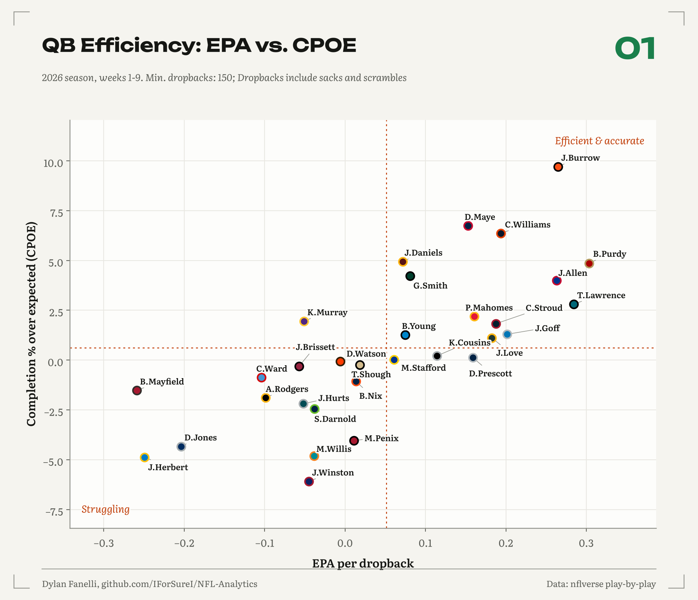 | 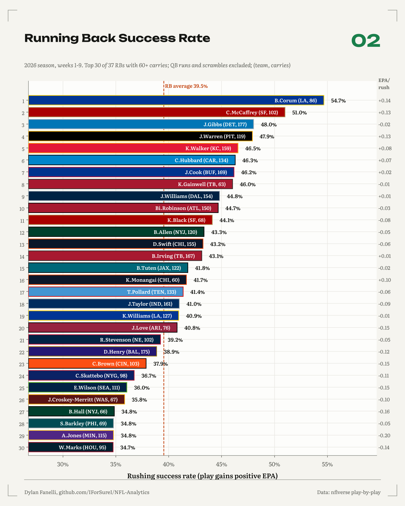 |
| 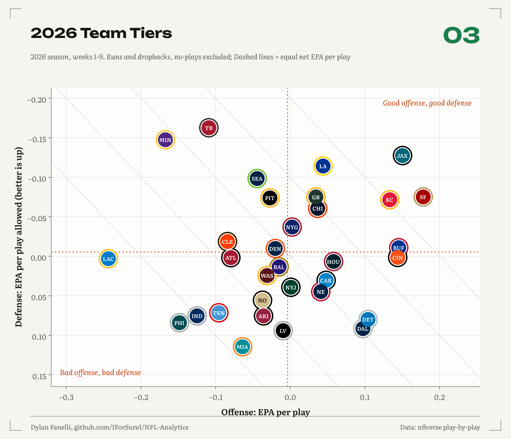 | 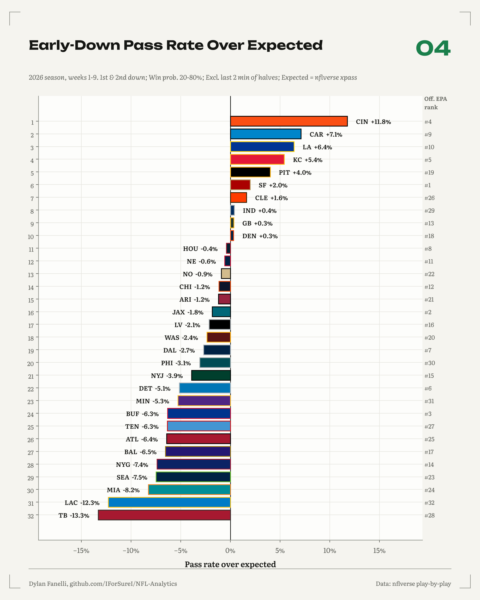 |
| 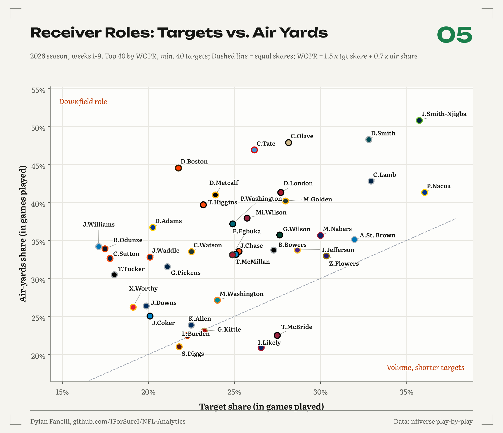 | 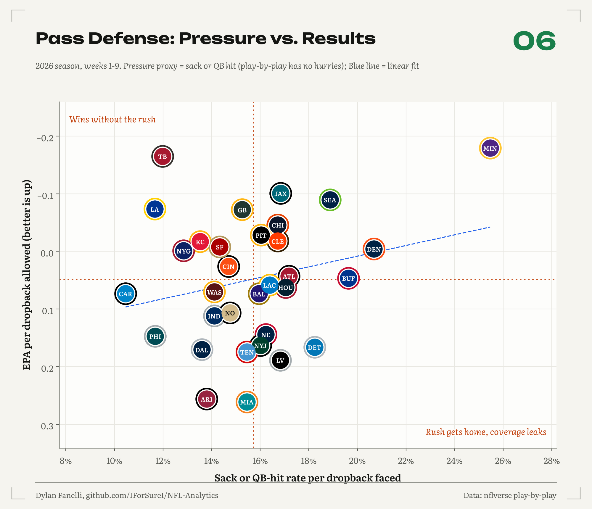 |
| 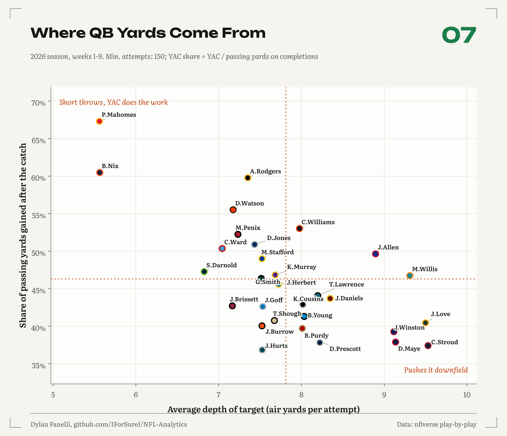 | 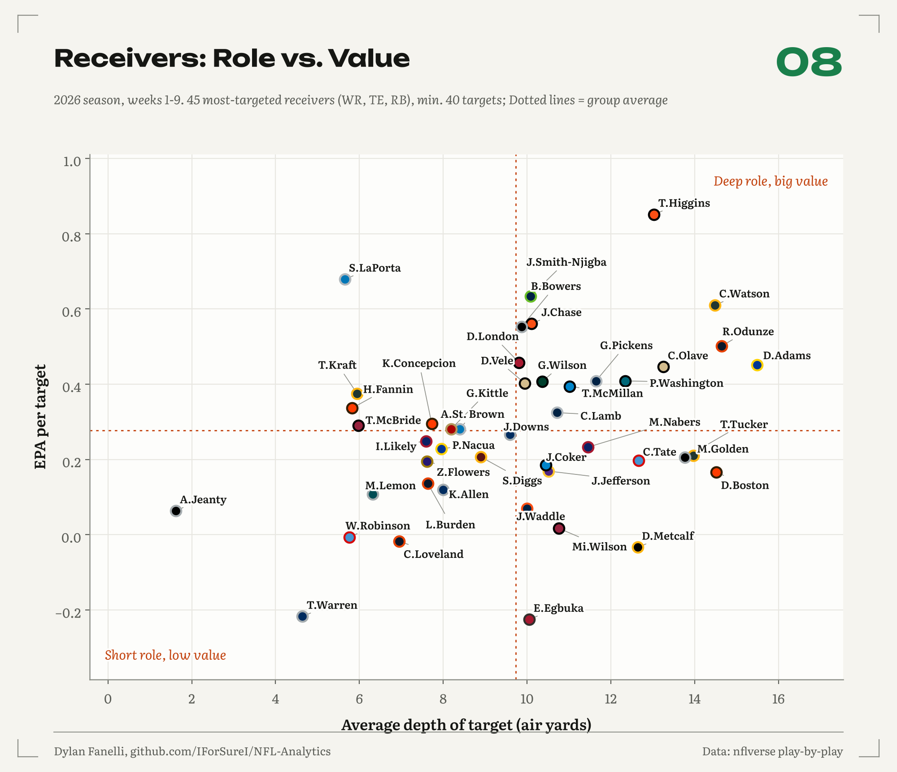 |
| 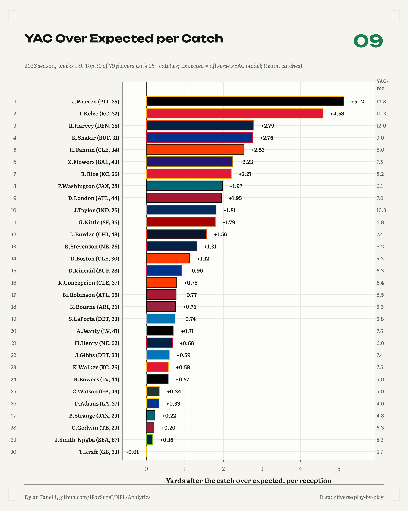 | 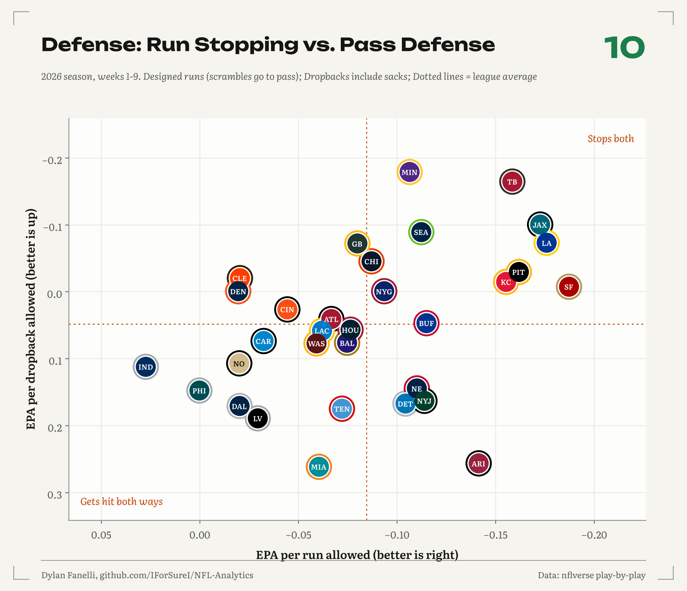 |
| 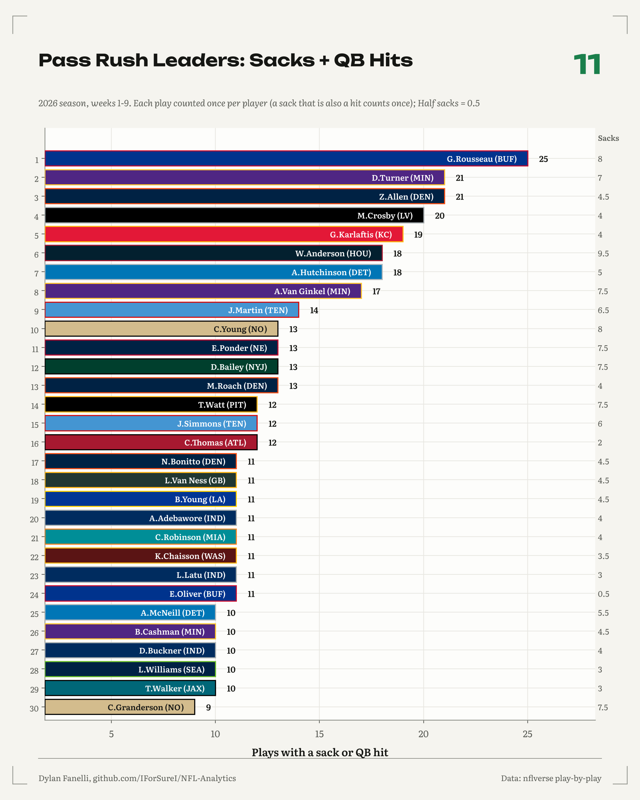 | 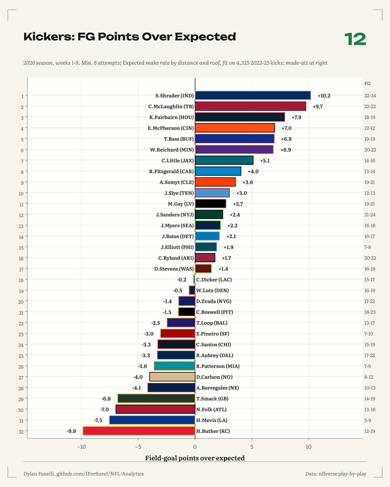 |

## What each one says

1. **QB Efficiency: EPA vs. CPOE** ([chart](qb_epa_cpoe.png)). B.Purdy (SF) leads in EPA per dropback (+0.303), ahead of T.Lawrence (JAX) (+0.284). Accuracy and efficiency move together this year (r = 0.74 across 31 QBs with 150+ dropbacks).
2. **Running Back Success Rate** ([chart](rb_success.png)). B.Corum (LA) leads the 37 backs with 60+ carries at 54.7% of runs gaining positive EPA, ahead of C.McCaffrey (SF, 51.0%) and J.Gibbs (DET, 48.0%). The RB average is 39.5%. Success rate shows how often a back keeps the offense on schedule; it mixes his work with his blocking, which study 09 (Run Game Value, coming next) will separate.
3. **2026 Team Tiers** ([chart](team_tiers.png)). Best net EPA per play: JAX (+0.278), SF (+0.253), KC (+0.205).
4. **Early-Down Pass Rate Over Expected** ([chart](early_down_proe.png)). CIN throws +11.8 points over expectation in neutral early downs; TB sits at -13.3. Teams that throw more than expected also have the better offenses so far (r = 0.51 with offensive EPA per play), the same pattern as [study 06](../06-pass-run/).
5. **Receiver Roles: Targets vs. Air Yards** ([chart](receiver_share.png)). J.Smith-Njigba (SEA) carries the league's biggest role: 36% of targets and 51% of air yards (WOPR 0.89). Points above the dashed line are used downfield; points below it are volume options on shorter throws.
6. **Pass Defense: Pressure vs. Results** ([chart](defense_pressure.png)). Defenses that hit the QB more allow less per dropback (r = -0.24), but the spread around the line is wide: teams far above it win in coverage, teams far below it get home and still leak.

7. **Where QB Yards Come From** ([chart](qb_adot_yac.png)). P.Mahomes (KC) gets 67% of his passing yards after the catch on a 5.6-yard average depth of target. The shorter the throws, the bigger the YAC share (r = -0.67), so a high YAC share is a style, not a skill by itself.
8. **Receivers: Role vs. Value** ([chart](receiver_epa_adot.png)). Among the 45 most-targeted receivers, T.Higgins (CIN) adds the most per target (+0.85 EPA on a 13.0-yard depth). Deeper roles earn more per target (r = 0.33), so compare a receiver with others at his depth.
9. **YAC Over Expected per Catch** ([chart](yac_over_expected.png)). J.Warren (PIT) gains +5.12 yards after the catch beyond what the nflverse xYAC model expects per reception, then T.Kelce (KC, +4.58). [Study 08](../08-yac-tax/) found a season of YAC over expected predicts next year about as well as air yards, so this is worth watching.
10. **Defense: Run Stopping vs. Pass Defense** ([chart](defense_run_pass.png)). Best run defense by EPA per run allowed: SF, LA, JAX; best pass defense: MIN, TB, JAX. The two go together only loosely (r = 0.41).
11. **Pass Rush Leaders** ([chart](pass_rush_leaders.png)). G.Rousseau (BUF) has a sack or QB hit on 25 plays, ahead of D.Turner (MIN) and Z.Allen (DEN) with 21 each. [Study 07](../07-box-score-tax/) showed hits and pressures predict future sacks better than sacks do, which is why this counts both.
12. **Kickers: FG Points Over Expected** ([chart](kicker_fgoe.png)). S.Shrader (IND, 22-24) is +10.2 points above what an average kicker makes from the same distances; the expected rate comes from a distance-and-roof model fit on 4,325 kicks from 2022-25.

## Method notes

- Data: [nflverse](https://github.com/nflverse/nflverse-data) play-by-play (EPA, CPOE, xpass from the nflfastR models) and nflverse team colors. Teams are drawn as color-coded markers with abbreviations.
- A week counts once all of its games are in the file; a week in progress is left out.
- Dropbacks include sacks and scrambles; two-point tries and penalty no-plays are excluded.
- Field-goal model: logistic regression on distance, distance squared and a dome flag (regular seasons 2022-25). Blocked kicks count as misses.
- Pressure proxy = sack or QB hit. Play-by-play has no hurries, so this undercounts pressure; treat it as a rate comparison between teams, not a pressure rate.
- Early-down PROE: 1st and 2nd down, win probability 20-80%, outside the last two minutes of each half.
- Receiver shares are computed over the games each player appeared in (so injuries don't shrink them).
- Small samples: part of a season is early. These are snapshots, not projections.

## Reproduce

```bash
python -m projects.in_season_snippets --refresh   # re-downloads the season in progress
```

Code: [`projects/in_season_snippets.py`](../../projects/in_season_snippets.py). Numbers: [`findings.json`](findings.json).
