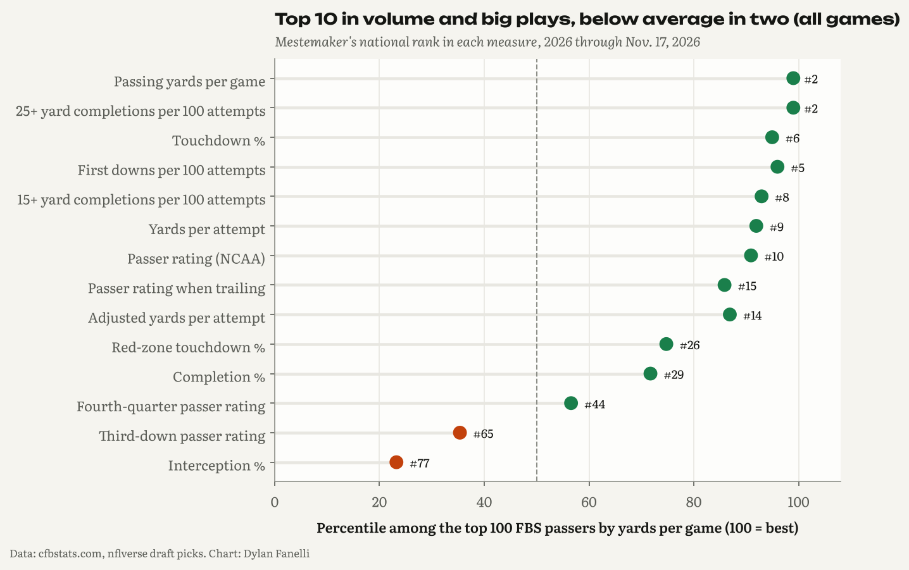
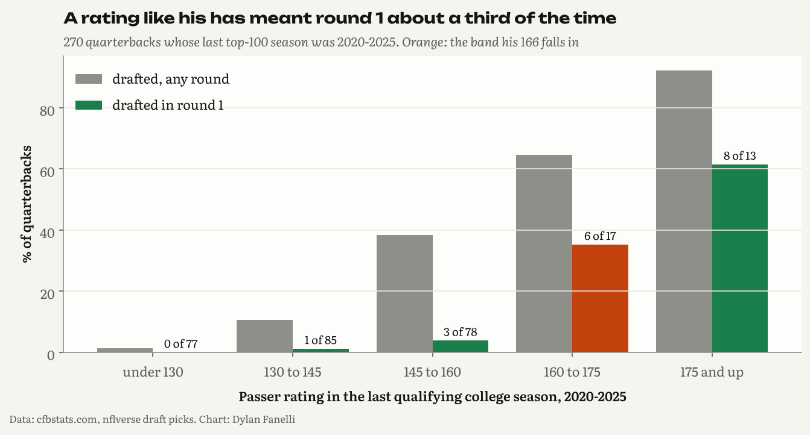
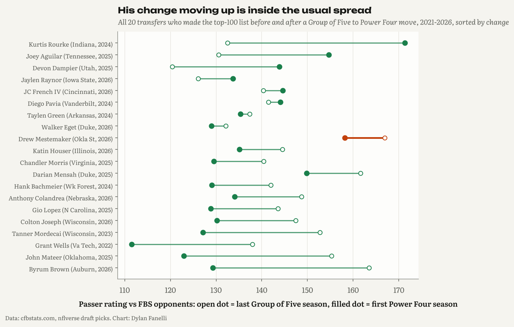
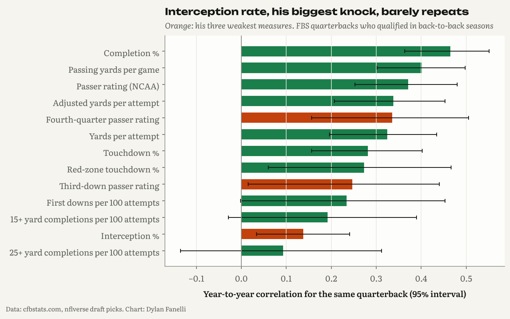

<sub>[← Portfolio](../../README.md)</sub>

# Draft 2027 evaluation: Drew Mestemaker, QB, Oklahoma State
### Is he QB1? The scouts say yes. The production says first-round candidate, and does not separate him from Mensah or Sayin

    

**TL;DR**

- **Grade: first-round candidate. The numbers alone do not make him QB1.** Through 10 games he has 3,239 yards (#1 of 100 FBS passers), 30 touchdown passes (#1 of 100) and a 166.4 rating, below what the 18 first-round quarterbacks since 2021 had through the same 10 games (median 175.7; he is ahead of 4 of 18 on rating and 13 of 18 on yards per game).
- **Against schedule he is #5 of 7 in this class.** His rating against FBS opponents is +24.3 above what those defenses allowed in their other games. Darian Mensah is +60.2 and Julian Sayin +57.6; the first-round median is +42.4, and he is ahead of 4 of 18. His opponents have been the easiest pass defenses any of the seven has faced.
- **Similar college lines have gone anywhere from pick 1 to undrafted.** Of the 17 quarterbacks since 2020 whose last college season had a rating of 160 to 175, 6 went in round 1. The case for QB1 is outside the box score: 17 of 25 NFL scouts and executives named him the first quarterback off the board (ESPN, Oct. 31), he leads the country in touchdown passes, and he will be 21 on draft day.

<p align="center"></p>
<p align="center"><sub>Passer rating against FBS opponents minus the rating those opponents allowed in their other games: first-round quarterbacks in their final college season, the 2027 class, and Mestemaker.</sub></p>

## Key numbers

| Measure | Value |
|---|---|
| 2026 passing line (10 games, through Texas Tech on Nov. 14) | **233-of-351, 3,239 yards, 30 TD, 10 INT** |
| Passer rating: all games / FBS opponents only | **166.4 (#10 of 100) / 158.2** |
| Rating over what his FBS opponents allowed | **+24.3** (#5 of 7 in the class; first-round median +42.4) |
| Rating through 10 games vs first-round QBs through 10 games | **166.4 vs median 175.7** (ahead of 4 of 18) |
| Round 1 rate, last-season rating 160 to 175 | **6 of 17** |
| Nearest 12 prior seasons in the full pool: round 1 / drafted later / not drafted / still in college | **2 / 3 / 5 / 2** |
| 25+ yard completions per 100 attempts (95% interval) | **11.1 (8.3 to 14.9)**; first-round median 9.6 |
| Interception % (95% interval) | **2.8 (1.6 to 5.2)**, #77 of 100 |
| Rating change vs FBS opponents, North Texas to Oklahoma State | **-8.8** (other 19 movers: mean -6.0, SD 19.5) |
| NFL scouts and executives naming him the first QB taken (ESPN, Oct. 31) | **17 of 25** |
| Age at the April 2027 draft (born January 2006) | **21** |

## Why it matters for a club

- **College scouting:** the tape consensus has him first. This page gives the area scout the base rates and the schedule context to test that against, and names the quarterbacks whose production is better.
- **General manager:** production like his has been a first-round profile about a third of the time. Taking him first is a bet on traits and age, so the tape and the interviews have to carry it.
- **Offensive staff:** he is at his best on early downs (passer rating 172 on first down, 187 on second, 120 on third) and has needed a third-and-long answer.

## The question

**Is Drew Mestemaker the best quarterback in the 2027 draft?**

The league is leaning that way. ESPN's midseason poll of 25 scouts and executives gave him 17 votes as the first quarterback taken, the most in the poll's three years; he had none in August. Dane Brugler's November board has him as the top quarterback and No. 2 overall. I started this page expecting the production data to agree. It agrees that he belongs in the first-round conversation. It does not show that he is better than Mensah or Sayin, and this page says so.

The background is part of the evaluation. He did not start a varsity game at quarterback at Vandegrift High in Austin, walked on at North Texas in 2024, led FBS in passing yards as a redshirt freshman in 2025, and followed Eric Morris to Oklahoma State, which went 1-11 last year and is 6-4 with him, scoring 42.2 points a game.

## Data

- **Season tables:** the top 100 FBS passers by yards per game in each season, 2020-2026 (700 quarterback seasons), from [cfbstats.com](https://cfbstats.com). The 2026 season was pulled on Nov. 18, 2026 and runs through Nov. 17, 2026: ten games for Oklahoma State, through the Texas Tech game on Nov. 14. Julian Sayin has not played since Oct. 17; at 7 of Ohio State's 10 games he is under the 75% of team games cfbstats requires for its national list, so his line comes from his own cfbstats pages and he is in the class comparison but not in the national ranks.
- **Situational tables** for every quarterback in the 2024, 2025 and 2026 lists and for each first-round quarterback's final season.
- **Game logs and splits** for Mestemaker (2024-2026), the 2027 class, every first-round quarterback's final season, and the 20 transfers in result 4.
- **Team pass defense,** every FBS team, 2020-2026 (cfbstats national tables), for the opponent adjustment.
- **Draft results:** [nflverse](https://github.com/nflverse/nflverse-data) draft picks, 2021-2026: 68 drafted quarterbacks, 19 in round 1, 18 of those from FBS (Trey Lance played in FCS).
- **Scouting consensus,** cited where used: ESPN (Pete Thamel, Oct. 31, 2026), The Athletic's Dane Brugler via Bleacher Report (Nov. 12, 2026), PFF (Oct. 6, 2026).

## Results

### 1. Through ten games his raw line is ahead of the first-round median on volume and behind it on rating and interceptions.

First-round quarterbacks are compared here through their first 10 games of their final college season, so the comparison is ten games against ten.

| Measure, first 10 games | Mestemaker 2026 | First-round median | First-rounders he is ahead of |
|---|---|---|---|
| Passing yards per game | 323.9 | 304.9 | 13 of 18 |
| Yards per attempt | 9.2 | 9.5 | 5 of 18 |
| Passer rating | 166.4 | 175.7 | 4 of 18 |
| Touchdown % | 8.5 | 8.6 | 9 of 18 |
| Interception % | 2.8 | 1.4 | 0 of 18 |

Situational measures are only available for full seasons, so these compare his ten games with their whole season, bowl and playoff games included:

| Measure | Mestemaker, 10 games | First-round median, full season | First-rounders he is ahead of |
|---|---|---|---|
| 25+ yard completions per 100 attempts | 11.1 | 9.6 | 16 of 18 |
| 15+ yard completions per 100 attempts | 22.9 | 22.6 | 10 of 18 |
| First downs per 100 attempts | 40.3 | 40.3 | 9 of 18 |
| Completion % | 66.4 | 68.9 | 6 of 18 |
| Fourth-quarter passer rating | 139.2 | 163.5 | 6 of 18 |
| Third-down passer rating | 120.5 | 168.2 | 1 of 18 |

These measures overlap heavily (rating is built from yards, touchdowns and interceptions per attempt), so they are one or two independent looks, not eleven. At his ten-game pace a 12-game regular season ends near 3,887 yards and 36 touchdowns.

<p align="center"></p>
<p align="center"><sub>National rank in each measure among the top 100 FBS passers by yards per game, 2026, all games.</sub></p>

### 2. Against the defenses he has faced, he is fifth of seven in the class and below most first-rounders.

For each FBS game I take what that opponent allowed to every other passing offense this season, weight it by his attempts, and compare. The FCS game (Murray State: 22 attempts, 289.6 rating) is out.

| Quarterback | Team | G | Yards | TD | INT | Cmp % | Y/A | Rating, all games | Rating vs FBS | What those defenses allow | Over expected | 25+ per 100 | INT % |
|---|---|---|---|---|---|---|---|---|---|---|---|---|---|
| Darian Mensah | Miami (Fl) | 10 | 3,076 | 29 | 2 | 76.3 | 9.7 | 186.8 | 181.1 | 120.9 | +60.2 | 8.5 | 0.6 |
| Julian Sayin | Ohio State | 7 | 2,007 | 19 | 4 | 68.2 | 10.5 | 184.5 | 184.5 | 127.0 | +57.6 | 8.9 | 2.1 |
| CJ Carr | Notre Dame | 10 | 2,385 | 23 | 2 | 67.9 | 8.2 | 161.8 | 161.8 | 131.6 | +30.2 | 9.0 | 0.7 |
| Sam Leavitt | LSU | 10 | 2,797 | 19 | 12 | 71.2 | 8.2 | 151.7 | 149.8 | 124.0 | +25.8 | 5.0 | 3.5 |
| **Drew Mestemaker** | Okla St | 10 | 3,239 | 30 | 10 | 66.4 | 9.2 | 166.4 | 158.2 | 133.8 | +24.3 | 11.1 | 2.8 |
| Arch Manning | Texas | 10 | 2,198 | 19 | 10 | 64.7 | 7.6 | 143.4 | 143.4 | 124.0 | +19.4 | 5.9 | 3.5 |
| LaNorris Sellers | S Carolina | 9 | 2,100 | 17 | 7 | 62.8 | 7.7 | 142.5 | 149.2 | 130.8 | +18.4 | 7.3 | 2.6 |

- His opponents allow a 133.8 rating to everyone else, the most generous schedule of the seven (#1 easiest).
- He is +24.3 over expected. Mensah (+60.2) and Sayin (+57.6) are more than twice that. He is behind Carr (+30.2) and Leavitt (+25.8) and ahead of Manning (+19.4) and Sellers (+18.4).
- The same measure for the 18 first-round quarterbacks' final seasons has a median of +42.4. He is ahead of 4 of them. His own 2025 at North Texas was +35.4.
- On unadjusted rating he is #3 of the seven. He leads the group in yards, touchdowns, yards per game and 25+ yard completions.

These seven are the quarterbacks named in ESPN's poll plus Sayin, not every eligible passer; nationally Michael Hawkins Jr. (WVU) has the top 25+ rate (15.8 on 209 attempts). Dante Moore, the August favorite, played 4 games (926 yards, 9 TD) before a concussion that is expected to end his season; Oklahoma State beat his Oregon team 39-31 with Mestemaker throwing for 317 and running for 109.

Over the last two seasons Mestemaker has the most yards (7,618) and touchdowns (64) of the group on 814 attempts, with a 167.7 rating. Julian Sayin has the best two-year rating (179.8).

| Quarterback | Seasons in data | Att | Yards | TD | INT | Y/A | Rating | Yards per game |
|---|---|---|---|---|---|---|---|---|
| **Drew Mestemaker** | 2 | 814 | 7,618 | 64 | 19 | 9.4 | 167.7 | 317 |
| Darian Mensah | 2 | 817 | 7,049 | 63 | 8 | 8.6 | 166.5 | 294 |
| CJ Carr | 2 | 583 | 5,126 | 47 | 8 | 8.8 | 165.0 | 233 |
| Julian Sayin | 2 | 583 | 5,617 | 51 | 12 | 9.6 | 179.8 | 267 |
| Arch Manning | 2 | 693 | 5,361 | 45 | 17 | 7.7 | 144.3 | 233 |
| Sam Leavitt | 1 | 340 | 2,797 | 19 | 12 | 8.2 | 151.7 | 280 |
| LaNorris Sellers | 2 | 567 | 4,537 | 30 | 15 | 8.0 | 141.1 | 216 |

<p align="center"></p>
<p align="center"><sub>Yards per attempt against 25+ yard completion rate for the top FBS passers; the draft-eligible class is labeled.</sub></p>

### 3. College seasons like his have produced first-round picks, day-three picks and undrafted players.

The nearest 12 seasons to his 2026 among all 600 qualifying seasons from 2020 to 2025 (distance on yards per attempt, completion %, touchdown %, interception % and yards per game):

| Quarterback | Team | Season | Rating | Y/A | TD % | INT % | What happened |
|---|---|---|---|---|---|---|---|
| Sam Hartman | Wk Forest | 2022 | 159.4 | 8.6 | 8.9 | 2.8 | not drafted |
| Jordan McCloud | James Mad | 2023 | 165.9 | 8.9 | 8.5 | 2.4 | not drafted |
| Tanner Mordecai | SMU | 2021 | 158.0 | 8.0 | 8.6 | 2.6 | not drafted |
| Spencer Rattler | Oklahoma | 2020 | 172.6 | 9.6 | 8.8 | 2.2 | round 5, pick 150 (2024) |
| Clayton Tune | Houston | 2022 | 158.9 | 8.2 | 8.1 | 2.0 | round 5, pick 139 (2023) |
| Josh Hoover | TCU | 2025 | 153.3 | 8.4 | 7.0 | 3.1 | in college in 2026 |
| Jacob Clark | MO State | 2025 | 156.9 | 8.6 | 7.4 | 2.9 | not drafted |
| Cam Ward | Miami (Fl) | 2024 | 172.2 | 9.5 | 8.6 | 1.5 | round 1, pick 1 (2025) |
| Sam Howell | N Carolina | 2020 | 179.1 | 10.3 | 8.6 | 2.0 | round 5, pick 144 (2022) |
| Michael Penix Jr. | Washington | 2023 | 157.1 | 8.8 | 6.5 | 2.0 | round 1, pick 8 (2024) |
| Byrum Brown | S Florida | 2025 | 167.1 | 9.3 | 8.2 | 2.1 | in college in 2026 |
| Tyler Van Dyke | Miami (Fl) | 2021 | 160.1 | 9.0 | 7.7 | 1.9 | not drafted |

Of the 10 whose draft outcome is known, 2 went in round 1, 3 were drafted later and 5 were not drafted. Several of these are not a quarterback's final season, so the outcome is what eventually happened to the player.

Every prior season at or above both his rating (166.4) and his yards per attempt (9.2): 40 seasons by 36 quarterbacks. Of those quarterbacks, 11 went in round 1, 11 were drafted later and 9 were not drafted.

| Quarterback | Team | Season | Rating | Y/A | What happened |
|---|---|---|---|---|---|
| Jayden Daniels | LSU | 2023 | 208.0 | 11.7 | round 1, pick 2 (2024) |
| Grayson McCall | Coast Car | 2021 | 207.7 | 11.9 | not drafted |
| Mac Jones | Alabama | 2020 | 203.1 | 11.2 | round 1, pick 15 (2021) |
| Zach Wilson | BYU | 2020 | 196.4 | 11.0 | round 1, pick 2 (2021) |
| Kaleb Eleby | W Mich | 2020 | 195.1 | 11.2 | not drafted |
| Dustin Crum | Kent State | 2020 | 192.7 | 10.5 | not drafted |
| Bo Nix | Oregon | 2023 | 188.3 | 9.6 | round 1, pick 12 (2024) |
| C.J. Stroud | Ohio State | 2021 | 186.6 | 10.1 | round 1, pick 2 (2023) |
| Grayson McCall | Coast Car | 2020 | 184.3 | 10.0 | not drafted |
| Fernando Mendoza | Indiana | 2025 | 182.9 | 9.3 | round 1, pick 1 (2026) |
| Hendon Hooker | Tennessee | 2021 | 181.4 | 9.7 | round 3, pick 68 (2023) |
| Jaxson Dart | Miss | 2024 | 180.7 | 10.8 | round 1, pick 25 (2025) |
| Kyle Trask | Florida | 2020 | 180.0 | 9.8 | round 2, pick 64 (2021) |
| Layne Hatcher | Ark St | 2020 | 179.2 | 10.6 | not drafted |
| Sam Howell | N Carolina | 2020 | 179.1 | 10.3 | round 5, pick 144 (2022) |
| C.J. Stroud | Ohio State | 2022 | 177.7 | 9.5 | round 1, pick 2 (2023) |
| Matt Corral | Miss | 2020 | 177.6 | 10.2 | round 3, pick 94 (2022) |
| Julian Sayin | Ohio State | 2025 | 177.5 | 9.2 | in college in 2026 |
| Stetson Bennett | Georgia | 2021 | 176.7 | 10.0 | round 4, pick 128 (2023) |
| Kaidon Salter | Liberty | 2023 | 176.6 | 9.9 | not drafted |
| Kurtis Rourke | Indiana | 2024 | 176.0 | 9.5 | round 7, pick 227 (2025) |
| Justin Fields | Ohio State | 2020 | 175.6 | 9.3 | round 1, pick 11 (2021) |
| Hendon Hooker | Tennessee | 2022 | 175.5 | 9.5 | round 3, pick 68 (2023) |
| Will Howard | Ohio State | 2024 | 175.2 | 9.5 | round 6, pick 185 (2025) |
| Jason Bean | Kansas | 2023 | 175.0 | 10.7 | not drafted |
| Spencer Rattler | Oklahoma | 2020 | 172.6 | 9.6 | round 5, pick 150 (2024) |
| Cam Ward | Miami (Fl) | 2024 | 172.2 | 9.5 | round 1, pick 1 (2025) |
| Jalen Milroe | Alabama | 2023 | 172.2 | 10.0 | round 3, pick 92 (2025) |
| Dillon Gabriel | Oklahoma | 2023 | 172.0 | 9.5 | round 3, pick 94 (2025) |
| Diego Pavia | Vanderbilt | 2025 | 170.4 | 9.4 | not drafted |
| Caleb Williams | USC | 2023 | 170.2 | 9.4 | round 1, pick 1 (2024) |
| Trevor Lawrence | Clemson | 2020 | 169.2 | 9.4 | round 1, pick 1 (2021) |
| Todd Centeio | James Mad | 2022 | 169.0 | 9.5 | not drafted |
| Drew Mestemaker | N Texas | 2025 | 168.7 | 9.5 | in college in 2026 |
| CJ Carr | Notre Dame | 2025 | 168.1 | 9.4 | in college in 2026 |
| Carson Beck | Georgia | 2023 | 167.9 | 9.5 | round 3, pick 65 (2026) |
| Kurtis Rourke | Ohio | 2022 | 167.7 | 9.2 | round 7, pick 227 (2025) |
| Byrum Brown | S Florida | 2025 | 167.1 | 9.3 | in college in 2026 |
| Darian Mensah | Tulane | 2024 | 166.7 | 9.5 | in college in 2026 |
| Dylan Hopkins | UAB | 2021 | 166.6 | 9.7 | not drafted |

The base rate by rating, for the 270 quarterbacks whose last top-100 season came in 2020-2025:

| Rating in last qualifying season | Quarterbacks | Drafted | Round 1 | Round 1 rate |
|---|---|---|---|---|
| under 130 | 77 | 1 | 0 | 0% |
| 130 to 145 | 85 | 9 | 1 | 1% |
| 145 to 160 | 78 | 30 | 3 | 4% |
| **160 to 175** | 17 | 11 | 6 | 35% |
| 175 and up | 13 | 12 | 8 | 62% |

Production gets a quarterback into the conversation. It has not been enough to make one a first-round pick, and the players who were not drafted from the top of this list were mostly from Group of Five schools, which is the question he had to answer by moving up.

<p align="center"></p>
<p align="center"><sub>Share of quarterbacks drafted, and drafted in round 1, by passer rating in their last qualifying college season, 2020-2025.</sub></p>

### 4. He slipped moving from the American to the Big 12 (-8.8 against FBS opponents), close to the typical mover and inside the normal spread.

20 quarterbacks since 2021 transferred from a Group of Five school to a Power Four school and made the top-100 list in both seasons. Against FBS opponents only:

- His rating went from 166.9 to 158.2 (-8.8).
- The other 19 changed by -6.0 on average (median -10.9); 13 of 19 declined. The standard deviation is 19.5 points, so his change is -0.1 SD from the average: not distinguishable from a typical move.
- His change ranks #9 of 20. His level after the move ranks #2 of 20; Kurtis Rourke is first.
- Counting all games, his rating changed -2.3 (168.7 to 166.4); the Murray State game is why that is smaller than the drop against FBS opponents.
- He moved with his head coach and offense. This is a test of better opponents, not of a new system.

Against Power conference opponents this year: 280 attempts, 9.6 yards per attempt, 24 touchdowns, 8 interceptions, 168.5 rating.

<p align="center"></p>
<p align="center"><sub>Passer rating against FBS opponents in the last Group of Five season and the first Power Four season, for every transfer who qualified in both.</sub></p>

### 5. The setting he came from is friendly to quarterbacks, and the coach is only part of it.

North Texas starters in this data:

| Season | Quarterback | Head coach | Att | Y/A | Rating |
|---|---|---|---|---|---|
| 2023 | Chandler Rogers | Eric Morris | 421 | 8.0 | 150.1 |
| 2024 | Chandler Morris | Eric Morris | 512 | 7.4 | 140.1 |
| 2025 | Drew Mestemaker | Eric Morris | 463 | 9.5 | 168.7 |
| 2026 | Tayven Jackson | Neal Brown | 318 | 9.4 | 169.0 |

- Under Morris, the two North Texas starters before him averaged a 145.1 rating. He was 24 points better in the same offense (168.7), which is evidence for the player.
- After he and Morris left, Tayven Jackson has a 169.0 rating there under a new staff, up from 126.2 at UCF in 2025. That is evidence that the schedule and setting at North Texas lift a passer's numbers, whoever coaches.
- Both readings are true at once, and this data cannot split them. No adjustment for receivers or line is made here.

### 6. His weakest numbers are noisy ones, and so is his best one.

He ranks #77 of 100 in interception rate and #65 of 100 in third-down rating (67 attempts), and his fourth-quarter rating (139) is #44 of 100. For the same quarterback in back-to-back seasons:

| Measure | Year-to-year r | 95% interval | Pairs |
|---|---|---|---|
| Completion % | 0.46 | 0.36 to 0.55 | 288 |
| Passing yards per game | 0.40 | 0.30 to 0.50 | 288 |
| Passer rating (NCAA) | 0.37 | 0.25 to 0.48 | 288 |
| Adjusted yards per attempt | 0.34 | 0.21 to 0.45 | 288 |
| Fourth-quarter passer rating | 0.34 | 0.16 to 0.51 | 90 |
| Yards per attempt | 0.32 | 0.20 to 0.43 | 288 |
| Touchdown % | 0.28 | 0.16 to 0.40 | 288 |
| Red-zone touchdown % | 0.27 | 0.06 to 0.47 | 90 |
| Third-down passer rating | 0.25 | 0.02 to 0.44 | 90 |
| First downs per 100 attempts | 0.23 | -0.00 to 0.45 | 90 |
| 15+ yard completions per 100 attempts | 0.19 | -0.03 to 0.39 | 90 |
| Interception % | 0.14 | 0.03 to 0.24 | 288 |
| 25+ yard completions per 100 attempts | 0.09 | -0.14 to 0.31 | 90 |

- **Interceptions.** 10 in 351 attempts is 2.8%, with a 95% interval of 1.6 to 5.2 that sits above the first-round median (1.5). Interception rate barely carries over year to year (r = 0.14); in 2025 he was at 1.9%.
- **Third down.** r = 0.25, on a small sample (67 attempts for him this year). In 2025 his third-down rating was 150.
- **Fourth quarter.** On a smaller sample it repeats about as well as overall rating (r = 0.34), so his drop from 186 in 2025 to 139 is the split I would watch.
- **Big plays.** 39 completions of 25+ yards in 350 attempts is 11.1%, #2 of 100 nationally and above 16 of 18 first-rounders' full seasons. The 95% interval is 8.3 to 14.9, which contains the first-round median (9.6), and the rate repeats at only r = 0.09 across quarterbacks. He was #19 of 100 in 2025. Yards per attempt (r = 0.32) is the safer number, and he led FBS in it in 2025.

<p align="center"></p>
<p align="center"><sub>Year-to-year correlation of each passing measure, with 95% bootstrap intervals.</sub></p>

<p align="center"></p>
<p align="center"><sub>Completions of 25+ yards per 100 attempts, with the 95% interval on his ten-game rate.</sub></p>

### 7. Since Week 2 his form is strong, and the hardest games have been his worst.

- Weeks 1 and 2 (Tulsa, Oregon): a 112.8 rating with 4 interceptions on 92 attempts. The 8 games since: 178-of-259, 2,681 yards, 27 touchdowns, 6 interceptions, a 185.4 rating (one of the eight is the FCS game).
- The latest game, Texas Tech on Nov. 14: 27-of-42, 277 yards, 1 touchdown, 2 interceptions, a 118.0 rating in a 27-52 loss.
- 300 yards in 8 of 10 games. On the ground: 44 carries, 169 yards, 4 touchdowns.
- Against AP-ranked teams: 119 attempts, 139.0 rating, 6 touchdowns, 5 interceptions. Against FBS teams with winning records: 127.3. In losses: 136.1.
- On third and 10 or more he is 6-of-16 for 40 yards.

<p align="center"></p>
<p align="center"><sub>Game-by-game passer rating, North Texas 2025 and Oklahoma State 2026.</sub></p>

### 8. What the scouts add, which this data cannot measure.

- **Consensus.** 17 of 25 in ESPN's poll; top quarterback and No. 2 overall on Brugler's board.
- **Tools, as cited.** ESPN's scouts point to size and arm ("arm talent, power and accuracy," one said). Brugler cites tools, passing instincts and toughness.
- **Pressure.** PFF had him at a 48.8 passing grade under pressure against 90.3 from a clean pocket through Week 5 (Oct. 6, 2026), when its board had him behind Manning, Moore and Carr among quarterbacks. That is PFF's charting over his first four games.
- **Experience.** ESPN projects 27 career starts by the end of 2026.
- **He may not come out.** He is a redshirt sophomore; Brugler reports scouts believe there is a good chance he declares.
- **Age.** Born January 2006, he will be 21 at the draft.

## Verdict

**What the evidence on this page supports**

| For QB1 | Against QB1 |
|---|---|
| 17 of 25 scouts and executives, and Brugler's board | Mensah (+60.2) and Sayin (+57.6) are far ahead of his +24.3 against schedule |
| #1 in touchdown passes and #1 in yards in FBS | The easiest set of pass defenses of the seven quarterbacks compared |
| Through ten games, ahead of 13 of 18 first-rounders in yards per game | Ahead of only 4 of 18 first-rounders once opponents are counted |
| Inside the normal spread moving up a conference | 6 of 17 quarterbacks with a last-season rating like his went in round 1 |
| 21 on draft day; two seasons as a starter | #77 of 100 in interception rate; 139.0 rating against ranked teams |

**Grade:** first-round candidate. On production he is #3 of seven on raw rating and #5 against schedule, behind Mensah, Sayin, Carr and Leavitt.

**My call, and it is an opinion:** I would still have him first, because the people who grade arms for a living do, because of his age, and because he was 24 points better than the two quarterbacks who ran the same offense before him. The numbers on this page do not prove that. If the draft were decided on college production against schedule, Mensah would be first.

**What would move it:** up, if he plays to his season line against the better defenses left; down, if the interception rate stays above 2.5% or Mensah and Sayin hold their margins through the postseason. Against Texas Tech (Nov. 14) he posted a 118.0 rating with 2 interceptions, and his interception rate is now 2.8%, above that line. I have not regraded him yet.

## Method

- **Rates.** Touchdown % and interception % are per attempt. Passer rating is the NCAA formula: (8.4 x yards + 330 x TD + 100 x completions - 200 x INT) / attempts.
- **Opponent adjustment.** FBS games only. For each game, the opponent's season passing line allowed, minus this quarterback's own game, gives what that defense allows per attempt to everyone else. Those rates times his attempts, summed over games, give an expected line and an expected rating. "Over expected" is his FBS rating minus that. It adjusts for pass defense only, and an opponent's other games are against different offenses.
- **Same-games comparison.** Each first-round quarterback's first 10 games of his final college season from the game logs (Justin Fields played eight in 2020).
- **Full-pool comps.** Euclidean distance on five z-scored measures across all prior qualifying seasons. Draft outcomes are matched by name to nflverse picks, 2021-2026; "not drafted" means not drafted through 2026 and not in the 2026 college data.
- **Base rate.** One row per quarterback: his last top-100 season, 2020-2025, excluding anyone still playing college football in 2026.
- **Intervals.** Wilson 95% intervals on the per-attempt rates. Year-to-year r from quarterbacks on the top-100 list in back-to-back seasons, with 2,000 bootstrap samples that resample quarterbacks.
- **Moving up.** Transfers only. Power conferences are the ACC, Big Ten, Big 12, SEC, Notre Dame and the Pac-12 through 2023. Ratings are from the "vs. FBS" split. The list is in `data/g5_to_p4_moves.csv`.
- **National ranks** are among the top 100 FBS passers by yards per game, all games.

## Validation

- Season totals reproduce from the game logs, and my computed passer rating matches the cfbstats rating.
- Through nine games the cfbstats line (206-of-309, 2,962 yards, 29 TD, 8 INT) matched the line reported by USA Today on Nov. 14, 2026 and by Bleacher Report on Nov. 12. The ten-game line (233-of-351, 3,239 yards, 30 TD, 10 INT) adds the Texas Tech game (27-of-42, 277 yards, 1 TD, 2 INT) from the cfbstats game log, pulled Nov. 18, 2026.
- All 18 FBS first-round quarterbacks, all 20 movers and all seven class quarterbacks have complete game logs or splits; tests fail if one is missing.
- The cfbstats situational table counts 350 attempts against 351 in the season table; the per-attempt situational rates use the situational count.
- Results that cut against the scouting consensus are reported at the same weight as the ones that support it.

## Limitations

- **Ten games.** Every 2026 number is a partial season, and the opponent ratings behind the adjustment are partial-season samples too.
- **Box-score data.** No air yards, pressure, drops or time to throw. The explosive measures count completions by total gain, so they credit receivers and scheme as well as the passer.
- **The opponent adjustment is simple.** One number per defense, no adjustment for the offenses that defense faced, none for receivers or line.
- **Survivor samples.** The stability, transfer and base-rate samples only include quarterbacks who made a top-100 list. "Not drafted" includes players who lost jobs or were hurt.
- **Name matching** to draft picks can miss a player whose name is listed differently; the 68 drafted quarterbacks were checked by hand, and the five from FCS schools are not in the college data.
- **Small groups.** Eighteen first-round quarterbacks and 17 quarterbacks in his rating band are enough for a base rate, not for a model.
- **No tape grades of my own** are in this report. Tools and traits are cited from published evaluations.

## Next steps

- Refresh after each game left (at Arizona State on Nov. 21, Kansas on Nov. 28).
- Play-by-play: expected points per dropback, air yards, pressure and blitz splits.
- A fuller opponent model (offense and defense together) and the same page for Mensah, Sayin and Carr.
- NFL outcomes for the comparison seasons, once the 2024-2026 classes have played enough.

## Reproduce

```bash
python -m projects.draft_mestemaker            # rebuilds this folder from data/
python -m projects.draft_mestemaker --refresh  # pulls the current season from cfbstats first
```

Code: [`projects/draft_mestemaker.py`](../../projects/draft_mestemaker.py). Numbers: [`findings.json`](findings.json).

## Files in this folder

| File | What it holds |
|---|---|
| `findings.json` | Every number on this page |
| `opponent_adjusted.png`, `national_ranks.png`, `class_map.png`, `base_rate.png`, `g5_to_p4.png`, `stability.png`, `explosive_vs_first_round.png`, `game_log.png` | The eight figures |
| `class_table.csv`, `first_round_final_seasons.csv`, `g5_to_p4_table.csv`, `stability_table.csv`, `opponent_adjusted.csv`, `pool_comps.csv` | The tables behind the figures |
| `data/qb_seasons_2020_2026.csv` | Top-100 passer tables, 2020-2026 |
| `data/situational_2024_2026_and_first_rounders.csv` | Situational passing tables |
| `data/gamelogs.csv`, `data/splits.csv` | Game logs and splits |
| `data/team_pass_defense_2020_2026.csv` | Passing allowed by every FBS defense |
| `data/first_round_qbs_2021_2026.csv`, `data/qb_draft_picks_2021_2026.csv`, `data/g5_to_p4_moves.csv` | Draft picks and the list of moves |

**Sources:** [cfbstats.com](https://cfbstats.com/2026/player/521/50259623/index.html); [nflverse draft picks](https://github.com/nflverse/nflverse-data); [ESPN, "NFL scouts favor Drew Mestemaker as first QB taken in draft"](https://www.espn.com/college-football/story/_/id/50335830/nfl-scouts-favor-drew-mestemaker-first-qb-taken-draft); [Bleacher Report on Brugler's board](https://bleacherreport.com/articles/25532576-drew-mestemakers-nfl-draft-2027-status-addressed-nfl-scouts-brugler-ranks-qb-new-big-board); [PFF, top 10 quarterback prospects after Week 5](https://www.pff.com/news/draft-top-10-quarterback-prospects-after-week-5); [Oklahoma State roster bio](https://okstate.com/sports/football/roster/drew-mestemaker/14374) and [Eric Morris staff bio](https://www.okstate.com/staff-directory/eric-morris/3991); [Fox Sports on Neal Brown replacing Morris at North Texas](https://www.foxsports.com/articles/cfb/no-20-north-texas-names-neal-brown-to-replace-oklahoma-stbound-eric-morris-after-season); [USA Today via Yahoo Sports, Nov. 14, 2026](https://sports.yahoo.com/articles/drew-mestemaker-one-win-away-100703900.html); birth month from [Wikipedia](https://en.wikipedia.org/wiki/Drew_Mestemaker).

<sub>[← Portfolio](../../README.md)</sub>
