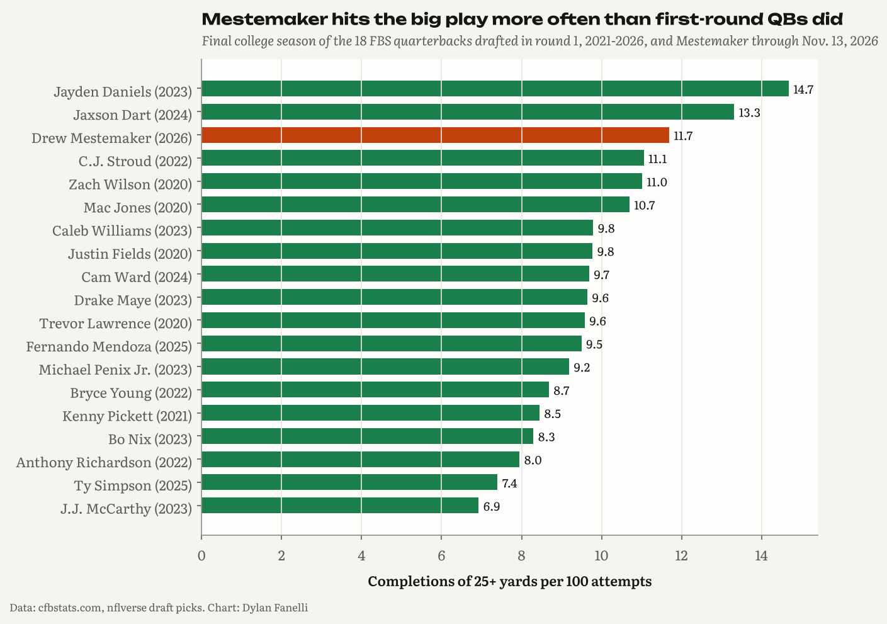
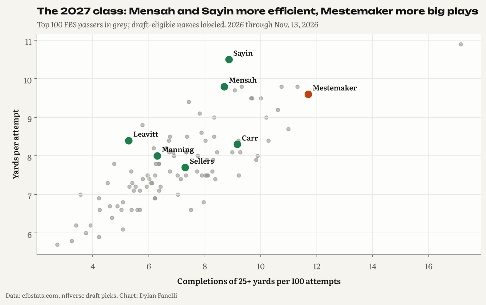
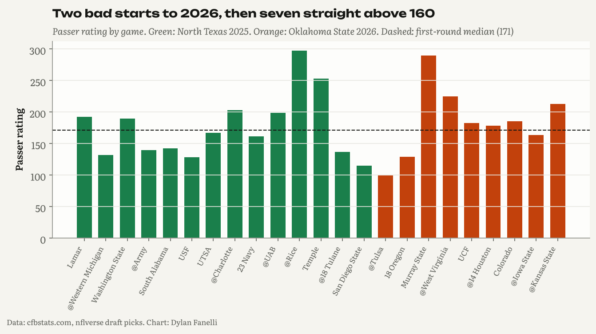

<sub>[← Portfolio](../../README.md)</sub>

# Draft 2027: Drew Mestemaker, QB, Oklahoma State
### The case for QB1: first-round production at 20, more big plays than any quarterback he is compared with, and it traveled up a level

    

**TL;DR**

- **He is my QB1.** Through 9 games he has 2,962 yards (#2 of 100 FBS passers), 29 touchdown passes (#1 of 100) and 9.6 yards per attempt (#8 of 100). He completes a pass of 25+ yards on 11.7% of his attempts (#2 of 100), a higher rate than 16 of the 18 first-round quarterbacks since 2021 managed in their final college season.
- **It came with him to the Big 12.** 19 other transfers made the top-100 list before and after a Group of Five to Power Four move; their passer rating changed by -5.6 on average. His went from 168.7 to 173.0 (+4.3).
- **The knocks are real, and the biggest one is mostly noise year to year.** His interception rate (2.6%, #70 of 100) and third-down rating (122, #65 of 100) are below average. Year to year those two repeat at r = 0.14 and 0.24; in 2025 he was at 1.9% and 150. Darian Mensah (190.8 rating) and Julian Sayin (184.5) have been more efficient in 2026 than Mestemaker (173.0); the case for him is volume, big plays, the tools scouts grade, and age.

<p align="center"></p>
<p align="center"><sub>Completions of 25+ yards per 100 attempts: Mestemaker in 2026 against the final college season of every FBS quarterback drafted in round 1 since 2021.</sub></p>

## Key numbers

| Measure | Value |
|---|---|
| 2026 passing line (9 games) | **206-of-309, 2,962 yards, 29 TD, 8 INT** |
| Yards per attempt / passer rating | **9.6 (#8 of 100) / 173.0 (#8 of 100)** |
| 25+ yard completions per 100 attempts | **11.7 (#2 of 100); first-round median 9.6** |
| Measures (of 14) where he beats the first-round median | **10** |
| Rating change, Group of Five to Power Four (other movers' average) | **+4.3 (-5.6)** |
| Last 7 games | **2,404 yards, 26 TD, 4 INT, 198.5 rating** |
| Interception % / third-down rating | **2.6 (#70 of 100) / 122 (#65 of 100)** |
| Year-to-year r: interception % / third-down rating / yards per game | **0.14 / 0.24 / 0.40** |
| Age at the April 2027 draft (born January 2006) | **21**; nflverse lists a median age of 22 for the 19 first-round QBs, 2021-2026 |
| NFL scouts and executives who named him the first QB off the board (ESPN, Oct. 31) | **17 of 25** |

## Why it matters for a club

- **College scouting:** the public numbers agree with the tape consensus on the strengths (arm, big plays, production) and put a size on the two concerns (interceptions, third down), so the area scout's report can be checked against a baseline.
- **General manager:** a quarterback who is 21 on draft day plays his rookie contract and fifth-year option at ages 21 through 25, a year younger than the typical first-round quarterback (nflverse lists a median age of 22 for the last 19).
- **Offensive staff:** he is at his best on early downs (passer rating 175 on first down, 198 on second, 122 on third). What he needs is a third-and-long plan and a staff that lives with some interceptions in exchange for the big plays.

## The question

**Is Drew Mestemaker the best quarterback in the 2027 draft?**

The league is leaning that way. ESPN's midseason poll of 25 scouts and executives gave him 17 votes as the first quarterback taken, the most in the poll's three years; he had none in August. Dane Brugler's November board has him as the top quarterback and No. 2 overall. This report asks whether the public production data backs that up, where it disagrees, and how much weight the disagreements deserve.

The background is part of the evaluation. He did not start a varsity game at quarterback at Vandegrift High in Austin, walked on at North Texas in 2024, led FBS in passing yards as a redshirt freshman in 2025, and followed Eric Morris to Oklahoma State, which went 1-11 last year and is 6-3 with him, scoring 43.9 points a game.

## Data

- **Season tables:** the top 100 FBS passers by yards per game in each season, 2020-2026 (700 quarterback seasons), from [cfbstats.com](https://cfbstats.com). The 2026 season runs through Nov. 13, 2026 (nine games for Oklahoma State, before Texas Tech).
- **Situational tables** (down, quarter, field zone, score, completions of 15+ and 25+ yards) for every quarterback in the 2024, 2025 and 2026 lists and for each first-round quarterback's final season.
- **Game logs and splits** for Mestemaker (2024-2026) and the 2027 class.
- **Draft results:** [nflverse](https://github.com/nflverse/nflverse-data) draft picks, 2021-2026: 19 first-round quarterbacks, 18 of them from FBS (Trey Lance played in FCS).
- **Scouting consensus,** cited where used: ESPN (Pete Thamel, Oct. 31, 2026), The Athletic's Dane Brugler via Bleacher Report (Nov. 12, 2026), PFF (Oct. 6, 2026).

## Results

### 1. His production is at the first-round standard, and his big-play rate is above it.

Against the final college season of the 18 FBS quarterbacks drafted in round 1 since 2021, Mestemaker's 2026 beats the median in yards per game, yards per attempt, passer rating, touchdown rate, first downs per attempt and both explosive measures. He trails it in completion percentage, interception rate, third down and the fourth quarter.

| Measure | Mestemaker 2026 | First-round median | First-rounders he beats |
|---|---|---|---|
| Passing yards per game | 329.1 | 305.2 | 14 of 18 |
| Yards per attempt | 9.6 | 9.4 | 13 of 18 |
| Passer rating (NCAA) | 173.0 | 171.2 | 10 of 18 |
| Touchdown % | 9.4 | 8.4 | 11 of 18 |
| 25+ yard completions per 100 attempts | 11.7 | 9.6 | 16 of 18 |
| 15+ yard completions per 100 attempts | 24.0 | 22.6 | 11 of 18 |
| First downs per 100 attempts | 40.9 | 40.3 | 12 of 18 |
| Completion % | 66.7 | 68.9 | 6 of 18 |
| Fourth-quarter passer rating | 146.5 | 163.5 | 6 of 18 |
| Interception % | 2.6 | 1.5 | 2 of 18 |
| Third-down passer rating | 122.1 | 168.2 | 1 of 18 |

His closest statistical matches in that group (distance on yards per attempt, completion %, touchdown %, interception %, 25+ rate and yards per game) are Justin Fields (2020, pick 11), Cam Ward (2024, pick 1), C.J. Stroud (2022, pick 2). At his nine-game pace a 12-game regular season ends near 3,949 yards and 39 touchdowns.

<p align="center"></p>
<p align="center"><sub>National rank in each measure among the top 100 FBS passers by yards per game, 2026.</sub></p>

### 2. In this class, Mensah and Sayin are the more efficient passers; Mestemaker has the most volume and big plays.

| Quarterback | Team | G | Yards | TD | INT | Cmp % | Y/A | Rating | 25+ per 100 | INT % | 3rd-down rating |
|---|---|---|---|---|---|---|---|---|---|---|---|
| **Drew Mestemaker** | Okla St | 9 | 2,962 | 29 | 8 | 66.7 | 9.6 | 173.0 | 11.7 | 2.6 | 122 |
| Darian Mensah | Miami (Fl) | 9 | 2,694 | 28 | 2 | 76.8 | 9.8 | 190.8 | 8.7 | 0.7 | 179 |
| CJ Carr | Notre Dame | 9 | 2,168 | 21 | 1 | 67.6 | 8.3 | 162.8 | 9.2 | 0.4 | 123 |
| Julian Sayin | Ohio State | 7 | 2,007 | 19 | 4 | 68.2 | 10.5 | 184.5 | 8.9 | 2.1 | 125 |
| Arch Manning | Texas | 9 | 2,024 | 18 | 7 | 66.1 | 8.0 | 151.0 | 6.3 | 2.8 | 164 |
| Sam Leavitt | LSU | 9 | 2,553 | 17 | 9 | 71.0 | 8.4 | 154.3 | 5.3 | 3.0 | 182 |
| LaNorris Sellers | S Carolina | 9 | 2,100 | 17 | 7 | 62.8 | 7.7 | 142.5 | 7.3 | 2.6 | 175 |

Mensah leads this group in rating and completion percentage, Sayin in yards per attempt, and Carr in interception rate; that has to be said plainly. Mestemaker leads it in yards, touchdowns, yards per game, 25+ yard completions and rating when trailing. These seven are the quarterbacks named in ESPN's poll plus Sayin, not every eligible passer; nationally Michael Hawkins Jr. (WVU) has the top 25+ rate (17.1 on 175 attempts). Dante Moore, the August favorite, played 4 games (926 yards, 9 TD) before a concussion that is expected to end his season; Oklahoma State beat his Oregon team 39-31 with Mestemaker throwing for 317 and running for 109.

Over the last two seasons Mestemaker has the most yards (7,341) and touchdowns (63) of the group on 772 attempts, with a 170.4 rating. Julian Sayin has the best two-year rating (179.8) and yards per attempt.

| Quarterback | Seasons in data | Att | Yards | TD | INT | Y/A | Rating | Yards per game |
|---|---|---|---|---|---|---|---|---|
| **Drew Mestemaker** | 2 | 772 | 7,341 | 63 | 17 | 9.5 | 170.4 | 319 |
| Darian Mensah | 2 | 776 | 6,667 | 62 | 8 | 8.6 | 166.8 | 290 |
| CJ Carr | 2 | 555 | 4,909 | 45 | 7 | 8.8 | 165.6 | 234 |
| Julian Sayin | 2 | 583 | 5,617 | 51 | 12 | 9.6 | 179.8 | 267 |
| Arch Manning | 2 | 658 | 5,187 | 44 | 14 | 7.9 | 147.3 | 236 |
| Sam Leavitt | 1 | 303 | 2,553 | 17 | 9 | 8.4 | 154.3 | 284 |
| LaNorris Sellers | 2 | 567 | 4,537 | 30 | 15 | 8.0 | 141.1 | 216 |

<p align="center"></p>
<p align="center"><sub>Yards per attempt against 25+ yard completion rate for the top FBS passers; the draft-eligible class is labeled.</sub></p>

### 3. More often than not, quarterbacks lose production moving up a level. He gained.

20 quarterbacks since 2021 transferred from a Group of Five school to a Power Four school and made the top-100 list in both seasons. The other 19 changed by -5.6 rating points on average (median -7.5) and -0.57 yards per attempt; 12 of 19 declined. Leaving out John Mateer, whose Washington State was a two-team Pac-12 in 2024, the average is -4.0. Mestemaker went 168.7 to 173.0 and +0.1 yards per attempt, and his first Power Four season ranks #2 of the 20. Of the 3 who left with a rating of 165 or better, he is the only one who kept it.

Against Power conference opponents this year: 238 attempts, 10.1 yards per attempt, 23 touchdowns, 6 interceptions, 177.4 rating.

<p align="center"></p>
<p align="center"><sub>Passer rating in the last Group of Five season and the first Power Four season for every quarterback who qualified in both.</sub></p>

### 4. His biggest knock, interception rate, is one of the least repeatable numbers a quarterback has.

He ranks #70 of 100 in interception rate and #65 of 100 in third-down rating (57 attempts), and his fourth-quarter rating (146) is #34 of 100. Before pricing those, check how much of each is the quarterback. For the same quarterback in back-to-back seasons:

| Measure | Year-to-year r | 95% interval | Pairs |
|---|---|---|---|
| Completion % | 0.47 | 0.38 to 0.55 | 290 |
| Passing yards per game | 0.40 | 0.30 to 0.49 | 290 |
| Passer rating (NCAA) | 0.38 | 0.27 to 0.49 | 290 |
| Fourth-quarter passer rating | 0.36 | 0.17 to 0.53 | 92 |
| Adjusted yards per attempt | 0.35 | 0.22 to 0.46 | 290 |
| Yards per attempt | 0.33 | 0.21 to 0.44 | 290 |
| First downs per 100 attempts | 0.32 | 0.05 to 0.55 | 92 |
| Touchdown % | 0.29 | 0.17 to 0.41 | 290 |
| Third-down passer rating | 0.24 | 0.02 to 0.44 | 92 |
| Red-zone touchdown % | 0.24 | 0.01 to 0.44 | 92 |
| 15+ yard completions per 100 attempts | 0.18 | -0.04 to 0.37 | 92 |
| Interception % | 0.14 | 0.03 to 0.25 | 290 |
| 25+ yard completions per 100 attempts | 0.09 | -0.13 to 0.32 | 92 |

Interception rate barely carries over (r = 0.14), and third-down rating is weak (r = 0.24, on a small sample: 57 third-down attempts for him this year). His own history says the same: in 2025 he threw interceptions on 1.9% of attempts with a 150 third-down rating. Fourth-quarter rating is different: on a smaller sample it repeats about as well as overall rating (r = 0.36), so his drop from 186 in 2025 to 146 this year is the split I would watch. Volume and accuracy repeat best (yards per game r = 0.40, completion % r = 0.47), and he has been top two in yards per game in both seasons.

The same test cuts against his headline strength. The 25+ yard completion rate repeats at only r = 0.09 across quarterbacks, so one season of it is weak evidence. He was #19 of 100 in 2025 and is #2 of 100 now, so there are two seasons behind it, but yards per attempt (r = 0.33) is the safer number to project, and he led FBS in it in 2025 (#1 of 100).

<p align="center"></p>
<p align="center"><sub>Year-to-year correlation of each passing measure, with 95% bootstrap intervals.</sub></p>

### 5. After two rough games to open 2026, he has been the best version of himself.

Weeks 1 and 2 (Tulsa, Oregon): a 112.8 rating with 4 interceptions on 92 attempts. The 7 games since: 151-of-217, 2,404 yards, 11.1 per attempt, 26 touchdowns, 4 interceptions, a 198.5 rating, and no game below 163. He has thrown for 300 yards in 8 of 9 games. On the ground: 36 carries, 177 yards, 3 touchdowns.

<p align="center"></p>
<p align="center"><sub>Game-by-game passer rating, North Texas 2025 and Oklahoma State 2026.</sub></p>

### 6. Where the numbers say to be careful.

- **Better opponents have slowed him.** Against AP-ranked teams: 77 attempts, 150.4 rating, 5 touchdowns, 3 interceptions. Against FBS teams with winning records: 152.5. In losses: 142.2.
- **Third and long.** On third and 10 or more he is 6-of-16 for 40 yards (46 rating). His third-down rating is the lowest of the seven quarterbacks in the class table and would rank ahead of only 1 of the 18 first-rounders.
- **Pressure.** PFF had him at a 48.8 passing grade under pressure against 90.3 from a clean pocket through Week 5 (PFF, Oct. 6, 2026), when its board had him behind Manning, Moore and Carr among quarterbacks. That is PFF's charting, not mine, and it covers his first four games.
- **Experience.** ESPN projects 27 career starts by the end of 2026. Scouts told ESPN and Brugler the same thing: the tools are there and the sample is short.
- **He may not come out.** He is a redshirt sophomore; Brugler reports scouts believe there is a good chance he declares, which is not the same as declaring.

## Verdict

**QB1, with a first-round grade.** The production is at or above the first-round median on 10 of 14 measures, he leads the quarterbacks compared here in yards, touchdowns and big plays, his overall efficiency held up after the step to the Big 12, he will be 21 on draft day, and ESPN's scout poll and Brugler's board both have him first. The interception and third-down numbers are worth a hard look on tape, and the data says not to overweight one season of either.

**What would change my mind:** an interception rate that stays above 2.5% over the last three regular-season games and the postseason, or Mensah holding a rating near 190 through the postseason. Mensah and Sayin are the alternatives, and on 2026 efficiency alone both are ahead of him.

## Method

- **Rates.** Touchdown % and interception % are per attempt. Adjusted yards per attempt is (yards + 20 x TD - 45 x INT) / attempts. Passer rating is the NCAA formula: (8.4 x yards + 330 x TD + 100 x completions - 200 x INT) / attempts.
- **Explosive rates** are completions of 15+ and 25+ yards per 100 attempts, from the cfbstats situational tables. Rating when trailing pools the three "losing by" score states.
- **National ranks** are among the top 100 FBS passers by yards per game, so a rank of #8 means eighth among high-volume starters, not among every quarterback who threw a pass.
- **First-round comparison.** Each first-round quarterback's final college season against Mestemaker's season in progress. Similarity is Euclidean distance on six z-scored measures.
- **Stability.** Pearson r between season t and t+1 for the same quarterback when he made the top-100 list in both, 2020-2026 for the season-table measures and 2024-2026 for the situational ones; intervals from 2,000 bootstrap samples that resample quarterbacks.
- **Moving up.** Transfers only (a quarterback whose school changed conferences is not counted). Power conferences are the ACC, Big Ten, Big 12, SEC, Notre Dame and the Pac-12 through 2023. The list of moves is in `data/g5_to_p4_moves.csv`.

## Validation

- Season totals reproduce from the game logs (the sum of nine games equals the season line), and my computed passer rating matches the cfbstats rating for the season.
- The cfbstats line (206-of-309, 2,962 yards, 29 TD, 8 INT) matches the line reported by USA Today on Nov. 14, 2026 and by Bleacher Report on Nov. 12.
- The cfbstats situational table counts 308 attempts against 309 in the season table; the per-attempt situational rates use the situational count, and the difference does not move any figure at one decimal.
- First-round names, picks and ages come from nflverse and were checked against the 2025 and 2026 first rounds reported by ESPN.
- Stability is reported for every measure, including the one that hurts the argument (25+ rate, r = 0.09).

## Limitations

- **Nine games.** Every 2026 number is a partial season, and several 2026 quarterbacks in the stability and transfer samples are also mid-season.
- **Box-score data.** No air yards, pressure, drops or time to throw. The explosive measures count completions by total gain, so they include yards after the catch and credit the receivers and scheme as well as the passer.
- **System and supporting cast.** He has played both seasons in Eric Morris's offense. North Texas's 2026 quarterback, Tayven Jackson, has a 174.1 rating in the offense Mestemaker left, which says the environment is quarterback-friendly. No adjustment for receivers, line or schedule strength is made here.
- **Survivor samples.** The stability and transfer samples only include quarterbacks who kept a starting job and stayed in the top 100; players who lost their jobs after moving up are missing, which makes the average mover look better than the true average.
- **Small comparison group.** Eighteen first-round quarterbacks is enough for a ranking, not for a model of NFL success.
- **No tape grades of my own** are in this report. Tools and traits are cited from published evaluations.

## Next steps

- Refresh after Texas Tech (Nov. 14) and the rest of the Big 12 schedule; the verdict section says what would move it.
- Add play-by-play: expected points per dropback, air yards, and performance under pressure and against the blitz.
- Opponent adjustment by defensive pass efficiency allowed.
- The same page for Mensah and Carr, so the class is ranked on one method.

## Reproduce

```bash
python -m projects.draft_mestemaker            # rebuilds this folder from data/
python -m projects.draft_mestemaker --refresh  # pulls the current season from cfbstats first
```

Code: [`projects/draft_mestemaker.py`](../../projects/draft_mestemaker.py). Numbers: [`findings.json`](findings.json).

## Files in this folder

| File | What it holds |
|---|---|
| `findings.json` | Every number on this page |
| `explosive_vs_first_round.png`, `national_ranks.png`, `class_map.png`, `g5_to_p4.png`, `stability.png`, `game_log.png` | The six figures |
| `class_table.csv`, `first_round_final_seasons.csv`, `g5_to_p4_table.csv`, `stability_table.csv` | The tables behind the figures |
| `data/qb_seasons_2020_2026.csv` | Top-100 passer tables, 2020-2026 |
| `data/situational_2024_2026_and_first_rounders.csv` | Situational passing tables |
| `data/gamelogs.csv`, `data/splits.csv` | Game logs and splits for Mestemaker and the class |
| `data/first_round_qbs_2021_2026.csv`, `data/g5_to_p4_moves.csv` | Draft picks and the list of moves |

**Sources:** [cfbstats.com](https://cfbstats.com/2026/player/521/50259623/index.html); [nflverse draft picks](https://github.com/nflverse/nflverse-data); [ESPN, "NFL scouts favor Drew Mestemaker as first QB taken in draft"](https://www.espn.com/college-football/story/_/id/50335830/nfl-scouts-favor-drew-mestemaker-first-qb-taken-draft); [Bleacher Report on Brugler's board](https://bleacherreport.com/articles/25532576-drew-mestemakers-nfl-draft-2027-status-addressed-nfl-scouts-brugler-ranks-qb-new-big-board); [PFF, top 10 quarterback prospects after Week 5](https://www.pff.com/news/draft-top-10-quarterback-prospects-after-week-5); [Oklahoma State roster bio](https://okstate.com/sports/football/roster/drew-mestemaker/14374); [USA Today via Yahoo Sports, Nov. 14, 2026](https://sports.yahoo.com/articles/drew-mestemaker-one-win-away-100703900.html); birth month from [Wikipedia](https://en.wikipedia.org/wiki/Drew_Mestemaker).

<sub>[← Portfolio](../../README.md)</sub>
